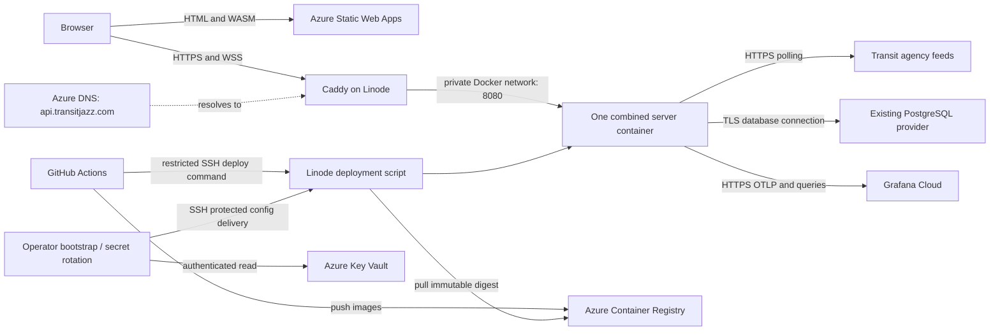

# TransitJazz server migration to Linode

**Date:** 2026-11-08

**Status:** Decision and implementation design; migration has not been executed.

**Pilot update, 2026-11-14:** The owner selected the existing 2 GB shared host. A public pilot is now verified; production cutover remains pending. See [migration status](LINODE_MIGRATION_STATUS.md). Actual `transitjazz.com` DNS authority is Name.com, not the nondelegated Azure DNS zone assumed below. Use the execution guide's corrected DNS step and cost reassessment for current decisions.

**Execution update:** The owner has confirmed PostgreSQL already runs on a Linode VM and will resize that same VM to host the app container. Follow the [step-by-step migration guide](LINODE_MIGRATION_STEP_BY_STEP.md) for that layout. Its combined sizing, local database connection, host-networking choice and database-aware recovery supersede the separate-VM assumptions below. Earlier billing and Azure inventory remain dated evidence.

**Owner:** Solo developer/operator.

**Scope:** Move the combined API, SignalR hub, and transit worker from Azure Container Apps to one Linode VM. Retain the browser hosting and existing external data services initially.

## 1. Recommendation and constraints

**Proceed with a small Linode pilot, starting with a shared CPU 2 GB VM at approximately $12/month.** This fits a hobby project whose owner accepts maintenance downtime of a week or more and wants inexpensive outbound traffic as usage grows. Keep the existing server container and use simple stop/start deployment. A VM reserved for this application does not require purchasing a dedicated CPU plan.

Resize to 4 GB shared CPU if cold GTFS loading, memory pressure, or worker scheduling warrants it. Purchase dedicated CPU only if a representative load test shows CPU contention. The current Azure allocation is only 0.25 vCPU and 0.5 GiB; that is useful context, not proof of the VM size needed under growth.

The owner's reported approximately $30/month of Container App egress is an input to this decision, but **the Azure billing queries performed for this document did not reproduce that charge**. Therefore this is a recommendation for predictable growth costs and acceptable operational responsibility, not a claim of verified immediate $30/month savings. Reconcile the invoice meter before treating that amount as avoidable expenditure.

Design priorities, in order:

1. Keep monthly infrastructure costs low and predictable.
2. Keep operation understandable for one developer.
3. Preserve live playback and existing statistics semantics.
4. Make failed deployments and replacement of a lost VM straightforward.

There is no requirement for high availability or uninterrupted deployments. Routine releases should still aim to recover within about 15 minutes; the week-long downtime tolerance is a recovery allowance, not a reason to leave broken deployments unnoticed. Historical observations lost during an outage may be unrecoverable, even when downtime itself is acceptable.

## 2. Evidence and present architecture

Repository inspection and read-only Azure inventory were performed on 2026-11-08. Infrastructure files describe intent; the live resource differs in several places.

| Component | Observed state | Migration consequence |
| --- | --- | --- |
| Server | `marta-jazz-dev-ca-server`, East US 2; one replica, 0.25 vCPU, 0.5 GiB | Move the combined process; retain a single active production worker |
| Container | `chefknife.azurecr.io/chefknifestudios.martajazz.server.webapi`; .NET 10, port 8080 | Reuse the existing image, pinned by digest |
| Work performed | `Program.cs` hosts `GtfsStaticLoader`, `Worker`, SignalR, HTTP API and statistics writers | No worker extraction or cross-cloud message bus is needed |
| Current deployed image | Tag `bc5e157b6d4e948597c56fe17bdd0345009219dc`; ready revision `--0000204` | Record the actual image digest again immediately before cutover |
| Browser hosting | Separate Azure Static Web Apps for `transitjazz.com` and `martajazz.com` | Keep both; publish the new API URL to both |
| Browser API configuration | Both `TransitJazzAPI` and `TransitJazzSignalR` use the generated Azure Container Apps hostname | An Azure DNS change alone cannot move existing clients |
| CORS | Azure ingress allows the production origins; application policy lists localhost origins | Add configurable production origins in ASP.NET Core before migration |
| Live production settings | Metrics enabled, environment `prod`; historical enabled with dry-run false; category capture enabled; reported-vehicle mode `Persistence` | A second default production instance would also write history |
| Readiness | Code checks route-index readiness at `/health/ready`; live ACA probes currently check TCP port 8080 | Use the semantic HTTP check on Linode, followed by per-city validation |
| Secrets | ACA resolves Key Vault references with a user-assigned managed identity | A plain Linode VM needs a replacement delivery mechanism |
| Registry/vault | ACR Basic in East US and Key Vault `transit-jazz-kv` have public network access enabled | HTTPS access is feasible; authentication still applies |
| Database | PostgreSQL configuration exists and production writer flags are active | Keep the existing DB initially; verify its actual host, provider, region and access rules |
| Database inventory limit | No `Microsoft.DBforPostgreSQL/flexibleServers` resource was returned in the selected subscription | Do not assume the DB is Azure Flexible Server or invent its network topology |
| Logs | Application emits structured JSON to stdout; current design uses ACA console/system tables in Log Analytics | Those tables do not automatically collect logs from a Linode VM |
| CI/CD | `.github/workflows/server.yml` builds server and migration images into ACR, deploys ACA, checks revision, then promotes `latest` | Retain build outputs; replace the deployment target and readiness check |

The resource names contain `dev`, but these resources serve the public applications. Treat them as production. Some live variables refer to the removed blob telemetry pipeline; an environment variable's presence does not prove that code still uses it. Inventory required configuration against the selected release before copying it.

### Billing evidence

Azure Cost Management `ActualCost`, `PreTaxCost`, USD, selected `ChefKnifeStudios` subscription:

| Period | TransitJazz Container Apps charges | TransitJazz Bandwidth service charge returned |
| --- | ---: | --- |
| August 2026 | $11.00 | No row |
| September 2026 | $9.55 | No row |
| October 2026 | $12.87 | No row |

October Container Apps meters were active/idle CPU and memory. A subscription-wide Bandwidth query from August 1 through November 7 found no material Bandwidth charge. The TransitJazz resource group also had October App Service charges of $7.36, DNS $1.00, Azure Monitor $0.82, and Key Vault $0.02. Shared ACR in `general` cost $5.46. These services largely remain after migration; do not count them all as savings. The App Service `Standard Bandwidth Usage` meter returned $0.

November data was incomplete, including no Container Apps rows in the returned period; do not extrapolate that absence into free operation. Billing totals do not establish byte volume. Credits, another billing scope, another period, or a different meter may explain the owner's figure; none was established here.

Reproduce the investigation through the Azure Cost Management query API (`2023-11-01`): subscription scope, custom UTC period, aggregate `PreTaxCost` with `Sum`, monthly granularity, group by `ResourceGroup` and `Meter`, filter `ServiceName` to `Bandwidth` and `Azure Container Apps`. Separately inspect all service names for the TransitJazz resource group to catch service-specific transfer meters. Compare the resulting resource ID, meter, quantity/unit, billing period, and invoice amount with the reported charge. Do not put credentials or full resource configuration exports in this document.

## 3. Cost model and growth decision

### Candidate plans

Listed US/global pricing retrieved November 8; confirm availability and the actual region quote before purchase:

| Plan | Compute/month | Included outbound transfer | Intended use |
| --- | ---: | ---: | --- |
| Shared CPU, 2 GB, 1 vCPU | $12 | 2 TB | Initial pilot |
| Shared CPU, 4 GB, 2 vCPU | $24 | 4 TB | More memory and CPU headroom |
| G6 Dedicated, 4 GB, 2 vCPU | $36 | 4 TB | Sustained CPU contention, if available |
| G7 Dedicated, 4 GB, 2 vCPU | $43 | 4 TB | Alternative dedicated generation |
| G8 Dedicated 4x2 | $0.07/hour, about $51.10 at 730 hours | 0 TB | Recalculate economics; no bundled transfer |

The referenced pricing lists $0.005/GB additional transfer for these global options. Region-specific pricing and pool rules apply. [Akamai CPU pricing](https://www.akamai.com/cloud/pricing/cpu).

Inbound transfer is free; applicable outbound traffic, including telemetry and DB writes, consumes transfer. Pools and prorating matter during a partial-month pilot. G8 and distributed compute regions do not have the same bundled-transfer economics. [Akamai transfer accounting](https://techdocs.akamai.com/cloud-computing/docs/network-transfer-usage-and-costs).

### Compare the costs that change

Let `E` be monthly browser-facing server egress, `X` Azure-to-Linode traffic, `L` other Linode outbound traffic, `A` actually removable ACA compute cost, `V` VM cost, and `Q` its available transfer allowance. Use consistent provider billing units.

```text
Stay = A + AzureEgress(E + other existing Azure traffic)
Move = V + LinodeOverage(E + L, Q)
       + additional AzureEgress(X)
       + additional backup/logging/network costs
       + temporary coexistence costs
Cash saving = Stay - Move
```

Shared services cancel only when their costs truly remain equal. Include ACR layer downloads, DB responses if the DB is in Azure, retained Azure compute during rollback, and any VPN gateway. Existing Azure free allowances are shared according to the billing scope; do not allocate a fresh 100 GB to each service.

For orientation, Azure's published North America Premium Global Network tier is $0.087/GB after the first 100 GB/month, for the next 10 TB. Other tiers and routing differ. [Azure bandwidth pricing](https://azure.microsoft.com/en-us/pricing/details/bandwidth/).

Illustrative monthly comparison below assumes that whole 100 GB allowance remains available, decimal GB/TB for arithmetic, October's $12.87 ACA compute stays constant, no other transfer, and full-month Linode allowances. It is **a sensitivity calculation, not a capacity forecast or invoice prediction**.

| Server egress | Azure compute + egress | Linode 2 GB + transfer | Linode 4 GB + transfer |
| --- | ---: | ---: | ---: |
| 100 GB | $12.87 | $12.00 | $24.00 |
| 500 GB | $47.67 | $12.00 | $24.00 |
| 1,000 GB | $91.17 | $12.00 | $24.00 |
| 2,000 GB | $178.17 | $12.00 | $24.00 |
| 4,000 GB | $352.17 | $22.00 | $24.00 |
| 10,000 GB | $874.17 | $52.00 | $54.00 |

A 4 GB VM's extra $11.13 over the observed ACA compute is offset by approximately 128 additional billable Azure GB at this rate, or about 228 total GB if the full free allowance applies. Operational time and other added costs raise that threshold. A 2 GB VM roughly matches current observed ACA compute before extras, while offering much cheaper growth in transfer. If the reported $30 is confirmed as avoidable transfer on top of compute, the case strengthens.

Treat personal maintenance time explicitly: the owner may prefer doing VM administration to paying managed-service transfer charges. Do not assume free operational labor when comparing a commercial production service, but this project's stated priorities support that tradeoff.

### Estimate listener traffic correctly

Use observed **receiving listener-hours**, city mix and real encoded bytes. A registered user, an open background tab and a continuously receiving listener are different quantities.

```text
monthly GB = sum over cities(
    average bytes per delivered batch
    * delivered batches per second
    * receiving listener-seconds
) / 1e9
+ HTTP catalog/stats traffic + transport overhead
```

The older [egress design](EGRESS_REDUCTION_SMALL_SCALE.md) has an arithmetic error in its baseline table: 60 KB every 10 seconds to 500 continuously receiving clients for 30 days is 7,776 GB, not approximately 470 GB. At 400 KB it is 51,840 GB, not approximately 3.1 TB. Those are demonstrations using its old assumptions, not measurements of today's optimized payloads. Preserve its implemented compression, MessagePack and delivery gating improvements; measure the current result.

Record VM interface transmit bytes, real WebSocket delivery, listener-hours, and provider transfer totals for 7–14 days, including an active weekday. Proxy HTTP access-log response sizes alone do not measure WebSocket payload volume. Include a bounded multi-client test with a spending/traffic limit. A VM's advertised network speed does not prove its .NET worker can support the corresponding audience.

**Pilot exit decision:** proceed if all configured cities work, the owner can recover the host, observed CPU/memory meet the limits in section 10, and the projected monthly bill fits the chosen budget. Resize or remain on Azure if those conditions fail. Resolve invoice attribution in parallel; it need not block a $12/month pilot motivated by future transfer economics.

## 4. Target architecture



Use one x86-64 Linux VM, a supported Ubuntu LTS image, Docker Engine with Compose, Caddy, and the existing .NET server image. Start in an available US East core region, then measure agency-feed access and database latency. DB location and user distribution may favor a different region. Keep both website domains pointed at their existing Static Web Apps.

Host layout:

```text
/opt/transitjazz/compose.yaml         # reviewed deployment definition
/opt/transitjazz/Caddyfile
/opt/transitjazz/releases/            # digest + config version + outcome metadata
/etc/transitjazz/server.env          # root-owned, mode 0600, never committed
/etc/transitjazz/registry/            # pull-only registry credential
/usr/local/sbin/transitjazz-deploy    # root-owned restricted deployment entry point
/var/lib/transitjazz/                # persistent proxy state, bounded operational data
```

Caddy publishes 80/443; the server's 8080 is reachable only on a private Docker network. Use a fixed bridge subnet/address for the trusted proxy and configure ASP.NET Core to trust that proxy only. Caddy terminates TLS and forwards to `server:8080`. Persist Caddy certificate state across upgrades. Enable Docker at boot, use container restart policies, and keep logs bounded. An unhealthy Docker health check alone does not restart a running container; exit recovery and semantic readiness are separate mechanisms.

No load balancer, Kubernetes, Redis, Azure SignalR Service, or automatic failover is required for the initial single-instance design. The current in-memory groups, route catalog, cached batches and capture state still constrain horizontal scaling; VM transfer economics do not remove that constraint.

## 5. Connections to existing services

| Connection | Network/access design | Identity and cost implications |
| --- | --- | --- |
| Browsers → Linode | Public TCP 443; TCP 80 for HTTPS redirect/certificate issuance | Public read API and SignalR remain anonymous; all delivery leaves Linode |
| Linode → PostgreSQL | TLS to the actual provider hostname/port; allowlist Linode's stable outbound address | Dedicated runtime DB role; Azure egress applies to DB responses only if hosted in Azure |
| Linode → ACR | HTTPS 443 to registry and required layer endpoints | Repository-scoped pull token; image downloads can incur Azure egress |
| Operator/CI → Key Vault | HTTPS 443, Entra authentication | Keep canonical secrets in the vault; explicitly deliver required values to the VM |
| Linode → Grafana | HTTPS 443 to existing OTLP and metrics-query endpoints | Preserve separate publish and read tokens; contributes to Linode transfer |
| Linode → agencies | HTTPS, plus any verified feed-specific transport | Preserve API keys; test IP restrictions, quotas and region-dependent blocking |
| CI → Linode | SSH key, pinned host key, restricted deployment command | No Azure managed identity is implied by this connection |
| Host maintenance | DNS, time synchronization, OS repositories and certificate services | Permit required outbound access; monitor usage |

### PostgreSQL decision branch

Before provisioning, determine the DB's actual provider, region, hostname, port, TLS policy, backups and firewall through a sanitized inventory. The discovery here did not establish that topology.

If public TLS access with a source-IP allowlist is supported, allow the VM's IPv4 address only, connect by hostname with certificate/hostname verification (`SSL Mode=VerifyFull` for Npgsql, with the correct trust roots), and retain bounded connection pools, command timeouts and existing write retries. Test both stats reads and writes from the candidate region. Keep schema-owner credentials separate from runtime credentials.

If the DB is private-only in Azure, direct internet access will not work. Either approve a narrowly restricted public endpoint where that provider supports it, or design an actual routed VPN/tunnel into its network, including private DNS, routes, credentials, gateway cost and failure recovery. An Azure private endpoint is not made reachable simply by enabling TLS on Linode. A permanent Azure VPN Gateway may erase the small project's savings. Resolve this branch before committing to the migration; moving the database is a separate decision. [Azure PostgreSQL networking reference](https://learn.microsoft.com/en-us/azure/postgresql/network/concepts-networking-public).

When Azure or the DB is unavailable, the live feed path should continue where independent; historical writes can fail or lose queued observations according to existing bounded-queue semantics. Exercise that behavior rather than restarting the whole server for every DB failure. Never silently treat missing historical observations as zero activity.

### Secret delivery

For this hobby deployment, use **operator-driven bootstrap and rotation from Key Vault into a root-readable VM environment file**. GitHub builds do not need runtime secrets, and the application needs no permanent Azure login just to read environment variables. Deliver values over authenticated SSH without printing them, adding them to arguments, embedding them in images, or uploading them as workflow artifacts. Use a file format/serializer that preserves secret characters and newlines; do not construct shell commands from secret strings.

Record a non-secret configuration version, required key names and rotation dates. Environment changes require a controlled container recreation. Recover a lost host by delivering current secrets again. Keep separate runtime DB and migration credentials; mount/provide the latter only for the one-shot migration. Preserve the agency keys, Grafana publishing token, Grafana reader token, and `ConnectionStrings__TransitJazzDB`.

ACA's user-assigned managed identity and Key Vault `secretRef` values cannot be copied as working authentication onto Linode. Likewise, `AZURE_CLIENT_ID` alone is not a credential. If unattended vault refresh is later desired, add a narrowly scoped Entra service principal with certificate authentication and a documented rotation path; that is additional operational work. GitHub-to-Azure OIDC is for workflow jobs and does not automatically provide a renewable VM identity.

Use an ACR repository-scoped pull credential for the VM, limited to server and migration image reads. Keep pushing credentials separate. Cache the current and previous good images so process recovery does not depend on ACR being reachable. [ACR authentication options](https://learn.microsoft.com/en-us/azure/container-registry/container-registry-authentication).

## 6. Application, proxy and configuration changes

### Required application changes

1. **Configurable CORS:** include `https://transitjazz.com`, `https://www.transitjazz.com`, `https://martajazz.com`, `https://www.martajazz.com` and the two approved Azure Static Web App origins. Preserve credentials support and necessary SignalR methods/headers. Use exact origins, not wildcard-with-credentials. Keep CORS in one layer on Linode.
2. **Forwarded headers:** process trusted `X-Forwarded-For` and `X-Forwarded-Proto` before rate limiting and other request-sensitive middleware. The stats limiter partitions by `RemoteIpAddress`; otherwise all visitors can share the proxy's quota. Reject spoofed chains from untrusted peers. [ASP.NET Core proxy configuration](https://learn.microsoft.com/en-us/aspnet/core/host-and-deploy/proxy-load-balancer?view=aspnetcore-10.0).
3. **Protect internal publish paths:** although hosted in the same process, `SignalRHubPublisher` uses a real SignalR client connection to `/hubs/worker-transit`. Keep that hub mapped and point the publisher at loopback. Block `/hubs/worker-transit` and its negotiation/subpaths at public ingress, and block `/test/*`, including the anonymous `/test/signalr` broadcast endpoint. The test endpoint can be disabled in production. Keep browser `/hubs/transit` working.
4. **Release identity:** set `Logging__Structured__DeploymentRevision` explicitly to the image commit/digest identifier. Do not depend on ACA's `CONTAINER_APP_REVISION`.
5. **Shutdown budget:** set an explicit .NET host shutdown timeout that covers worker finalization and enabled writer drains, then set Compose `stop_grace_period` longer. Start with a 90-second host budget and 120-second container grace, and verify actual ordering/drains. Existing per-writer budgets are commonly 15 seconds; account for their cumulative behavior.

Caddy supports WebSocket proxying. Configure readiness-based upstream selection and ensure application 503/unready state does not present as a usable live server. Allow long-lived sockets; verify idle timeout, binary MessagePack frames, negotiation, reconnection, and city rejoin. Existing clients use MessagePack; a generic JSON SignalR probe is insufficient. [Caddy reverse proxy reference](https://caddyserver.com/docs/caddyfile/directives/reverse_proxy).

Illustrative proxy routing, to validate in implementation:

```caddyfile
api.transitjazz.com {
    @internal path /hubs/worker-transit /hubs/worker-transit/* /test/*
    respond @internal 404
    reverse_proxy server:8080 {
        health_uri /health/ready
        health_interval 10s
        health_timeout 5s
    }
}
```

If alternate routing could bypass the proxy, add an application restriction that preserves the loopback worker connection while rejecting external publishers. Do not remove the worker hub or block its loopback traffic. The example omits operational logging and maintenance responses; it is not a complete tested deployment file. Keep existing HTTP Brotli/Gzip and conditional GET behavior, and avoid adding duplicate proxy compression or caching dynamic stats responses indiscriminately.

### Configuration manifest

Export **names and intended non-secret values**, then deliver secrets separately. Preserve the live release's city list and overrides, cadence, flags, time zones and categories. Important entries include:

| Setting | Linode value/handling |
| --- | --- |
| `ASPNETCORE_ENVIRONMENT` | `Production` |
| `ASPNETCORE_URLS` | `http://+:8080` |
| `WebApi__BaseUrl` | `http://localhost:8080`; never route self-requests through Azure/public DNS |
| `SignalR__HubUrl` | `http://localhost:8080/hubs/worker-transit`; required for the worker's local publishing connection; remove stale service-discovery overrides that take precedence |
| `Metrics__Enabled`, endpoints, service name | Preserve existing publishing behavior; use a separate environment label for a pilot |
| `HistoricalStatistics__Enabled`, `__DryRun`, `__InitialBackfill` | Pilot: no production writes/backfill; production: preserve approved live settings, including initial backfill false |
| `CityCategoryInsights__Enabled` | Pilot false; production preserve live enabled state |
| `ReportedVehicleHistory__Mode` | Pilot `Disabled`; production `Persistence` after old writer stops |
| `StatsOverlay` and city-specific capture settings | Preserve the selected release's full effective configuration |
| CORS origins, trusted proxy | New explicit application configuration |
| Structured deployment revision | Immutable release identifier |

Do not copy stale blob-telemetry or unused settings just because they remain on ACA. Preserve the local SignalR publishing configuration even though the worker is embedded. Check array/index overrides carefully against the image's city ordering. A standalone worker's settings file is not the effective configuration of the combined WebAPI host.

## 7. CI/CD and database migration workflow

### Build and publish

Retain GitHub-hosted build runners and ACR initially. The current workflow has useful configuration/schema checks but does not run the server tests. Add PR build/test checks and run the WebAPI and worker test projects, plus relevant disposable-PostgreSQL tests, before publishing a deployable image. Never run tests against the production DB.

Build the server and migration images from the same commit; publish SHA tags and record immutable digests. Keep deployment separate from promotion of `latest`. Use the digest in Compose and in release records. Keep both client workflows and their SWA deployment tokens; change their shared API/SignalR configuration as described in section 9.

Replace the long-lived Azure login used by CI with GitHub OIDC where practical: federation restricted to this repository and deployment environment, `id-token: write`, and minimum ACR push permissions. This removes a CI credential without changing VM runtime authentication. [GitHub Azure OIDC guide](https://docs.github.com/en/actions/how-tos/secure-your-work/security-harden-deployments/oidc-in-azure).

### Deployment transport

Use a GitHub environment such as `server-linode`, a dedicated SSH key and a pinned `known_hosts` entry verified during provisioning. Since GitHub-hosted runner IPs change, the simple initial design permits public SSH with password/root login disabled and a restricted deployment account; operator access should be restricted to known addresses where practical.

The workflow key has a forced command, no PTY, no agent/port forwarding, and no general shell. It invokes a root-owned deployment wrapper that accepts only a validated release identifier/digest. Use a narrowly scoped sudo rule for that wrapper; do not give the account unrestricted Docker-group access. Treat the power to deploy an image as privileged regardless. The script and Compose definition are installed through the operator's reviewed provisioning process, not replaced by arbitrary workflow arguments.

Manual fallback uses the same deployment command from the developer's SSH session. This avoids running a general GitHub self-hosted runner on the production VM. A private management network can be added later if public SSH is undesirable; it is not required for the hobby pilot.

### Release state machine

Use workflow concurrency with cancellation disabled for in-progress deployments, plus a host file lock that covers manual and CI deployment. Persist phases so interrupted SSH sessions are diagnosable.

1. Validate the requested digest and allowed ACR repository. Check free disk, configuration completeness, and registry access.
2. Pull the candidate and record the current good digest/config version. Pull failure leaves the running application alone.
3. If a schema change is included, run its reviewed migration image with the migration credential, from the VM's allowed network address. Verify migration history. Default to additive/backward-compatible changes. Hosting migration itself should require no schema change.
4. Enter maintenance response, stop the current application gracefully, and confirm the process has exited. Leave Caddy running.
5. Start the candidate as the sole production server. Poll `/health/ready` for up to 15 minutes initially; observe logs while GTFS data loads. Do not restart repeatedly merely because cold loading takes several minutes.
6. Validate routes for configured cities, a real MessagePack city join and fresh batch, stats reads, and persistence/metrics evidence. Route-index readiness alone does not prove every city or dependency healthy.
7. On success remove maintenance state, record the good digest and configuration version, and mark the workflow successful. Promote `latest` only after the verified deployment if it remains useful.
8. On failure stop the candidate, restore previous compatible configuration and digest, and perform the same checks. Mark the release failed even if rollback succeeds. If both versions fail, retain maintenance state and logs for manual recovery; do not enter an endless restart/rollback loop.

The deployment process should continue under a bounded host service/job if the SSH connection drops, with CI reconnecting to read the result. CI timeout or cancellation must not leave two workers active or report a deployment successful before readiness. Retain at least two known-good images and bounded logs; prune old releases only after success and never indiscriminately remove named volumes.

Do not automatically reverse database migrations on an application rollback. If an incompatible schema change prevents the old image running, restore from a reviewed DB recovery procedure or roll forward. Document that release's recovery plan before applying it.

### Why stop/start is intentional

Each server process polls feeds and can persist history. Starting two production versions concurrently risks duplicate producers, conflicting hourly records and misleading production metrics. A staging candidate must have production capture disabled and metrics isolated. Even sequential restarts can create multiple producer segments within an hour; existing route-hour/reported-vehicle conflict and coverage rules must be exercised. Do not promise continuous or complete history from a deployment that resets in-memory observation state.

For this owner's downtime tolerance, a brief interruption is preferable to introducing leader election, state transfer, or worker extraction. Stopping near a UTC hour boundary can make observations easier to inspect, but it does not prove completeness or eliminate startup gaps.

## 8. Observability and day-to-day operation

**Initial choice: keep Grafana metrics and use bounded local structured logs over SSH.** This is a deliberate reduction in centralized-log convenience to keep a solo hobby deployment small. ACA diagnostic settings cannot send Linode's console output into the existing ACA tables.

Use Docker log rotation, for example 10 MB × 5 files per container, plus bounded proxy logs and journald limits. Record release, host, city, event and cycle identifiers already supported by the application. Do not put full request URLs with keys, connection strings, auth headers or full event payloads into proxy/deployment logs. Retrieve incident windows over SSH before retention expires. Local logs are lost with the VM; accept that explicitly for the pilot.

Grafana OTLP publishing and historical Prometheus queries remain outbound HTTPS with existing distinct credentials. Keep stable production service/environment labels; isolate pilot traffic so it cannot inflate metrics used for historical statistics. Remove stale ACA-specific alert assumptions and add an external availability check for HTTPS readiness plus worker-cycle freshness. An absence-of-metrics check must work when the whole VM is down.

Track host CPU, CPU steal, memory, disk, interface transfer, worker cycle duration/failures, fresh per-city batches, database write failures/queue pressure, stats latency, TLS expiry and log growth. Alert to the owner through the existing notification channel during implementation; no new notifications were sent for this design.

If centralized logs are worth the additional work later, retain Azure Log Analytics using a supported collector and Logs Ingestion API, a DCR, an Entra credential and a dedicated custom table such as `TransitJazzServerLogs_CL`. Test bounded buffering and ingestion failure. Update queries/runbooks and the `transitjazz-logs` skill to read both the old ACA history and new host logs. Do not pretend the old `ContainerAppSystemLogs` exists for Linode. Price ingestion/query charges and credential maintenance separately. [Azure Logs Ingestion API](https://learn.microsoft.com/en-us/azure/azure-monitor/logs/logs-ingestion-api-overview).

Before migration, update the existing log runbook to state the cutover time, where new logs live, retention, and the SSH retrieval command. The current logging skill's ACA queries will only cover pre-migration history. Central logging is optional; clear operational instructions are required.

Apply security updates on a schedule and reboot during an announced maintenance window. Keep container/runtime updates deliberate and digest-pinned. Use the provider firewall plus host controls; verify that Docker does not expose 8080 publicly through port publishing. Enable account MFA and keep console/recovery access available. Set transfer alerts at roughly 50%, 80% and 100% of the available pool; an alert is not a hard spending cap.

## 9. Migration, rollback and recovery runbook

### Phase A — prepare

- Identify the PostgreSQL provider and network access path. Prove a TLS read and disposable/reviewed write test from the candidate network without modifying production data for a test.
- Capture a sanitized release manifest: old image digest, non-secret settings, secret names/versions, DNS records, active feature flags, and database migration level. Verify existing database backups/restore ownership separately.
- Implement configurable CORS, trusted proxy handling, private publish paths, shutdown budget and deployment script. Review their behavior on the current container image.
- Provision the VM, firewall, SSH accounts, Docker, Caddy and secret files. Store a small reproducible cloud-init/bootstrap definition in the repository with no secrets. Record region, instance type and stable IP; avoid a new IaC framework unless one is already being used for this purpose.
- Add `api-pilot.transitjazz.com` in Azure DNS. Start a pilot with production writers disabled, separate metrics labels and no production backfill. Test current agency feed URLs and API keys from the new IP.

### Phase B — validate and prepare cutover

- Run the acceptance checks in section 10 and a 7–14 day cost/traffic observation where practical. A shorter technical trial can precede the cost observation.
- Prepare `api.transitjazz.com` with a low TTL, such as 300 seconds, and a valid certificate on Linode. Keep the pilot hostname separate. Publish an AAAA record only if IPv6 routing, firewall and TLS are also tested.
- Prepare both clients with `TransitJazzAPI` and `TransitJazzSignalR` set to `https://api.transitjazz.com`. Ensure cache behavior allows refreshed clients to receive new configuration. Existing open tabs retain the old URI until reload/reconnect logic actually replaces it.
- Suspend the ACA deployment job before switching, so a push cannot restart or update the old production writer. Keep a manual rollback path. Verify that only one workflow is authorized to deploy production.

### Phase C — cut over during maintenance

1. Record UTC start time and final old-host observations; expect a gap in capture.
2. Stop the ACA application and confirm all old revisions/replicas have stopped polling and writing. Merely setting minimum replicas to zero does not guarantee no execution. Prevent automated deployment or scaling from reactivating it.
3. Stop the pilot process. Apply production settings and credentials to the Linode instance. Start exactly one production server and verify readiness, per-city batches, database writes and Grafana metrics.
4. Point the stable API hostname at Linode if not already configured; deploy the client endpoint change to both Static Web Apps. Validate both public domains in real browsers.
5. Tell any active testers to reload. The old generated `azurecontainerapps.io` hostname is owned by Azure and cannot be redirected by editing the application's DNS zone. Do not leave a second writer running to accommodate stale clients.
6. Observe the next complete UTC statistics hour and the next normal static-feed refresh, then inspect provider transfer. Record actual downtime and any incomplete/conflicted history.

A pre-migration custom-domain binding on ACA can reduce future client endpoint churn, but is optional here. Given the accepted downtime, direct client publication to the new stable API hostname is simpler. A DNS TTL does not forcibly move existing WebSocket connections.

### Rollback to Azure

1. Put Linode into maintenance, stop its worker and verify all production writes have ceased.
2. Start the preserved ACA release with its preserved configuration, checking compatibility with any schema changes. Re-enable only the intended revision.
3. Restore both client endpoint entries to the original ACA hostname and publish both Static Web Apps; reload browsers. If a custom domain was actually bound and certified on ACA during preparation, DNS rollback can use that tested binding instead. A CNAME to ACA without domain/TLS configuration is insufficient.
4. Validate all cities, stats and metrics, record the gap, and keep Linode off until the cause is resolved.

Keep the stopped ACA app and its deployment configuration for 7–14 days after a successful cutover, checking any residual environment cost. Do not remove shared ACR, Key Vault, DNS zones, SWAs, workspace or identities until their remaining consumers are established. Later disable/remove only obsolete server resources and deployment steps. Update Bicep so a routine infrastructure deployment cannot accidentally recreate an active second server; shared Azure resources must remain managed.

### Lost VM / disaster recovery

Recreate the host from bootstrap, install the reviewed proxy/deploy files, deliver current secrets, pull the last good image, update the DB allowlist for a changed outbound IP, update DNS, obtain/restore certificates and run acceptance checks. Confirm the old host cannot return and resume production writing. Revoke the lost host's registry/deployment credentials as appropriate.

Treat the server as replaceable: the durable database remains with its existing provider. Retain configuration and release metadata outside the VM. VM backups are optional convenience, with an explicit provider quote; they are not a substitute for database backups. Cache/state in memory, unflushed writer queues, and current-hour observations may be lost. Historical aggregate collection from Grafana does not reconstruct detailed raw route or reported-vehicle observations.

**Recovery objective:** an operator can rebuild during the owner's accepted maintenance window of up to a week or longer. Practice one rebuild before deleting the Azure fallback. **Data objective:** preserve already committed database history; quantify unavoidable in-flight/observation gaps without claiming zero data loss.

## 10. Acceptance checks and implementation deliverables

| Area | Required evidence before relying on Linode |
| --- | --- |
| Networking | HTTPS certificate valid; only intended public ports exposed; 8080 and worker/test publish paths inaccessible externally |
| Browser behavior | Both public brands load routes, negotiate MessagePack, receive fresh city batches, play audio after gesture, and reconnect/rejoin after restart |
| CORS / proxy | Approved origins and preflights work; rejected origins stay rejected; client-IP limits distinguish users; forged forwarded headers do not bypass limits |
| Feed completeness | Every configured city has usable geometry and its expected feed coverage; no missing API keys or source-IP rejection |
| Data | Stats reads succeed; one active production writer; complete post-cutover hour inspected; restart/conflict/gap semantics verified |
| Performance | No OOM; adequate cold-load and static-refresh memory; initial target ≥25% free memory and sustained CPU below 70%; worker cycles keep up with configured 10-second cadence |
| Latency | Representative API/stats p95 and DB write timings compared with Azure; no repeated command-timeout/queue-overflow regression |
| Deployment | Failed pull leaves old server running; bad candidate rolls back; SSH interruption is recoverable; old and new writers never overlap |
| Recovery | Host reboot restarts services; rebuild from documented files works; secret/certificate recovery tested |
| Observation | Production metrics visible; external down detection works; bounded local logs accessible; transfer totals recorded and forecast |

These targets are initial engineering acceptance values, not a commercial SLA. Resize based on the actual bottleneck. Do not claim 500–2,000 clients are supported by a 2 GB VM merely because its transfer allowance is sufficient. Bound any public-feed/load testing to avoid unnecessary upstream polling and unexpected bandwidth costs.

Planned repository changes:

| File/area | Change |
| --- | --- |
| `src/Server/...Server.WebAPI/Program.cs` and configuration | CORS, trusted proxy, production endpoint restrictions, shutdown timeout |
| `src/Server/...Server.WebAPI.Tests/` | Meaningful CORS/proxy/endpoint restriction checks using the real host pipeline |
| `deploy/linode/compose.yaml`, `Caddyfile`, bootstrap script | New production host definition, private service networking, persistent proxy state, bounded logging |
| `deploy/linode/deploy.sh` and example configuration | Validated digest, lock, stop/start, health checks, rollback, release records; examples contain no secrets |
| `.github/workflows/server.yml` | Tests, immutable image outputs, Linode SSH deployment, concurrency, verified promotion; disable automatic ACA deployment |
| `.github/workflows/client.yml`, `client-marta.yml`; client `wwwroot/appsettings.json` | Publish stable API/SignalR URI to both brands and validate the emitted artifacts |
| `bicep/main.bicep` and generated deployment artifacts | Explicitly retire/disable server creation after rollback window while retaining shared resources |
| Observability docs and existing logging skill guidance | Document new log location and cutover boundary; update host/availability alerts |
| This document / release runbook | Record actual SKU, region, IP, DB access choice, cost reconciliation, test evidence and rollback results |

Suggested work order: dependency/billing inventory → minimal application portability changes → host bootstrap → CI deployment/recovery test → pilot → maintenance cutover → observe one full capture hour and feed refresh → retire ACA automation/resources. A rough solo-development allowance is 2–5 focused days plus observation time if PostgreSQL already supports public TLS; private networking or centralized Azure log ingestion can add substantial work.

## 11. Decisions still to close during implementation

| Decision | Default / next evidence |
| --- | --- |
| Actual source of reported $30 egress | Match invoice meter/period/scope; current queries did not corroborate it |
| Database location and access | Establish provider/region/public vs private; prove allowlisted TLS connectivity |
| Final VM SKU/region | Pilot shared 2 GB in available US East core region; resize after cold-load/steady-state measurements |
| Additional recurring budget | Record backup, optional central logs and remaining Azure costs; personal ops time is an explicit owner tradeoff |
| Loss of centralized ACA logs | Initial design accepts local rotated logs and retained Grafana metrics; add central ingestion only if wanted |
| Retention of Azure fallback | 7–14 days proposed, then remove only obsolete server resources |

The owner's downtime tolerance resolves the availability decision. It does not require an elaborate migration platform: retain the application image, move its fan-out to a provider with inexpensive transfer, deploy one server at a time, and keep recovery documented.

## 12. Repository references

- [Server entry point](../src/Server/ChefKnifeStudios.TransitJazz.Server.WebAPI/Program.cs)
- [Server Dockerfile](../src/Server/ChefKnifeStudios.TransitJazz.Server.WebAPI/Dockerfile)
- [Current server CI/CD](../.github/workflows/server.yml)
- [Container Apps module](../bicep/modules/containerApp.bicep)
- [Client endpoint configuration](../src/Client/ChefKnifeStudios.TransitJazz.Client.WebApp/wwwroot/appsettings.json)
- [Current readiness check](../src/Server/ChefKnifeStudios.TransitJazz.Server.WebAPI/Health/RouteIndexHealthCheck.cs)
- [Worker's loopback SignalR publisher](../src/Server/ChefKnifeStudios.TransitJazz.Server.TransitDataWorker/SignalRHubPublisher.cs)
- [Current logging design](AZURE_CENTRALIZED_LOGGING_DESIGN_DOCUMENT.md)
- [Route-hour persistence semantics](HOURLY_ROUTE_HISTORY_DESIGN_DOCUMENT.md)
- [Existing egress reduction work](EGRESS_REDUCTION_SMALL_SCALE.md)

Only this design document was added for this task. Application changes, provider purchases, deployments, firewall/DNS mutations and Git commits were not performed.
