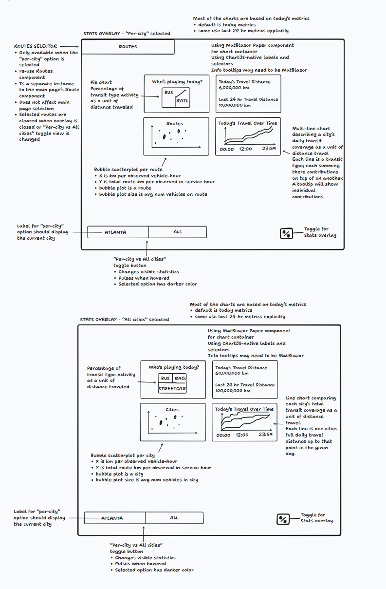
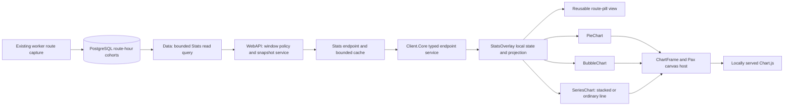

# Design Document: TransitJazz Stats Overlay

**Status:** Proposed implementation design; no application code is delivered by this document.  
**Date:** 2026-10-11  
**Audience:** Product, client, API, data, testing, and deployment contributors  
**Companion:** [Pax Blazor Chart.js foundation](PAX_BLAZOR_CHARTJS_COMPONENTS_DESIGN_DOCUMENT.md)

## 1. Purpose and decisions

Add a dashboard overlay to the existing transit map. Visitors can inspect today's observed transit movement for the current city, optionally select routes, or compare all configured cities. Four panels answer: which transit types contributed, how far transit moved, how routes or cities compare, and how movement accumulated through the day.

The design uses the existing Blazor WebAssembly application, MatBlazor surfaces, a small extension of the proposed Pax chart foundation, one bounded read API, and existing PostgreSQL hourly route history. The map and music keep their current lifecycle while the dashboard is open. Dashboard route selection belongs exclusively to the overlay.

| Decision | Outcome |
| --- | --- |
| User-confirmed Y denominator | An observed active clock hour is a complete UTC hour with at least one observed active vehicle; it is not exact elapsed time in service. |
| User-confirmed All-city day | Each city contributes its own local calendar day. The comparison does not represent a simultaneous global day. |
| Default mode | Current city, no route filter; the segment label is its display name, such as Atlanta. |
| User-confirmed All-view navigation | All is comparison-only: city bubbles and lines expose tooltips, with no city drill-down. The city-specific view always represents the map's current city. |
| User-confirmed All-line visibility | Use native Chart.js legend toggles to hide/show city lines in the All timeline. Visibility affects that chart only; the pie, totals and bubbles continue to represent all cities. |
| User-confirmed welcome access | Offer a secondary “View statistics” action before audio unlock. Opening Stats never enables audio; closing it returns to the welcome screen when audio remains locked. |
| User-confirmed playback | Continue already-playing audio while Stats is open. After audio unlock, provide an accessible mute/unmute control inside Stats using the existing audio setting. |
| User-confirmed route-filter scope | In current-city mode, selected routes filter all four panels: category pie, both distance totals, route bubbles and cumulative timeline. Empty selection restores the whole city. |
| User-confirmed differing route coverage | Use each selected route's own available eligible hours. Do not restrict all selected routes to their shared hours; report per-route coverage and qualify comparisons across different observation periods. |
| User-confirmed partial-hour plotting | If any selected route lacks usable data for an hour, leave a gap in the entire plotted category stack. Retain other selected routes' known contributions in cards, tables and later cumulative values. |
| User-confirmed route-selector presentation | Keep the existing route grid grouped by transit category; find routes by scrolling. Do not add a route search box in this release. |
| User-confirmed route-selector membership | Offer routes retained in today's or the last 24 completed hours' reporting history, including inactive routes with recorded zero activity. Do not add current-catalog-only routes without reporting history. |
| User-confirmed overlay layout | Full-screen on desktop and mobile. The Stats toggle/close control dismisses the overlay; there is no exposed map backdrop. |
| User-confirmed Back navigation | Browser/phone Back closes the open Stats or Info overlay before navigating away from the app. Both overlays participate in one shared history lifecycle. |
| User-confirmed Forward navigation | Forward reopens the corresponding Stats or Info overlay. Stats starts a fresh current-city session with no route selections and all lines visible; Info reopens normally. Preserve the current audio state. |
| User-confirmed full reload | A full page reload returns to the existing welcome/audio-unlock screen with Stats and Info closed. Overlay restoration through Back/Forward applies only within the current page session. |
| Data source | `city_route_hour_statistics` for every panel and both modes; no mixing of independently captured category/city totals. |
| User-confirmed freshness | Show only completed hours; no provisional current-hour measurements. Refresh the open visible overlay once a minute and display the actual window and coverage. |
| User-confirmed incomplete coverage | Show useful measurements from eligible completed hours, with visible contributing/expected hour counts and timeline gaps. Do not estimate missing hours or hide all results merely because coverage is incomplete. |
| User-confirmed cumulative gaps | Resume the cumulative observed subtotal after a visible gap, retaining the coverage warning. Do not reset accumulation after a missing hour. |
| Last 24 hours | Twenty-four completed UTC hours ending at the response cutoff; explicitly label that cutoff. Exact rolling-to-the-second values require finer capture. |
| User-confirmed X denominator | Observed **route-vehicle-hours**, including in city aggregates. Count a vehicle once per observed route per hour; transfers can contribute on multiple routes. Never label the result city-unique vehicle-hours or measured driving time. |
| Delivery | A new Stats feature implements this proposal. Features 056/057 retain their original internal SQL contracts. |

The X-axis qualification and completed-hour freshness are deliberate refinements to the sketch, required by the retained evidence. If unique city vehicle-hours or minute-fresh route totals become requirements, add capture contracts before changing these labels; they cannot be recovered from aggregate route rows.

### Scope

Deliver the toggle, overlay, two modes, independent reusable route selector, pie, two distance totals, bubble chart, daily cumulative chart, coverage explanations, accessible tables, English/Spanish strings, light/dark parity, typed API, bounded queries/cache, and an operational handoff. User-requested scope also includes Back-to-close for the existing Info overlay through shared overlay history handling. Initial access is public aggregate data, matching the public transit experience.

Historical date pickers, exports, arbitrary metric builders, listener/audio-playback statistics, per-vehicle records, live partial-hour capture, city-unique hourly populations, and new retention/backfill jobs are outside this release. The existing statistical capture system remains the evidence source.

## 2. Wireframe and interaction specification

The supplied image is readable, and its annotations are transcribed here so implementation does not depend on interpreting handwriting. Illustrative distances in the sketch are placeholders.



| Sketch element | Implementation requirement |
| --- | --- |
| Upper-left Routes control | Present only in current-city mode; reuse the existing route grid grouped by transit category in its own accordion instance. User-confirmed: scrolling, with no search box. |
| Independent selection | User-confirmed: changes affect all four dashboard panels, including both distance totals, and neither map selection nor audio. Clear on close, either mode change, or current-city change. |
| Upper-left chart | Pie, titled “Who's playing today?”; category share of observed distance, not share of sounds or vehicles. |
| Upper-right card | Today's distance and last 24 completed hours' distance, each with its own window and coverage. |
| Lower-left chart | One bubble per route in city mode; one per city in All mode. X is distance per route-vehicle-hour, Y is distance per active clock hour, area represents average observed active vehicles. |
| Lower-right, city | Cumulative category distance, stacked by transit type. Tooltip/table shows each category's own contribution and combined total. |
| Lower-right, All | Unstacked cumulative distance line per city, using each city's local day. |
| All-city chart interaction | User-confirmed: inspecting plotted data shows its tooltip without navigation or city/playback changes. Native timeline legend toggles independently hide/show city lines. |
| Chart containers | MatBlazor `MatPaper` surfaces; Chart.js axes, legends, and data tooltips. MatBlazor info controls explain measures. |
| Lower-left segmented control | Current-city display name and “All”; darker selected treatment, hover pulse, keyboard focus and selected semantics. |
| Lower-right percent icon | Opens/closes Stats. Same logical action when placed inside the open overlay. Accessible label says “Open statistics” or “Close statistics.” |

### Layout and overlay behavior

- User-confirmed: Stats fills the viewport on every device, covering the map or welcome screen. Desktop uses Routes at top, a two-by-two card grid, and a persistent footer with the scope switch and close/toggle. Keep headers and metric explanations outside the canvas; distribute available space without stretching text or charts beyond useful reading sizes.
- Narrow viewport: retain the full-screen shell, with a single column in reading order (pie, totals, bubbles, timeline), internal vertical scrolling, and a sticky footer with safe-area padding. Card minimum widths must not force horizontal page scrolling; tables may scroll within their own containers.
- Use a fixed shell with `inset: 0`, a height based on `100dvh`, and one content scroll owner. Reserve chart height before loading to avoid layout jumps. A shared chart-height CSS variable permits responsive card sizing without altering renderer code.
- Modal semantics: labeled full-screen dialog, focus moved to its heading/first control, focus contained while open, and background UI inert. Browser/phone Back, Escape and the persistent Stats toggle/close control dismiss immediately and restore focus to the invoking control. There is no exposed backdrop or outside-click dismissal target. Use the existing MatBlazor dialog facility if it supports this full-screen layout and meets these checks; otherwise implement these behaviors in the overlay shell with a small focus helper. Verify rather than assume the library supplies them.
- Enter over 100 ms; dismiss immediately. Hover pulse is short and stops on pointer leave; disable pulse/entrance motion under `prefers-reduced-motion`. Selected state also has text/ARIA indication, not color alone.
- User-confirmed: add a secondary “View statistics” action to `AudioUnlockOverlay`, alongside its existing enable-audio action. Both this action and the post-unlock Stats launcher open the same Stats component through its `TransitMap` owner. Opening Stats never calls the audio-enable callback, changes the audio-unlocked flag or persisted audio preference, or requires the live map/feed to become ready. The read API supplies the route metadata needed for silent exploration.
- When opened from the welcome screen, make that screen inert while Stats has focus; closing restores the welcome screen and focus to “View statistics,” with audio still locked. Do not leave two active dialogs/focus traps. After audio unlock, closing Stats restores focus to its map launcher. Coordinate the existing settings blade and Info overlay so only one modal receives focus; opening Stats closes the existing surface through its owner and shared history handling where applicable.
- User-confirmed: opening Stats continues already-playing audio and does not change the selected city's SignalR group or recreate the map. After audio unlock, include a labeled mute/unmute control inside the modal so visitors can control playback while background controls are inert. Before audio unlock, omit that control; the silent Stats entry point never unlocks audio.
- The in-overlay audio control reads/writes the same persisted audio setting and uses the existing audio-change event path as the main app. Reuse a shared toggle action/presentation where practical rather than creating a Stats audio state. Keep both controls synchronized when settings change. Closing Stats preserves any explicit mute/unmute change; it neither restores an earlier setting nor resumes playback automatically.
- Host `StatsOverlay` and its launcher in `TransitMap`, where city identity and visibility state already exist. Do not duplicate page state in `MainLayout`. Use a local stacking layer above existing map controls and below no competing modal; audit current z-index values instead of assuming a new arbitrary value wins.

### Shared Back-to-close behavior for Stats and Info

The design interview explicitly extended Back-to-close to the existing Info overlay. That overlay currently lives inside `Components/FABs/InfoFab.razor`, owns a local `_isOpen` flag, and closes through its FAB, body button or Escape. Refactor those entry/exit paths to participate in the same small history coordinator as Stats; a second popstate handler with independent rules would duplicate navigation knowledge and risk consuming two history entries.

- Opening either overlay from the base app adds exactly one same-URL history entry with a namespaced overlay marker, instance/session identity and originating city. Preserve the existing URL, city hash and framework-owned history state. No overlay opening may invoke the city switch's hash/reload behavior.
- Back from that overlay entry returns to its underlying entry and closes the surface, restores focus where possible, and runs normal cleanup. Stats stops requests/polling and clears its selection; neither overlay changes audio settings or the audio-unlocked flag.
- User-confirmed: Forward into a valid overlay entry reopens the corresponding surface without pushing another entry. Stats creates a fresh session in the map's current-city mode, with no selected routes or hidden city lines, and fetches current reporting windows. Info reopens its normal current-city content. Neither reopening restores old audio settings or unlocks audio.
- Closing through Escape, the FAB/toggle or Info's body button uses the same close operation. Dismiss the UI promptly and consume the overlay-owned history entry once. A subsequent popstate notification acknowledges that close; it must not call Back again. Repeated taps while a history transition is pending are idempotent.
- Only move history backward when the current entry is demonstrably the coordinator's active overlay entry. Component disposal, unrelated navigation, city reload, stale/foreign history state and cancellation never trigger an unconditional Back that could leave the app.
- Retain enough entry ownership information for Back/Forward within the current page lifetime, even after its overlay component unmounts. A valid Forward traversal adopts the existing entry as active; it does not reuse a disposed component or restore stale data/filter snapshots. Validate the entry's originating city against the current app city; never reopen a different city's overlay from an obsolete marker.
- User-confirmed: a full reload creates a new page-session identity and starts with both overlays closed at the existing welcome/audio-unlock screen. Do not persist overlay state in local/session storage or restore an old overlay from history on startup. Remove only this feature's obsolete marker from the current history state using replacement, preserving the URL/city hash and framework-owned fields. Never call Back during startup to remove an old overlay entry: that could navigate away from the app. Ignore markers belonging to older page sessions if later traversed. The browser may retain same-URL entries from a prior session; do not attempt to delete or skip unrelated history to eliminate them.
- Permit only one active Stats/Info overlay entry. If one surface replaces the other programmatically, replace the owned marker and active surface rather than stacking overlays; Back then returns to the base map/welcome screen. Close the settings blade through its existing owner without extending this feature into a general modal stack.
- Keep one shared `OverlayNavigationService` with a small `Stats | Info` discriminator and one isolated local JS module for history events. Component owners retain their content, selection and focus behavior. The service coordinates entry ownership, active surface changes and lifecycle cleanup; use the existing app event/DI patterns where useful, without creating a generic navigation framework.
- Initialize the bridge before enabling history-aware launch actions. Dispose listeners and .NET callback references when their owning scope ends. Verify Blazor navigation integration and same-URL history behavior in a browser prototype; do not assume that changing `_isOpen` alone handles Back correctly.

The browser supplies [same-document history entries through pushState](https://developer.mozilla.org/en-US/docs/Web/API/History/pushState) and traversal notifications through [popstate](https://developer.mozilla.org/en-US/docs/Web/API/Window/popstate_event). Back/Forward and full-reload behavior are confirmed for both overlays: same-page traversal can reopen them, while a reload always starts the normal welcome flow.

### State transitions

| Event | Required result |
| --- | --- |
| Open | From welcome or map launcher, resolve current canonical city, select city mode, empty route selection, load one snapshot. Preserve audio lock/preference and remember the invoking control for focus restoration. |
| Toggle one/many routes | Empty set means all routes. Debounce rapid selection for 200 ms and request one filtered snapshot. |
| Select all / clear | Category Select-all adds that category's routes; Clear removes them. Whole-list Clear restores the unfiltered view. |
| Change mode | Clear route selection before requesting; All hides the selector. Returning to city does not restore its old selection. |
| Inspect city bubble / line in All | Show tooltip only; no drill-down or app-city change. Returning to city mode always uses the map's current city. |
| Toggle All-timeline legend entry | Use native Chart.js dataset visibility; no API request or other-panel filtering. Preserve visibility by city key through refresh/theme/language changes; reset to all visible when leaving All mode or closing Stats. |
| Close / navigate | Cancel requests and timer, clear selection, unsubscribe/dispose overlay resources. On close, return to welcome when audio remains locked, otherwise to the map; restore focus to the invoking control when still mounted. |
| Browser / phone Back with Stats or Info open | Consume the overlay history entry and close that surface, preserving audio state. A later Back performs ordinary page navigation; no duplicate history traversal from close callbacks. |
| Browser Forward into a valid Stats / Info entry | Reopen that surface without pushing history. Stats resets to current city, no selected routes and default line visibility, then fetches a fresh snapshot. Info reopens normally. Preserve current audio state. |
| Full page reload | Start normal welcome/audio-unlock flow with both overlays closed; invalidate prior-session overlay markers without traversing history or restoring selections/audio unlock. |
| Current city changes | Close overlay and reset; next open uses the new city and display label. |
| Browser hidden | Parent forwards its existing visibility state; cancel/suspend dashboard refresh. |
| Browser visible | If open, refresh immediately, then resume the single timer. |
| Midnight / new cutoff | Next response supplies the new window; atomically replace dates, charts, totals and coverage. |
| Theme / language changes | Reproject/redraw locally using the same snapshot; do not requery statistics. |
| Audio toggle inside Stats | Available only after audio unlock; update the existing audio setting/event path. Preserve the chosen setting when Stats closes; do not change dashboard selection or data. |

The existing page visibility service stores one callback; do not attach a second listener through that singleton and overwrite the map's callback. Pass the parent's visibility flag to the overlay.

## 3. Verified repository fit

These are observations of the source tree on the document date, not claims that history is enabled or healthy in production.

| Existing seam | Reuse or required change |
| --- | --- |
| `Client.WebApp/Pages/TransitMap.razor[.cs]` | Hosts map, Routes accordion, audio unlock, city resolution and visibility lifecycle. Add overlay state and mounting here. |
| `Client.Shared/Components/RouteFilters.razor[.cs]` | Currently injects `IRouteFilterViewModel` and subscribes to its changes. A second instance currently shares the same state. Extract the visual control as described in section 8. |
| `Client.Shared/Components/FABs/InfoFab.razor` | Owns Info markup and a local open flag, with FAB/body-button/Escape close paths. Wire every path into shared Back-to-close handling and retain its content/theme behavior. |
| `Client.Shared/ViewModels/RouteFilterViewModel.cs` | Owns live selection and subscribes to application batches; keep that responsibility. Do not instantiate it again for Stats. |
| `Client.Core/Services/EndpointsServices` and `Shared/ApiEndpoints.cs` | Add the Stats endpoint constant, wire DTOs and typed service following these conventions. |
| `Server.WebAPI/EndpointGroups` | Add `StatsEndpoints`; existing APIs use minimal endpoint groups. No Stats endpoint currently exists. |
| `Server.Data/Models/CityRouteHourStatistic.cs` | Contains canonical route/category metadata, distances, hourly distinct population, sample counts, status/conflict and boundary evidence. |
| `Server.Data/Configurations/CityRouteHourStatisticConfiguration.cs` | Existing city/hour/route index supports bounded city-range reads; use it before proposing another index. |
| `Server.TransitDataWorker/Statistics/RouteHourStatisticsCapture.cs` | Activity is deduplicated across routes once per vehicle per cycle. This supports summing per-route activity at one common cycle denominator. |
| `Server.TransitDataWorker/Cities/CityConfig.cs` | Holds configured IANA time zone. Use canonical city identity separately from display name. |
| `specs/057-hourly-route-history` | Defines hourly coverage, identity and weighted statistics; real-database/load/operator acceptance remains a dependency. |
| Pax foundation document | Proposed components/package setup, not already implemented chart infrastructure. Budget its implementation into this feature. |

The older city-minute dashboard table has no distance measure. Category minute/hour history is useful for its own insights, but its collection eligibility and control settings differ from route capture. Neither provides a sound way to fill missing route data. No Grafana credential, direct database connection, or query text belongs in the WASM client.

## 4. Statistical contract

### 4.1 Meaning and identity

“Distance” is accepted observed movement along resolved route geometry, as defined by `observed-city-route-hour-statistics-v1`. It is not scheduled route length, unique network coverage, passenger distance, completed trips, or actual audio playback. Repeated movement on the same segment contributes repeatedly. Use “Observed travel distance” in explanatory copy even where compact card titles say “Today's travel distance.”

Route identity is the ordinal tuple `(CitySlug, RouteJoinKey)`. `StaticRouteId`, route short name and localized labels are metadata. Never parse a display label into an identity, lowercase a route key, or join solely on its number. Category comes from retained metadata for each hour; a route's category can change across hours. Retain `unknown` visibly.

### 4.2 Time windows

Capture one `asOfUtc` per uncached snapshot using `TimeProvider`. Define the default cutoff `H = floorToUtcHour(asOfUtc - 2 minutes)`. The two-minute allowance gives the existing finalizer/writer time to retain the just-ended hour. It is an API policy, not proof of successful retention; missing hours remain missing. At 14:30 UTC, H is 14:00; at 14:01, H is 13:00.

For city c, resolve the local date containing `asOfUtc`, then compute its actual local midnight `M_c` and next local midnight `N_c` as UTC instants from the configured IANA zone. Today's request is `[M_c, min(H, N_c))`, clamped to empty if H precedes M_c. The rolling comparison is `[H - 24 hours, H)`, shared in absolute time across cities. All boundaries are half-open.

Only entire UTC hours contained in a requested window contribute. Return requested bounds and the actual eligible boundary grid. Do not prorate partially intersected hours. Current configured zones have whole-hour offsets; an added zone with half/quarter-hour midnight requires explicit boundary-exclusion copy or finer capture before claiming full local-day coverage.

The current unfinished hour is `pending`, not missing. Before the first completed local hour, show “Today's first complete hour is still being collected”; the last-24-hours metric can already be available. The API never serves a yesterday window with a today label to fill this state.

The design interview confirmed completed-hour-only reporting. At 14:45 local time in a current whole-hour-offset city, data runs through 14:00; after midnight, today's first hour remains pending until approximately 01:02 under the proposed finalization allowance. Minute polling checks for retained evidence and does not imply minute-resolution measurements. The two-minute allowance remains an engineering default to validate against writer behavior.

Each All-city series carries its own local date, zone, UTC bounds and cutoff. Title/subtitle: “Today's travel by city — each city's local day.” The All-city today total sums those local-day observed subtotals; it is explicitly labeled “Sum of each city's local day.” Cities can be on different dates or at different times of day. This comparison is descriptive, not a normalized city performance ranking.

### 4.3 Eligibility and coverage

Build an expected city/UTC-hour grid before reading aggregates. For a retained cohort, apply the route-history contract and conservatively require all its rows to be Complete, nonconflicting, supported-definition, stable-catalog rows with a consistent capture run and common eligible sample count. Each row's `RouteCatalogFingerprint` describes that route; fingerprints need not match between different routes. A conflict anywhere in that city/hour excludes the whole cohort. Complete inactive rows remain valid zero evidence. Never test just `distance > 0` for eligibility.

The whole-cohort eligibility rule validates the integrity of the rows actually retained for a city/hour. It does not require every route selected for the reporting window to exist in every cohort. Retained routes in one healthy cohort share observation samples, while a selected route absent from that hour has unknown membership. The existing atomic writer is the authority on intact retained membership; the read API does not invent a new manifest. Validate cohort consistency and treat unexpected discrepancies as unavailable evidence.

| Coverage reason | Contribution |
| --- | --- |
| Complete compatible cohort | Eligible, including healthy zero movement. |
| Partial / NoData / Conflict | Excluded; retain distinct counts/reason codes. |
| Entirely missing cohort | Excluded and counted on the expected grid even if no route is discoverable. |
| Unsupported definition or cadence policy | Excluded and separately reported; never average incompatible partitions. |
| Requested route not retained in a known cohort | Unknown membership for that route/hour; do not turn it into an inactive route. |
| Boundary cut / current unfinished hour | Outside contributing full hours; describe separately from failures. |

Use the configured cadence for each city as part of the supported API policy. A stored different cadence is excluded in v1; a future version can deliberately support normalized mixed policies. No implicit blend of versions or cadence partitions.

User-confirmed: for a filtered city request, each selected route contributes its own available rows from eligible cohorts. An absent selected route does not discard another selected route's good data in the same hour. Do not intersect all selected routes' observation periods or fill the absent route with zero. For unfiltered requests, use exactly that hour's retained route cohort, including routes absent from the current catalog. Catalog changes can alter the population across hours; disclose that change and show coverage per route. Today's catalog must not fabricate historical membership.

Example: Route 10 contributes 100 km over ten eligible hours and Route 20 contributes 60 km over six eligible hours in the same ten-hour window. Their combined observed subtotal is 160 km, retaining all ten hours from Route 10. Route coverage is 10/10 and 6/10 respectively; the combined selection has 16 of 20 requested route-hours available, with only six hours fully covered for both routes. These counts describe evidence availability, not proof of scheduled service. Category shares describe the composition of this known subtotal and must retain the partial-coverage qualification.

For totals and category shares, return known subtotals over contributing hours plus `complete`, `partial`, `unavailable`, or `pending` coverage. A partial amount is visibly “Observed subtotal · partial coverage”; it is never shown as an unqualified whole-day total. `null` means no eligible evidence or an undefined ratio. Numeric zero means eligible observation and zero distance. Return numerator/denominator details needed to explain each ratio.

The design interview confirmed showing partial results rather than requiring whole-window completeness. For example, with nine usable hours out of twelve completed hours, show “Observed distance: 12,400 km · 9 of 12 hours available” and retain visible timeline gaps. This decision permits sums of eligible complete hours; it does not admit Partial, NoData or conflicted source rows into those sums. If no eligible hour contributes, retain the unavailable/pending state instead of inventing a zero.

Coverage includes expected closed hours, hours with any eligible contribution, fully covered hours for the requested scope, excluded counts by reason, boundary exclusions, first/last contributing UTC bounds, and pending-through time. For a selected route set, also return each route's available/expected hours and aggregate available/requested route-hours; label these explicitly rather than treating an hour with one available route as fully covered. The expected selected route-hour count is selected-key count times expected closed hours, including unknown historical membership as an availability gap. For an unfiltered entirely missing cohort, expected historical route count is unknown; keep expected route-hours null instead of inferring it from today's catalog. All-city coverage remains per city plus contributing/expected city-hours and number of cities with any data; do not present a single percent that hides a missing city. This feature exposes route-hour coverage, never fabricated covered minutes.

### 4.4 Formulas

Let r be a route, h an eligible UTC hour, and P the matching contributing route/hour set. For a filtered request, P is the union of the selected routes' individually available eligible rows, not an intersection of their hour sets. Each route ratio uses only that route's members of P; all its numerator and denominator sums use exactly the same rows. Define:

- `D_rh = DistanceMetersSum / 1000` in km.
- `V_rh = DistinctActiveVehicleCount`, the number of observed vehicle memberships on that route during that hour.
- `S_rh = ActiveVehicleCountSum`; `N_ch` is the eligible sample count common to the city's whole cohort for hour h.
- `A_rh = 1` when `S_rh > 0`, otherwise 0. A stationary active vehicle makes an hour active even if distance is zero.

All statistical divisions use server decimal/numeric arithmetic; convert to finite doubles only for chart coordinates. Display rounding happens after aggregation.

| Visual value | Formula and meaning |
| --- | --- |
| Today / last-24 distance | `sum(D_rh)` across that window's P. |
| Category distance | Sum D for retained category k within P; category totals sum to the same distance card subtotal. |
| Category percentage | `100 * categoryKm / totalKm`; null percentages when total is zero. Round for display only; displayed percentages may differ slightly from 100. |
| Route bubble X | `sum_h(D_rh) / sum_h(V_rh)`, km per observed route-vehicle-hour. |
| Route bubble Y | `sum_h(D_rh) / sum_h(A_rh)`, km per observed active clock hour. |
| Route bubble area measure | `sum_h(S_rh) / sum_h(N_ch)`, average active vehicles across its eligible observed samples, including inactive hours. |
| City bubble X | `sum_rh(D_rh) / sum_rh(V_rh)`, still route-vehicle-hours, not unique city vehicles. |
| City bubble Y | `sum_rh(D_rh) / count(h where sum_r(S_rh) > 0)`. An active city clock hour counts once, not once per route. |
| City bubble area measure | `sum_rh(S_rh) / sum_h(N_ch)`. Count the common sample denominator once per city/hour, never once per route. |
| Cumulative series | Prefix sum of eligible hourly km, by category in city mode or by city in All mode, with explicit gap handling below. |

For a route bubble, use all its own eligible rows in P and show its own eligible-hour count; another selected route's missing hours do not remove those rows. Route bubbles can cover different observed periods, so include that qualification in chart help and per-point/table coverage. City bubbles in All mode use their city's entire eligible cohorts. The per-cycle deduplication in route capture makes the city area measure a mean active-vehicle count; hourly distinct unions are still unrecoverable. Do not sum hourly distinct counts and label the result period-unique vehicles.

The design interview confirmed route-based counting for X in both modes. Use the axis label “km per observed route-vehicle-hour” and localized help explaining that a vehicle seen on two routes in one hour counts once on each route. A vehicle observed for only five minutes still counts once for that route/hour; the denominator records observed hourly memberships, not measured driving duration. City comparisons retain this same definition rather than attempting to deduplicate transfers from aggregate rows.

Example: two complete route hours contain 20 and 10 km, 4 and 2 vehicle memberships, active sums 120 and 60 with 60 samples each. X = 30/6 = 5 km/route-vehicle-hour; Y = 30/2 = 15 km/active hour; mean active vehicles = 180/120 = 1.5. A vehicle transferring routes in one hour increases both route membership denominators, but a city active hour still counts once.

If a divisor is zero, the ratio is null. Omit a bubble lacking either coordinate or positive area measure from the canvas and retain its table row and reason. An active stationary route has X=0 and Y=0 and remains a valid visible bubble. Do not place unavailable points at the origin.

### 4.5 Cumulative display and reconciliation

The API returns hourly contributions and cumulative known subtotals, with status per bucket; it owns prefix arithmetic. On healthy coverage, a city stack's top equals the distance card, and the last cumulative value equals the corresponding category subtotal. In All mode each city endpoint equals that city's today subtotal; summing all city series' endpoints, including any hidden through the legend, gives the All-city today card. The sum of only visible lines is not the card's scope.

Separate numeric evidence from whether a bucket can be drawn as a fully observed point. For each bucket, the API computes hourly known km and cumulative known km from every contributing route row, even when another selected route is absent. With no contributing row, hourly km is null and the internal prefix receives no increment; never substitute zero evidence. The plot value is nullable independently of the known subtotal, so leaving a visual gap does not erase good route data from cards, percentages, ratios or later prefixes.

At an excluded bucket return null plotted values, not a repeated plateau or zero increment. After a gap, subsequent fully covered buckets resume the cumulative **known subtotal**, including any eligible route contributions retained during partially covered buckets but no invented amounts for missing routes. Keep the persistent partial-coverage label and tooltip text. The table identifies unavailable routes/hours and any known contributions within a visually gapped bucket. A resumed value must never be described as total actual travel through that time. If the final buckets cannot be plotted, the card and table still report the complete known subtotal even though the last visible chart point is earlier.

The design interview confirmed this resume behavior: 100 km observed before a missing hour and 40 km observed afterward produces a visible gap followed by a cumulative value of 140 km. Label the measure “Cumulative observed distance,” retain the coverage warning, and keep the card and resumed timeline on the same known subtotal. Do not restart the later segment at 40 km or interpolate travel through the gap.

User-confirmed: for category stacking, null the entire plotted stack at an excluded city/hour or an hour lacking one or more selected routes. Preserve known km in the table and cumulative arithmetic; do not substitute a partial-data marker for the gap. For example, if two of three selected routes have usable data, their distance contributes to cards and later cumulative values, but that hour is a visual gap with table coverage “2 of 3 selected routes available.” `spanGaps=false`; future hours are null. A zero at local midnight is an origin marker, not evidence that capture was healthy; a missing first hour leaves a visible gap after it. If no eligible route-hour contributes, show pending/unavailable data. If useful subtotals exist but every bucket is visually gapped, explain that coverage prevents plotting and retain those subtotals and the table rather than reporting no data.

## 5. Architecture and DRY boundaries



| Knowledge | Single owner |
| --- | --- |
| Observation and movement eligibility | Existing route capture and definition contract. |
| Window, cohort eligibility, denominators, shares and prefixes | Server Stats query/service, versioned as `stats-overlay-v1`. |
| Route filtering meaning | Overlay's selection state and normalized API selection; main-map state remains with its existing view model. |
| API paths and serialization shapes | Shared endpoint constants and DTOs. |
| Snapshot-to-display projection | One `StatsOverlayProjection` pure helper; no formula copy in Razor or JavaScript. |
| Chart colors, precision policy and lifecycle | Shared chart presentation helpers/host. |
| Route-pill markup and keyboard behavior | One presentational `RouteFilterList`, consumed by map and Stats. |
| Overlay history-entry ownership and Back-to-close | One `OverlayNavigationService` and JS module, shared by Stats and the existing Info overlay. |

Add no chart registry, generic dashboard framework, generic repository, second global application store, browser metric registry, or SignalR statistics stream. Reuse proven policies through small functions and composition. Distinct pie/bubble models are necessary because their meanings differ from aligned numeric series.

## 6. Public API contract

### 6.1 Request and validation

Add `ApiEndpoints.Stats.Query = "/stats/overlay/query"` and a read-only `POST` endpoint. POST keeps a potentially large ordinal route-key array out of URL/proxy limits; it does not mutate state. A separate metadata request is unnecessary: the response includes selectable historical route metadata. Use the existing configured API base URL, HTTP factory, error handling and cancellation conventions.

```json
{ "scope": "city", "citySlug": "marta", "routeJoinKeys": [] }
```

```json
{ "scope": "all", "citySlug": null, "routeJoinKeys": [] }
```

- `scope` is exactly `city` or `all`. City mode requires a known canonical configured city. All mode rejects a city or nonempty route selection.
- Empty selection means all routes; otherwise keys are distinct, nonblank, ordinal strings no longer than 512 UTF-8 bytes. Deduplicate and ordinal-sort before caching/querying; preserve spelling/case.
- Maximum 4,096 selected keys and 4 MiB request body. Enforce both before running SQL; reject oversize requests with 413. Limits support the existing default capture cap and can be reduced only with an explicit selector UX.
- No caller-specified SQL, city lists, definition, date range, time zone, metric expression, or arbitrary page size. Today's and last-24 windows are server-owned.
- A validly formed but unknown historical route key returns an unavailable selection with an `unknown_route` reason. Do not silently discard it and widen to all routes. Historical routes need not exist in the live catalog.
- User-confirmed: the unfiltered selector metadata is the union of retained routes in the city's today/last-24 windows, including routes with recorded zero activity. Do not union in current-catalog routes that have no rows in these windows. Retained routes remain discoverable even when their rows are currently ineligible for metrics; expose availability separately from membership. Return label/category and last retained metadata time, plus category-change indication where relevant. Keep selected-but-absent keys visibly selected using their key as fallback label. Do not fetch geometry for Stats.
- All-city membership is the configured public app city set with valid IANA zones. Include unavailable cities with reasons such as `history_disabled`, `not_retained`, or `unsupported_definition`; do not redefine “All” to omit them silently.

### 6.2 Response shapes

Add DTOs in `ChefKnifeStudios.TransitJazz.Shared/Stats`. Exact C# naming can follow repository conventions; these fields are the binding wire requirements. String discriminators are explicit and stable; serialize UTC instants as ISO-8601 with Z, dates as ISO dates, and numeric values as JSON numbers or null. Shared DTOs contain no EF/Pax types.

| DTO / field group | Required fields |
| --- | --- |
| `StatsOverlayResponse` | `contractVersion`, `metricDefinitionVersion`, `generatedAtUtc`, `cutoffUtc`, normalized `selection`, `cities`, `routeOptions`, `todayDistance`, `last24Distance`, `categoryShares`, `bubbles`, `timeline`, `warnings`. |
| `CityWindow` | City slug, display-name key, IANA zone, local date, local-day UTC start/end, requested today bounds, eligible full-hour bounds, today's coverage and last-24 coverage. |
| `Coverage` | State, expected closed hours, hours with any contribution, fully covered hours, nullable expected and available route-hours, per-route available/expected hours for selected routes, excluded counts by reason, boundary-excluded hours, first/last contributing bounds, pending-through instant, historical-membership notice. |
| `DistanceSummary` | Nullable `kilometers`, coverage, contributing/expected city-hours, contributing/expected city counts. Its window reference is `today` or `last24CompletedHours`. |
| `RouteOption` | City slug, route join key, historical label, category, metadata timestamp, category-change flag, availability reason. |
| `CategoryShare` | Category key, nullable kilometers and percent, coverage reference. Include observed zero categories and `unknown`; never renormalize after a legend is hidden. |
| `BubbleStatistic` | Stable entity key/kind, city slug, optional route join key, label, category when applicable; distance km, route-vehicle-hour sum, active-clock-hour count, activity-sample numerator and sample denominator, nullable X/Y/mean-active values, coverage and omission reason. |
| `Timeline` | `seriesKind` (`category`/`city`), `stacked`, elapsed-hour extent, ordered series. |
| `TimelineSeries` | Stable key, category or city identity, window reference, ordered buckets. |
| `TimelineBucket` | UTC start/end, local end label and UTC offset, elapsed hours since that city's midnight, nullable hourly known km, nullable cumulative observed km, independently nullable `plotCumulativeKilometers`, available/expected selected-route counts where applicable, coverage state/reason. Known cumulative km can be present when plot km is null; an entirely unavailable prefix remains null. |
| `warnings` | Bounded code list, such as `partial_coverage`, `city_days_differ`, `catalog_changed`, `boundary_excluded`; localized text belongs to the client. |

Return the published metric-definition identifier even when all amounts are unavailable. A partial response is structurally complete: every card knows whether it can draw. Omit internal run IDs, individual vehicle/trip/listener IDs, raw feed records, credentials and exception messages. Do not send raw route/hour rows merely so the client can repeat the server aggregation.

Route options and route bubbles are bounded at 4,096 distinct keys per city response, including historical union. If a catalog transition exceeds that response bound, return 422 `scope_too_large` with a safe explanation that this city's statistics exceed the current display limit, rather than silently truncating routes or biasing aggregates. Do not promise that selecting fewer routes resolves an oversized unfiltered metadata list. All-city output is bounded at 32 configured cities and 32 categories; configuration validation and deployment preflight catch larger installations before UI exposure. These are initial capacity limits to validate, not measured guarantees or an automatic top-N policy.

### 6.3 Status and failure semantics

| HTTP result | Behavior |
| --- | --- |
| 200 | Includes complete, partial, pending or wholly unavailable retained history. Availability is data, not a server exception. |
| 400 | Invalid scope/identity/request shape. ProblemDetails with safe stable code. |
| 413 / 422 | Body/key cap or response scope cap. No partial/truncated success. |
| 429 | API budget exceeded; include Retry-After. |
| 503 | Read feature unavailable, schema dependency absent, DB unavailable, or query deadline exceeded; safe ProblemDetails and retry hint. |

The existing `IHttpService.PostAsync<X,T>` already supports typed POST, but its implementation catches cancellation and discards status/Retry-After/ProblemDetails metadata on most failures. Add a narrow opt-in `PostWithMetadataAsync<X,T>` operation returning the existing `Result<T>` alongside status, retry delay and safe problem code. Reuse the same HTTP factory, serializer and response parsing; leave existing callers on their current method signatures. Dispose response messages and rethrow caller-requested cancellation before general exception handling. The Stats endpoint service maps this transport result into its own success/error state and resource keys; it never displays raw exception text. Cover this seam explicitly in client transport tests. Do not create another HttpClient factory.

## 7. Backend query, consistency and capacity

### Query execution

1. Validate request and public city set; normalize selection. Capture one time and compute per-city windows.
2. Load only rows in the union of requested today and last-24 windows for those cities. Include unfiltered cohort metadata for eligibility even on filtered requests; filtering first would miss conflicts on another route.
3. Build expected grids and validate cohorts. Use retained metadata to select route membership. Retain exclusions before numeric aggregation.
4. Project selected eligible hourly contributions once, then reuse them for cards, category shares, bubbles and timeline. Compute the last-24 window from the same read snapshot.
5. Return one immutable response; cache successful unfiltered responses under the bounded policy below.

Implement a dedicated read query in `Server.Data/Statistics/StatsOverlayQuery.cs` with parameterized SQL (or EF projection where equally clear). Use one statement/CTE chain for related result sets, or one short read-only REPEATABLE READ transaction if metadata and results require separate statements. A default read-committed multi-command request can mix pre/post-quarantine evidence and is insufficient.

Push grouping/projection into PostgreSQL and keep vehicle-free intermediate data bounded. Do not run a query per chart, route or city. Use `AsNoTracking` for EF reads; avoid loading full entities into the change tracker. The route-history analyst SQL is a correctness reference; do not expose its unrestricted range interface publicly or copy all its diagnostic output into the browser.

No schema migration is initially required. Confirm query plans against the existing `(city_slug, hour_start_utc, route_join_key)` index. Add an index only after EXPLAIN/representative load demonstrates a need; it would use the existing Data migration and schema-before-code process. Do not add materialized views, tables, or a job solely to cache these four bounded panels.

### Cache, polling and public limits

- Server: cache successful unfiltered city responses and the All response for 60 seconds. At most 32 city entries plus one All entry, within an initial 64 MiB aggregate budget to validate by measurement; use a dedicated size-limited cache. Expired entries are evicted, and a new cutoff replaces old snapshots. Account for object memory, not merely serialized byte count.
- Filtered requests execute the same bounded query with selection parameters and are not cached. This avoids arbitrary route-subset cardinality and retaining a large route/hour cube in application memory. Profile before adding more caching.
- Populate a whole requested snapshot from one database snapshot; do not combine independently timed per-city cache entries for an All response. Cache the All response as one bounded unit, counting its bytes in the same budget.
- Coalesce duplicate in-flight unfiltered reads. A canceled caller stops waiting; it must not cancel a shared fill needed by another caller. Shared fill has its own five-second deadline. Do not cache failures or retain a successful value beyond TTL without a visible stale policy.
- Response `generatedAtUtc` describes the cached snapshot, not the moment it was handed out. Scope/city, UTC cutoff, city local dates, definition/policy version and configured city-set version form the key. New quarantines may remain visible as old data for at most the TTL; document this bounded consistency lag.
- POST responses use `Cache-Control: no-store`; reuse stays server-side. Conditional GET helpers are unnecessary for this endpoint. Never use an unbounded output cache keyed by every route subset.
- Client: fetch immediately on open, then at 60-second intervals while open/visible; one request in flight per overlay. After 429/503, use a retry delay of 60 seconds to five minutes, resetting after success; a longer server Retry-After takes precedence. A selection change cancels obsolete work and records the newest selection, but must still respect an active server rate-limit cooldown before sending it.
- Add endpoint-specific ASP.NET rate limiting: initial budget 60 requests/minute per trusted client IP, burst 10; global maximum four concurrent cold database reads per instance, with no unbounded queue. Confirm forwarded-header trust before using proxy-derived client IP. Configure limits centrally and measure under expected instance count.
- Set five-second query/request database deadline and pass cancellation through commands. Return 503 on timeout. Keep capture/writes on their existing path; Stats reads must not hold row locks or block the worker.

Initial performance acceptance: cache-hit p95 API latency below 250 ms, cold p95 below two seconds, cold deadline five seconds, typical compressed city response below 1 MiB, absolute uncompressed response cap 8 MiB, and useful content within two seconds after a warm open on a representative device/network. These are targets to measure, not existing guarantees. A cap violation returns a safe scope error and an operational counter, not a truncated chart.

Emit bounded request scope/status, cache hit/miss, query duration, response bytes, timeout/rejection counters and unavailable-city counts through existing telemetry. Never put arbitrary route keys, requested arrays or raw SQL into metric labels. Sample safe logs with trace IDs for failures. Dashboard traffic must not materially change worker cycle latency; compare before/after p95 against the existing history performance budget.

## 8. Frontend composition and isolated route selection

### Components and ownership

`StatsOverlay.razor[.cs/.css]` owns open-session selection, request generation, timer cancellation, snapshot and error state. Keep this state local; introduce a view model only if actual complexity warrants it. `StatsOverlayProjection.cs` converts DTOs to chart/table models and localized explanatory text. `StatsEndpointsService` owns transport only.

Render the four cards from one selected snapshot. On selection changes, clear the old snapshot and show loading so totals from another selection cannot appear under new labels. On a routine refresh, keep a previously successful same-selection snapshot visible with a small refresh indicator. On refresh failure, mark it stale with its actual generated time and offer Retry. Initial failure shows an error state. The refresh indicator is overlay-owned; the shared renderer remains Ready for retained same-selection content, preserving the Pax foundation's simple load-state contract.

Increment a request generation on every selection/session/window reset. Check generation, normalized selection and disposal state before accepting a response; cancellation alone does not prevent late results. Publish snapshot, models, dates, coverage and status together via the Blazor renderer. Disposing cancels pending work and prevents all further state writes.

### Extract the route view without duplicating behavior

Create `RouteFilterList.razor[.css]` as the reusable presentational route-pill list, taking immutable item records, selected keys, category order and callbacks for toggle/select-category/clear-category/hover. It owns no live-feed subscription and does not inject `IRouteFilterViewModel`.

- Existing `RouteFilters` becomes a thin adapter: it reads its injected map view model and passes state/actions to `RouteFilterList`. Preserve live sorting, selection, emphasis and map/audio notifications.
- Stats passes API route metadata and its own `HashSet<string>(StringComparer.Ordinal)`. It never passes the map's mutable `RouteItem` objects or calls the map view model.
- Stats has no independent city-selection state: city requests use the map's current canonical city, and All-chart inspection never invokes `CityFab` navigation. The existing app city switch reloads the page; adding dashboard city drill-down is outside this release.
- Reuse visual color resolution from the existing route/category helpers; do not introduce another GTFS-category classification table. Historical metadata remains authoritative for this dashboard.
- Move only proven shared markup/style and small select-set operations. Do not generalize the feed-dependent view model or inject arbitrary strategy/provider objects.
- Make route pills actual buttons with `aria-pressed`, complete accessible route labels, keyboard focus, Enter/Space activation, and separate named clear/select-all controls. Avoid copying today's clickable-div accessibility limitation into the new view.
- Keep Stats ordering stable by category and label/key; background live vehicle counts do not reorder its historical options. Include category names and full labels in accessible text even if visual pills truncate them.
- User-confirmed: retain the existing grouped grid without a search field or search state. Visitors scroll to routes within their categories. Preserve category Select-all/Clear and the shared selection summary; use the overlay's scroll owner so the expanded grid remains usable on narrow screens. Maximum-cardinality browser checks must cover the grid as well as the bubble chart.
- User-confirmed: populate that grid from reporting history, not the live catalog. Recorded inactive routes remain selectable; current-catalog-only routes are absent. If neither reporting window has any retained routes, show an empty-history explanation in the Routes accordion while keeping the rest of the dashboard's coverage states available.

Selectable options remain unfiltered when a route subset is requested; otherwise choosing one route would make other options disappear. Metadata refresh never silently drops a selected key. If it becomes unavailable after a day change, show that state until cleared.

The design interview confirmed that all four panels describe the selected route set. For example, selecting two bus routes makes both distance totals and the timeline describe those routes, the bubble chart contain those routes, and the category pie show 100% bus when eligible observed distance is positive. Show a shared selection summary above the cards, such as “2 routes selected,” so this scope is visible even when the Routes accordion is collapsed. Empty selection restores citywide results; the zero-distance and unavailable pie rules still apply.

## 9. Chart foundation extensions

Extend the Pax proposal rather than invent a parallel chart layer. Package types remain private to `Client.Shared/Components/Charts`; Shared DTOs, endpoint services and Stats components use app-owned models. Implement and pin the foundation's tested package/static-asset combination; revalidate compatibility at implementation time. The currently documented candidate is Pax 0.9.1 with local Chart.js 4.5.1, not an instruction to float to latest.

### Shared shell and lifecycle

The second and third renderers now justify extracting `ChartFrame`: MatPaper/figure title, summary, period, coverage/status and a semantic table slot. Keep the rendering host separate from figure text. Compose each concrete renderer with the frame; do not inherit a generic chart base class.

Extract a small internal `ChartCanvasHost` to own the already-documented Pax config identity, initialization/latest-pending-snapshot coordination, update and disposal. It accepts internal prepared configuration input, not endpoint types. Theme palette and keyed style resolution move from the series-only helper into `ChartPresentation`; each renderer maps its own typed data and subscribes through the same existing theme pattern. The host owns package lifecycle, the renderer owns model-to-package mapping, and the overlay owns requests.

Retain one mutable config per mounted Pax component. Ordinary data/theme/label changes synchronize datasets and options; chart-kind changes remount deliberately. No animation for data refresh. No global shared config, per-page interop service, package options escape hatch, or custom resize loop. Test initialization with pending updates and close during initialization.

### PieChart

App-owned slices contain stable category key, localized label, nullable km, and server-calculated nullable percent. Reject negative/nonfinite amounts and duplicate keys. Use one pie dataset; Chart.js calculates arc geometry from km, while the HTML table and custom tooltip use the authoritative displayed shares. Pie support and proportional data structure are documented by [Chart.js](https://www.chartjs.org/docs/latest/charts/doughnut.html).

Known positive subtotals produce slices even under partial coverage, with that limitation visible. All-zero observed distance shows “No observed movement in this period” with zero table rows, not a misleading equal-slice pie. Wholly unavailable data shows the coverage message. Omit zero-size arcs while retaining their legend/table identity as appropriate.

Use stable category colors and native legend/tooltips. Disable native legend toggling for the initial pie so hiding a category cannot silently redefine “share.” Native slice labels inside tiny wedges are not required; use the legend, tooltip and table. No datalabels plugin is needed.

### BubbleChart

Use app-owned points with entity key, label, X, Y, mean-active count, coverage text and axis/unit titles. Map only finite eligible coordinates. Bubble data requires x/y/r, and r is a pixel radius rather than a quantity that Chart.js scales; convert area explicitly. See [Chart.js bubble data](https://www.chartjs.org/docs/latest/charts/bubble.html).

Use `r = 24 * sqrt(meanActive / maxMeanActiveInVisibleSnapshot)` for positive values, with a minimum 3 px visible radius. Explain that tiny bubbles use a minimum marker size; tooltip/table gives exact mean. Render a compact size key based on the same scale, and disclose that sizes are comparable within this snapshot, not across separately scaled screens. Draw larger bubbles first so small ones remain selectable. Omit undefined points and list omissions above the table.

Axes begin at zero, with enough padding for edge bubbles. City mode uses category colors; All uses stable city colors. Tooltip names route/city and all three measures, their units, eligible hours and exclusions. Bubble clicks do not change filter state. Provide no jitter that would alter measured coordinates. Coincident points are fully discoverable through the accessible table; maximum-cardinality browser testing is a release gate.

### SeriesChart: numeric X and stacking

The original label-only series model cannot represent unequal city/day extents honestly. Add a narrowly scoped numeric-X variant: a shared ordered list of elapsed-hour coordinates and display labels, with each series' aligned nullable plot values, plus per-series point details containing UTC/local date/offset, server-provided hourly and cumulative known km, and coverage text for tooltip/table use. Preserve the original category-label mode for other consumers. Validate strictly increasing X positions and aligned series lengths. The feature projection carries the server's plot and known values through separately; it does not recover hourly km by subtracting cumulative values across gaps or discard a known subtotal because its plot value is null.

For city mode, X is elapsed hours since that city's actual local midnight; show local-clock tick labels and distinguish repeated hours by offset. On a spring/fall transition, actual extents are 23/25 hours. For All mode, align on elapsed hours since **each** local midnight, show numeric hour ticks (0, 6, 12, 18, 24, and 25 when relevant), and label the axis “Hours since each city's local midnight.” Every tooltip/table row retains actual local time/date/zone. This is a deliberate clarification of the sketch's ordinary 00:00–23:59 labels. Later cities' future points remain null.

Use a Chart.js linear X scale, avoiding a date-adapter dependency; it supports numeric coordinates directly. See [linear axes](https://www.chartjs.org/docs/latest/axes/cartesian/linear.html). Do not spread variable-duration days across 24 equal positions or format all cities with the viewer's time zone.

Add `SeriesStackMode.None | CumulativeContributions` to the app-owned parameters. For city mode, stack the **raw per-category cumulative values once** on the Y scale, in stable category order. Never pre-stack in the DTO/projection and also enable stacking. All mode has no stacking and no area fill. Straight segments, zero tension, no gap bridging, and no smoothing of missing observations; line and stack options are documented by [Chart.js line styling](https://www.chartjs.org/docs/latest/charts/line.html).

In the city tooltip, report each category's raw cumulative km plus their sum, not the top-of-stack Y coordinate as if it were that category's contribution. Use index interaction for city categories; nearest interaction for All-city lines with distinct local-time metadata. If native tooltip formatting needs executable code, use Pax's existing named callback mechanism and one trusted local module. Escape labels as data; never evaluate server-provided JavaScript. Keep category legend toggling disabled in city mode so the stack retains its relationship to the selected-route total.

### All-city line visibility

The design interview confirmed native Chart.js legend toggles for the All-city timeline. Use its standard line-dataset hide/show behavior and hidden-legend treatment. If a callback is needed to synchronize accessible controls or display status, delegate the toggle to Chart.js's default legend handler and then report the resulting visibility; do not recreate native legend behavior. See the [Chart.js legend contract](https://www.chartjs.org/docs/latest/configuration/legend.html).

- Visibility is chart presentation state, keyed by stable city identity. It never changes the API selection, city membership, metric arithmetic, pie, totals or bubbles.
- Show a localized visible-series count such as “2 of 7 cities displayed” and a “Show all” action. Keep all series in the data table, identifying hidden lines. If all lines are hidden, show “All city lines are hidden” with Show all; do not report missing transit data.
- Preserve visibility across data refreshes, series reorder, theme and language changes during the current All-view session. Newly appearing cities start visible; removed keys are discarded. Mode change or closing resets visibility to all visible. Do not persist this state in app settings.
- Add a narrow `AllowSeriesVisibilityToggle` presentation parameter, enabled only for the All-city timeline. The shared chart host owns any lifecycle synchronization. Prove Pax's dataset updates preserve native hidden state; if they reset it, the internal adapter reapplies the city-keyed visibility snapshot as part of the same update path.
- Supply keyboard-operable visibility controls in the timeline's expandable HTML data section, bound to the same Chart.js visibility state. This complements the primary native canvas legend. Use the package's supported bridge where available; otherwise one small trusted internal adapter can call Chart.js's [dataset visibility API](https://www.chartjs.org/docs/latest/developers/api.html#setdatasetvisibilitydatasetindex-visibility). Keep events, Show all and the accessible controls synchronized; do not maintain competing filter sets.
- Native axis rescaling may follow visible city series; keep the zero baseline and unit labels. Coverage text continues to distinguish hidden lines from unavailable observations. Verify hide-all, rapid toggles during refresh, and disposal with pending events.

## 10. Accessibility, localization and presentation

Every chart has a visible title, short definition, period and coverage. The percent icon and info controls have accessible names. Unit help is available on click/focus as well as hover, using MatBlazor tooltip/popover support only where keyboard behavior is verified. Persistent essential warnings are text, not tooltip-only content.

Canvas content alone is not an accessible data representation. Place canvas hosts under `aria-hidden="true"` and provide a keyboard-accessible `<details>` table generated from the same app-owned model, following the foundation and [Chart.js accessibility guidance](https://www.chartjs.org/docs/latest/general/accessibility.html). Pie tables contain category/km/share; bubble tables contain entity/X/Y/mean/coverage; timeline tables contain actual interval/local offset/series/hourly km/cumulative known km/status. Include omitted or unavailable points.

Tables use captions, row/column headers and explicit units. Do not announce the entire table every minute; use a small polite status region for refresh/error/coverage changes. Support touch, keyboard-only use, 200% zoom and screen-reader traversal. Chart asset failure must still leave metric text, summaries and tables usable.

All text uses existing `RouteFilterResources.resx` and `.es.resx` through `IStringLocalizer<RouteFilterResources>`, as required by the constitution. Add Stats/chart keys there; do not create another resource store. Culture controls number formatting, while city zones control dates. Decimal km remain precise in the response; cards can show whole km with exact precision in the table. Keep the `km` unit consistent across modes.

Use `ColorConstants.Light/Dark` for surfaces, axes, grid, text and tooltips; stable keyed category/city palettes must survive reordering. Use labels/line patterns and accessible tables as alternatives to color. Recompute datasets as well as options on theme changes. Check narrow layouts, large numbers, long Spanish strings and unknown-category labels.

## 11. Implementation map

All paths below are relative to `src/`; names are proposed unless noted as existing.

```text
ChefKnifeStudios.TransitJazz.Shared/
  ApiEndpoints.cs                         # add Stats.Query
  Stats/StatsOverlayRequest.cs
  Stats/StatsOverlayResponse.cs           # response records, coverage/reason vocabulary
Server/ChefKnifeStudios.TransitJazz.Server.Data/
  Statistics/StatsOverlayQuery.cs         # parameterized bounded read/projection
Server/ChefKnifeStudios.TransitJazz.Server.WebAPI/
  EndpointGroups/StatsEndpoints.cs
  Statistics/StatsOverlayService.cs       # windows, policy, cache and orchestration
  Statistics/StatsOverlayOptions.cs       # read exposure, limits, freshness policy
  Program.cs                             # DI, route mapping, limiter
Client/ChefKnifeStudios.TransitJazz.Client.Core/
  Services/HttpService.cs                 # opt-in status/retry metadata and cancellation
  Services/EndpointsServices/StatsEndpointsService.cs
Client/ChefKnifeStudios.TransitJazz.Client.Shared/
  Components/Stats/StatsOverlay.razor[.cs/.css]
  Components/Stats/StatsOverlayProjection.cs
  Components/AudioUnlockOverlay.razor     # secondary Stats action/callback; no audio unlock
  Components/FABs/AudioFab.razor          # shared toggle behavior and synchronized setting state
  Components/FABs/InfoFab.razor           # shared history for open/FAB/button/Escape close
  Components/RouteFilterList.razor[.css]
  Components/RouteFilters.razor[.cs]       # existing adapter after extraction
  Components/Charts/
    ChartFrame.razor[.css]
    ChartCanvasHost.razor[.cs]
    ChartPresentation.cs
    SeriesChart.razor[.css]               # foundation plus numeric X / stacking
    SeriesChartModel.cs / SeriesChartConfig.cs
    PieChart.razor / PieChartModel.cs / PieChartConfig.cs
    BubbleChart.razor / BubbleChartModel.cs / BubbleChartConfig.cs
  Resources/RouteFilterResources[.es].resx # existing text store
  Services/OverlayNavigationService.cs    # shared Stats/Info history coordination
  wwwroot/js/overlay-navigation.js        # one isolated history listener/bridge
  wwwroot/js/chart-formatters.js          # only callbacks proven necessary
Client/ChefKnifeStudios.TransitJazz.Client.WebApp/
  Pages/TransitMap.razor[.cs]              # host launcher, open state, visibility
  Program.cs                             # endpoint/overlay-navigation DI and AddChartJs
  wwwroot/vendor/chartjs/<pinned>/        # foundation asset/license/source
```

Keep test additions in existing Shared, Client.Shared, WebAPI and Worker test projects according to responsibility. No additional runtime project is required. Retain current client `Result<T>` patterns and host registration conventions.

## 12. Verification and acceptance

Use tests for statistical meaning, state isolation and integration boundaries. Avoid testing third-party serialization internals or snapshots that only repeat mapper implementation.

| Layer | Required cases / evidence |
| --- | --- |
| Domain/query arithmetic | Weighted sums versus averages of averages; city sample denominator counted once per hour; transfers affect route memberships; active stationary hour; no active hours; undefined divisors; selected subsets and category reconciliation; ten-hour/100-km route plus six-hour/60-km route yields 160 km and 16/20 requested route-hours, without discarding the first route's other four hours; all per-route ratios use matching numerator/denominator rows. |
| Time | Fixed TimeProvider; cutoff on either side of two-minute grace; local midnight; cities on different local dates; spring/fall 23/25-hour days; repeated local labels retain UTC identity; fractional-offset boundary exclusion. |
| Coverage | Complete zeros; missing entire cohorts; all unknown routes; quarantined row elsewhere in cohort; Partial/NoData; incompatible version/cadence; removed routes; category change; no eligible rows; filtered key missing from one cohort leaves the whole plotted stack null while other routes' amounts stay in cards/table/later prefixes; no false no-data state when useful subtotals exist but all plotted buckets are gaps; selector includes retained inactive/ineligible routes but excludes current-catalog-only routes with no reporting history. |
| PostgreSQL | Disposable real database with existing migration; representative query plans; single-snapshot consistency during quarantine/write; ordinal keys; aggregate result matches fixtures; timeout/cancellation. Never alter an operator database for a test. |
| Endpoint | Request/status caps, public-city membership, invalid scope, SQL parameterization, no sensitive fields, cache boundaries at local midnight/cutoff, TTL refresh reveals new conflicts, concurrent fill coalescing and rate-limit Retry-After. |
| Client state | Welcome-to-Stats-to-welcome leaves audio locked and settings unchanged; Stats works without live route shapes/feed readiness; opening during playback preserves playback; in-overlay mute/unmute updates existing settings and remains effective after close; both audio controls stay synchronized; All-city chart inspection never navigates or changes city/playback, and city mode always returns to the map city; map A/B selection survives Stats C selection, either mode change and close; route hover has no map/audio side effect; slow response cannot overwrite a newer request; midnight resets windows; hidden/disposed overlay has no active polling. |
| Chart projection | Keys/style stable under reordering; finite values; pie zero/unknown; bubble area sqrt/minimum and zero-coordinate point; raw contributions stacked once; numeric X aligns cities and future nulls; table and chart use same values; All-line visibility preserves city identity across updates and never changes other-panel values. |
| Browser | Full-screen layout on desktop and mobile with reachable close/audio/scope controls; all four panels in both modes; native All-timeline legend toggles, visible count, Show all and synchronized keyboard controls; hide-all differs from no-data; hidden series survive refresh/theme/language changes and reset on mode change/close; theme changes during initialization/refresh; keyboard/focus/Escape and focus restoration to each entry point; long Spanish strings; reduced motion; 320px viewport and 200% zoom; broken Chart.js asset; rapid reopen; large route count and coincident bubbles. |
| Overlay history | Stats from welcome/map and Info each close on Back without leaving the page; subsequent Back navigates normally; Forward reopens either surface without a new entry, Stats uses a fresh default session, and repeated Back/Forward does not grow history; explicit toggle/button/Escape closes consume only the owned entry; rapid repeat close and surface replacement do not duplicate traversal; retain URL/city hash and audio state; obsolete-city entries cannot reopen the wrong surface; full reload with either overlay open returns to welcome, old-session markers never restore overlays, and startup never traverses history; unrelated navigation/disposal cannot call Back; clean up listeners. |
| System load | Seven current cities plus configured upper bounds; worst historical route union; response cap; cold/cache latency; bounded cache/concurrent queries; worker p95 remains within agreed history overhead budget. |

Concrete acceptance fixture: construct two cities, three categories, an inactive route, a transfer, a missing hour and a conflict. Independently calculate expected cards/shares/bubbles/cumulative endpoints. Demonstrate that changing a route subset changes only Stats and that All mode clears it. Verify a healthy day's pie/category stack/cards reconcile exactly before display rounding, and partial coverage stays visible on every relevant panel.

Build the WebAPI and WebAssembly host, run focused existing test projects, and publish the host to verify local static assets and package patch compatibility. Browser evidence is required for Pax initialization/update/disposal and modal behavior; unit tests alone cannot certify canvas lifecycle or focus containment. Record any skipped real-DB/browser/load checks as unresolved release gates.

## 13. Delivery sequence and rollout

| Phase | Deliverable | Exit criteria |
| --- | --- | --- |
| 1. Freeze contracts | DTO/reason vocabulary, metric formulas and fixture examples; validate current history capture status and source definition. | Preserve confirmed active-clock-hour, city-local-day, completed-hour, partial-result and route-based X decisions; review arithmetic fixtures and explanatory copy. |
| 2. Prove chart foundation | Pin package/asset versions, extract shared frame/host, render fixed pie/bubble/stacked/unstacked fixtures. | Theme, accessibility tables, numeric-X/DST, tooltip contributions and lifecycle browser checks pass. |
| 3. Read API | Bounded query, cohort coverage, snapshot consistency, endpoint, cache, limiter and typed transport. | Real PostgreSQL correctness, request caps and latency checks pass; no worker regression. |
| 4. Isolate route presentation | Presentational list plus existing map adapter and Stats-owned selection. | Existing map/audio selection regression passes; no shared mutable selections. |
| 5. Integrate overlays | Stats layout, entry points, modes, polling/cancellation, card projection, resources, coverage and errors; shared Back-to-close integration for Stats and Info. | End-to-end acceptance fixture, overlay-history scenarios and mobile/keyboard/theme/language checks pass. |
| 6. Operational release | Validated history coverage, read exposure configuration, dashboards/alerts, deployment and rollback notes. | Production read smoke test, agreed latency/capture health and review of partial-data copy. |

Use one API read-exposure option, `StatsOverlay.Enabled`, default false until validation, plus client launcher exposure configuration for staged rollout. The same client exposure setting controls both the welcome-screen action and the map launcher. These control reading/presentation only and must never modify `HistoricalStatistics.Enabled`, `DryRun`, Cities or category-capture settings. The API exposes only aggregate history already retained. Missing history yields honest unavailable UI.

Deploy dependencies in order: existing route-history schema/capture validated, API deployed with bounded reads, then client. No new migration is assumed; any proven index change is deployed before code that relies on it. The feature must tolerate API disablement without breaking map/audio. Build artifacts follow existing GitHub Actions; no commit or deployment is performed by this design task.

Before enabling the launcher, inspect at least a representative healthy day of per-city coverage, response sizes/latency, and worker cycle behavior. Exercise disabled history, a missing city, and an empty early-morning window. Confirm which cities are actually retaining data; this document does not claim seven-city production completeness.

Rollback: hide the launcher, disable the Stats read endpoint if needed, and roll back its client/API artifacts. Existing capture/history remains intact. No data deletion, collector disablement or attempted backfill is required. Document expected hourly freshness in release notes so users do not confuse one-minute polling with live minute-resolution statistics.

## 14. Risks and explicit follow-up boundaries

| Risk / request | Resolution |
| --- | --- |
| “Live app” makes users expect live stats | Persistent completed-hour cutoff and last refreshed time; finer route capture is a separately designed extension. |
| Vehicle-hour label implies unique city vehicles | Use route-vehicle-hour axis/help wording in both modes. Exact city hourly union would require new capture/storage, not a query fix. |
| Active-hour ratio mistaken for operating speed | Label km per observed active clock hour; do not call it vehicle speed or efficiency. |
| Different local-day durations bias comparisons | Per-city date/cutoff/coverage and elapsed-hour axis; no normalized ranking claims. |
| Incomplete history looks like low activity | Distinguish partial/unavailable/zero everywhere; never fill gaps from category tables or the live feed. |
| Route catalog turnover complicates comparisons | Historical labels/membership plus per-point coverage; don't assume current catalog existed all day. |
| Pax option support differs from proposal | Phase 2 proves pie/bubble/stack/tooltip shapes against the pinned package before API/UI coupling. Extend the internal mapper or revise the bounded package choice; keep public models stable. |
| Public query load harms capture | Bounded windows, cache, deadlines and limiter; load evidence gates exposure. |

The design interview resolved the identified product choices; section 1 is the decision record. It includes full-screen presentation, silent entry and continued playback, independent route filtering, each route's available history, visual gaps for incomplete selected-route hours, native All-city line toggles, and shared Stats/Info Back/Forward behavior with a fresh welcome flow after reload. No handwriting transcription or further product answer is currently required to plan implementation.

Remaining engineering validation is explicit: prove the pinned Pax chart/lifecycle/native-toggle integration, test Blazor history coordination on target browsers, verify PostgreSQL consistency and representative query plans, inspect actual retained coverage, and measure the proposed finalization allowance, cache/cap budgets and performance targets. Resolve these from code, prototypes and measurements. If a result requires changing a confirmed user-facing behavior, bring that concrete tradeoff back for review. This document records a design; it does not claim implementation or production deployment has occurred.

## 15. References

- [Pax Blazor Chart.js foundation and Stats extension](PAX_BLAZOR_CHARTJS_COMPONENTS_DESIGN_DOCUMENT.md)
- [Hourly Route History design](HOURLY_ROUTE_HISTORY_DESIGN_DOCUMENT.md), [current implementation plan](../specs/057-hourly-route-history/plan.md), [definition contract](../specs/057-hourly-route-history/contracts/observed-route-hour-statistics-v1.md), and [query recipes](../specs/057-hourly-route-history/contracts/route-hour-insights.sql)
- [City and Transit Type Insights design](CITY_TRANSIT_TYPE_INSIGHTS_DESIGN_DOCUMENT.md)
- [Project constitution](../.specify/memory/constitution.md)
- [Pax source](https://github.com/ipax77/pax.BlazorChartJs) and [pinned candidate NuGet 0.9.1](https://www.nuget.org/packages/pax.BlazorChartJs/0.9.1)

External chart documentation was reviewed on 2026-10-11. Package/library behavior must be verified again when implementing the pinned combination; this design does not report tests that have not been run.
