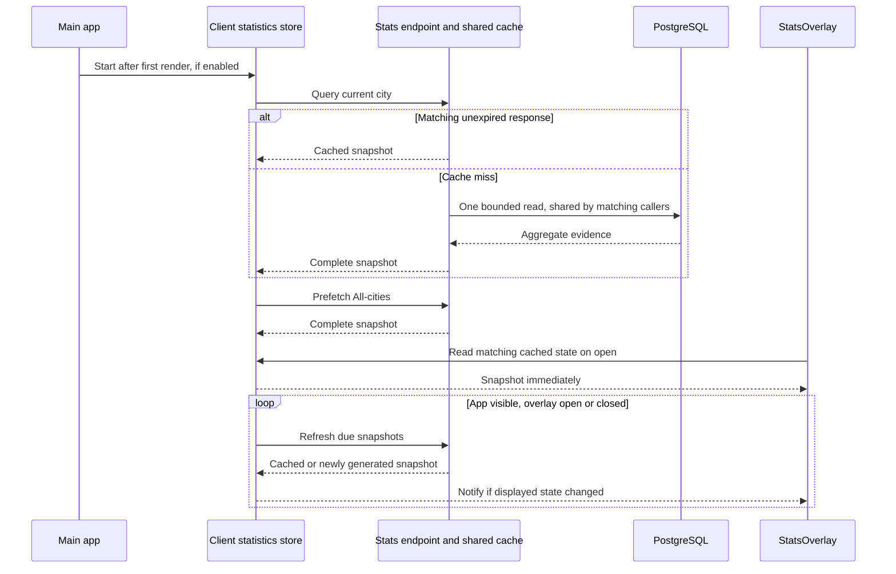

# Design Document: StatsOverlay Retrieval Optimization

**Status:** Proposed; design only.  
**Date:** 2026-10-30  
**Related:** [Statistics design](STATS_OVERLAY_DESIGN_DOCUMENT.md), [statistics API contract](../specs/058-stats-overlay/contracts/stats-overlay-api-v1.md), [reported vehicles plan](../specs/059-reported-vehicles/plan.md), [units design](STATS_UNIT_TOGGLE_DESIGN_DOCUMENT.md)

## Decision

Make statistics retrieval independent of opening the overlay. Start a shared client statistics store from the main app on initial UI load, prefetch the current city and All-cities snapshots, and refresh them while the app is visible, including when StatsOverlay is closed. Opening the overlay reads an already available snapshot immediately. Subsequent retrieval happens without replacing usable charts with a loading screen.

**Locked decision:** refresh on load and at fixed hourly boundaries, offset by the existing ingestion grace period (currently two minutes: `HH:02 UTC`). The interval is a backend setting, defaulting to 60 minutes; clients receive the next refresh time from the API. Changing to quarter-hour refreshes requires changing that setting to 15, with no client code change or rebuild. City-local day changes are additional refresh boundaries so daily headings remain correct.

Reuse the backend's existing snapshot cache and extend it to identical selected-route requests. Cache complete responses by normalized request, refresh window, and reporting-policy identity until the next boundary, with bounded memory and one shared fill for concurrent identical requests. Keep the existing endpoint, SQL aggregation, and metric definitions; extend the response with scheduling metadata.

There are two separate savings:

- A backend cache hit avoids the WebAPI-to-PostgreSQL read and response projection. It still requires a browser-to-WebAPI request and response serialization.
- A client cache hit avoids an HTTP request on overlay opening. Periodic background requests maintain that client snapshot.

The goal is to remove loading screens from ordinary warm opens and refreshes. A fresh browser session, an uncached route combination, or an outage can still require a loading or unavailable state. No data should be invented to conceal those cases.

## Current implementation

Repository paths in this document are relative to the repository root.

| Location | Current behavior | Design implication |
| --- | --- | --- |
| `src/Server/ChefKnifeStudios.TransitJazz.Server.WebAPI/Statistics/StatsOverlayService.cs` | Singleton service; caches successful unfiltered city/All responses for 60 seconds and coalesces matching in-flight reads. Selected-route requests bypass both. | Extend this cache; a second general cache layer is unnecessary. |
| `Statistics/StatsOverlayOptions.cs` in the same project | Defaults: 33 entries, 64 MiB estimated cached-object memory, four simultaneous reads, five-second read deadline, 8 MiB maximum JSON response. | Preserve existing total limits and admission controls. |
| `EndpointGroups/StatsEndpoints.cs` in the same project | Anonymous POST endpoint, validated bounded input, rate limiting, `Cache-Control: no-store`. | Application memory can retain responses without introducing HTTP/CDN caching. |
| `src/Server/ChefKnifeStudios.TransitJazz.Server.Data/Statistics/StatsOverlayQuery.cs` | One bounded aggregate read. Selected keys affect SQL output, including category/hour and coverage aggregates. | An unfiltered response cannot simply be filtered in the browser to reproduce a selected-route response. |
| `src/Client/ChefKnifeStudios.TransitJazz.Client.Shared/Components/Stats/StatsOverlay.razor` | Starts retrieval on open, polls every 60 seconds only while open and visible, and clears accepted data on close. | Move retrieval and retained data out of the dialog lifecycle. |
| `Components/Stats/StatsOverlayRequestPolicy.cs` in the same project | Existing request admission, selection matching, generations, backoff, and accepted presentation state. | Reuse these behaviors while separating app retrieval from dialog presentation. |
| `src/Client/ChefKnifeStudios.TransitJazz.Client.WebApp/App.razor` | Starts app-lifetime initialization from the component's DI scope. | Own startup and teardown of background statistics retrieval here. |
| `Services/JsInterop/PageVisibilityJsInterop.cs` in Client.Shared | Provides a shared visibility event; the map currently registers the browser listener. | Subscribe to the shared event without replacing the map's callback. |

“Every user receives the same data” applies to the same city/scope, normalized route set, reporting windows, and policy. Different route selections or city-local days have different answers. All-cities is its own consistent database snapshot; do not assemble it by joining independently cached city responses.

## End-to-end flow



## Backend design

### One adjustable schedule

Add `StatsOverlay.RefreshIntervalMinutes`, default **60**, to `StatsOverlayOptions` and WebAPI configuration. Reuse `IngestionGraceMinutes`, default **2**, as the boundary offset; do not duplicate this setting in the browser.

```json
{
  "StatsOverlay": {
    "RefreshIntervalMinutes": 60,
    "IngestionGraceMinutes": 2
  }
}
```

Validate that the interval is an integer from 1 through 60 that divides 60 evenly. Reject invalid values at startup rather than silently rounding. Existing ingestion-grace validation still applies. Examples with the two-minute offset:

| Interval setting | Scheduled boundaries in UTC |
| --- | --- |
| 60 (default) | `00:02`, `01:02`, `02:02`, ... |
| 30 | `00:02`, `00:32`, `01:02`, ... |
| 15 | `00:02`, `00:17`, `00:32`, `00:47`, ... |

Derive the schedule from a fixed UTC origin, not from each visitor's load time:

```text
windowStart = origin + floor((now - origin - grace) / interval) * interval + grace
scheduledNext = windowStart + interval
nextRefresh = min(scheduledNext, earliest future local-day end in the requested scope)
```

Use one server helper and `TimeProvider` for cache identity, expiry, and response metadata. Resolving a reporting plan still uses the real request time and the existing completed-hour policy. The interval controls rereading, not aggregation: setting 15 does not create quarter-hour statistics. Hourly reads deliberately defer visibility of late writes, quarantine changes, or corrections until the next boundary; this replaces the old <=60-second cache visibility policy.

Use the existing configuration/deployment path. A setting change takes effect when the WebAPI reloads/restarts with that configuration. Open clients learn the new interval on their next response or page reload; configuration changes do not push notifications to already open tabs. All replicas must receive the same settings.

### Cache identity and correctness

Retain `StatsOverlayService` as the cache owner. Normalize and validate every request before lookup. Build an unambiguous selection key from structured fields, rather than joining arbitrary route keys with a separator:

```text
selection = { scope, citySlug, ordinal-sorted distinct RouteJoinKeys }
identity  = hash(selection, refresh window start, interval, cutoff, per-city local dates/time zones,
                 metric/contract versions, configured-city/cadence policy,
                 ingestion grace, reported-vehicle settings/policy fingerprints)
```

The existing `BuildCacheKey` omits selected keys because filtered requests are currently uncached. Add them before allowing filtered requests into either the response cache or the in-flight dictionary. Both must use the same exact selection identity. Preserve case-sensitive `RouteJoinKey` semantics and normalization limits; do not use labels or static `RouteId` as identities.

Use a replaceable slot per normalized selection, with the full reporting identity stored in the entry. Changed cutoffs, local dates, definitions, or settings invalidate that entry immediately. Responses retain their original `GeneratedAtUtc`, `CutoffUtc`, selection, coverage, and previous-day evidence on every hit. A cache hit never rewrites the generation timestamp.

### Lifetime, concurrency, and failures

Replace the fixed `CacheSeconds` lifetime with absolute expiry at `nextRefresh`. A first fill at `10:59` expires at `11:02`, not one hour after generation. A hit never extends the boundary. Retire `CacheSeconds` from this feature's active policy and update its validation/tests; retaining a hidden 60-second expiry would defeat the hourly shared-cache decision. Preserve the current request-time fill policy: an unexpired hit returns immediately; a miss awaits a fill. No server polling service or stale-response fallback is required because the client performs those waits in the background.

Do not admit a fill that finishes after its boundary, or allow it to overwrite a response from a later window. If it reaches a waiting client, its original deadline must remain visible and trigger a follow-up request through normal admission. Clock changes must not turn an expired entry back into a valid one.

For both filtered and unfiltered requests:

1. Return a matching unexpired successful response, if admitted to cache.
2. Otherwise join an existing fill for the exact full identity.
3. Otherwise acquire one of the existing four read slots without an unbounded queue. If unavailable, return the existing `busy` problem.
4. Execute query, projection, and response-size validation under the existing five-second total deadline.
5. Cache the complete response if capacity permits, resolve waiters, and release all in-flight state and admission resources on success or failure.

A canceled HTTP waiter stops waiting without canceling a shared fill. Shared fills have their own deadline and must also stop on host shutdown. Guard against an older fill replacing a newer entry. Never hold the cache lock across an awaited operation.

Cache valid 200 responses even when their evidence is partial, pending, unavailable, or a known zero. Those are data states. Do not cache transport exceptions or HTTP problem responses as statistics. On expiry followed by a database failure, return the existing problem response; the client decides whether it has a last known snapshot to display.

### Bound selected-route cache growth

Route combinations are unbounded in principle. Retain the existing **33-entry / 64 MiB total cache caps** and conservative object-size admission estimate. Add a filtered-entry subset capped initially at **eight entries / 16 MiB**, counted inside those totals. These are proposed starting settings, subject to representative payload measurements.

Keep subset budgets internal: eight entries and 16 MiB, clamped to the existing configured total caps. Do not expose additional filtered-retention configuration. Preserve bounded exact-request coalescing.

- Expired entries are removed first.
- Filtered admission may evict the least recently used filtered entries, but cannot evict unfiltered city/All entries.
- Unfiltered admission may evict filtered entries first, then the oldest unfiltered entry as required by the existing bounds.
- If an entry cannot fit, return its valid response without retaining it. Concurrent identical requests still share its in-flight fill.
- At the maximum 33 unfiltered scopes, there may be no room for filtered entries. This is an accepted bounded fallback, not permission to grow the cache.

Include key/entry overhead in estimates. Maintain the four-fill limit even when callers continually supply different route sets. Cache capacity does not bound working memory from in-flight reads; measure both.

The cache is process-local. With multiple WebAPI replicas, each replica can perform its own fill and return a snapshot generated at a slightly different time. This feature promises equivalent semantics and bounded freshness, not fleet-wide byte-identical responses. Introduce a distributed cache only if deployment measurements establish that need.

### API compatibility

Keep the existing POST endpoint and request schema. Add `RefreshIntervalMinutes`, `RefreshWindowStartUtc`, and `NextRefreshAtUtc` to `StatsOverlayResponse`, serialized with the existing JSON naming convention. These describe the original snapshot's schedule and stay unchanged on cache hits. `NextRefreshAtUtc` is the effective boundary, including any earlier city-local day end. Keep rate limiting, safe problems, compression, response caps, and `Cache-Control: no-store`. The client store holds explicit in-memory application state; browser HTTP caching is not involved. No ETag, new bulk endpoint, Redis dependency, SignalR statistics push, schema migration, or worker change is required.

Make scheduling fields optional on deserialization for server-first compatibility. Before using them, validate the interval and timestamp ordering against the snapshot. If the fields are absent during a mixed-version rollout, do not guess an hourly deadline: use the legacy 60-second scheduling/expiry behavior and existing short retention limits until a schedule-aware response arrives. Invalid supplied metadata is `invalid_response`. New servers always provide the fields. Include serialization fixtures and update the contract's additive-field compatibility policy.

Update the feature-058 read/API contracts during implementation: change unfiltered-only cache/coalescing, fixed 60-second TTL/visibility claims, and scheduling metadata. The existing “no silent expired backend fallback” rule remains in force.

## Client design

### App-owned retrieval and retained state

Add a `StatsSnapshotStore` service in Client.Shared and register one instance per WASM app in WebApp `Program.cs`. Keep `StatsEndpointsService` as the transport boundary. The store owns requests, cached DTOs, refresh scheduling, retry state, and notifications; it does not own chart models or render UI.

Give `App.razor` responsibility for starting the store idempotently after the first interactive render and stopping it on disposal. Resolve the initial city with the existing navigation helper. Begin the current-city request immediately, then prefetch All-cities at lower priority. Do not await either request as a condition of rendering the app, connecting transit updates, or enabling audio.

Using the first render also permits the initial visibility query. Blazor documents this lifecycle boundary for browser interop in its [component lifecycle guidance](https://learn.microsoft.com/en-us/aspnet/core/blazor/components/lifecycle?view=aspnetcore-10.0). Observe all background task failures and cancel/await owned work during teardown.

When the StatsOverlay feature flag is false, create no polling work and issue no statistics requests. If the server reports `stats_disabled`, stop automatic attempts for this app session until feature configuration is explicitly re-evaluated or the page reloads.

The store exposes, conceptually:

```text
StartAsync(currentCity, appLifetimeToken)       // idempotent; does not wait for warmup
SetCurrentCity(city)
SetOverlaySelection(selection or closed)
TryGet(selection) -> immutable state
EnsureRequestedAsync(selection)                // joins matching work; respects backoff
StateChanged(selection)
StopAsync()
```

State includes the exact normalized selection, accepted snapshot, original generation time, returned refresh window/next boundary/interval, local receipt time, refresh-in-progress status, last error, and next allowed retry time. A completed request is not itself evidence that the data was newly generated.

Retain at most three snapshot slots: the current unfiltered city, All-cities, and the most recently requested filtered selection. Start with a 32 MiB combined estimated retained-object budget, measured using the existing conservative serialized-size weighting at admission. Serialize at most once for this estimate; measure that CPU/allocation cost on mobile. This budget excludes transient transport/projection memory, which must be measured separately.

Prefer current city, then All, then filtered retention when capacity is tight. Retain an overdue snapshot for at most two configured intervals after its original `NextRefreshAtUtc` (two hours after the missed boundary by default), always explicitly marked stale. Derive this limit from the response's interval rather than hardcoding minutes; the retention multiplier is a client policy and needs no additional refresh setting. An otherwise valid response too large to retain may still serve its active consumer; record the missed retention opportunity. The loading-free target applies to admitted snapshots. Validate that representative city and All snapshots fit together before release.

Evaluate age on every read/open and scheduled wakeup, including during backoff, and notify an open overlay when its state becomes stale or expires. Expiry must not depend on a successful replacement response.

On city navigation, drop the prior city's retained slots, cancel or invalidate its pending work, and request the new city immediately. Retain the independent All snapshot. Keep the existing behavior that reopening the overlay starts in current-city scope with no selected routes; data lifetime changes independently of that UI selection behavior.

### One scheduler and one request owner

Move polling out of `StatsOverlay.razor`; do not leave a second timer there. One app scheduler handles startup, periodic refresh, selection changes, explicit retry, and visibility restoration.

| App/UI condition | Retrieval behavior |
| --- | --- |
| First visible UI load | Current city immediately; All next. |
| App visible, overlay closed | Refresh current city and All once per returned boundary, hourly by default, with a small independent 0–5 second jitter. |
| Overlay open in default city or All scope | Consume the same baseline polling; opening does not force an extra request when usable data exists. |
| Overlay open with selected routes | Fetch a newly requested selection after the existing 200 ms debounce; refresh that exact selection at its returned boundaries. Baseline boundary refreshes continue. |
| Overlay closes | Stop automatic refresh of a filtered selection; retain its latest snapshot within the retention bounds. Baseline polling continues. |
| Browser tab hidden | Pause scheduling, cancel app-owned waiting requests, and retain snapshots. Closing the overlay does not count as hiding the tab. |
| Browser tab visible again | Refresh overdue data once, with displayed selection first. Resume ordinary scheduling; do not replay missed ticks. |
| City changes | Invalidate prior-city work and start the new city warmup. |
| App stops or feature becomes disabled | Cancel work, stop the scheduler, and unsubscribe handlers. |

Schedule one cancellable delay to the earliest required boundary rather than a recurring minute timer. After waking, re-evaluate due state and apply 0–5 seconds of positive jitter; never request before the server boundary. Recompute from the returned timestamps after every acceptance, resume, or schedule change so delays do not drift by an hour from page load. If a response already belongs to the current window, count it as satisfying that window rather than fetching it again for another trigger. A local-day presentation transition also gets a scheduled wakeup even if normal network work is backing off.

Allow at most one HTTP request at a time per app. Coalesce duplicate exact selections. If several selections are due, prioritize the displayed selection, then current city, then All. Keep only the latest desired filtered selection, not a queue of every click. Alternate due baseline requests so repeated UI activity cannot starve them indefinitely. A due time reached while a request is active produces one pending refresh, not accumulated ticks. Boundary jitter spreads browser requests only over a few seconds; backend coalescing and cold-read admission still protect the boundary burst.

Subscribe to `IPageVisibilityJsInterop.VisibilityChanged` and read its initial state. Do not call `AddVisibilityChangeListenerAsync` a second time: the existing map owns that listener and its callback. Verify initial-load and navigation ordering with the map. If listener ownership ever moves to App, migrate the existing map registration at the same time rather than registering competing listeners.

Reuse 60-second initial exponential backoff, capped at five minutes, and honor any longer `Retry-After`. Keep retry state per retained selection so one failed filtered request does not suppress healthy baseline retrieval. A 429 also imposes an endpoint-wide cooldown across the scheduler. Opening/closing, route changes, and manual retry cannot clear an applicable cooldown. A successful HTTP response resets backoff, but only acceptance of a valid snapshot clears its error state.

### Response acceptance and races

Reuse `StatsOverlayResponseSelection.Matches` and the existing generation checks. Validate contract/metric versions, required response structure, exact selection, and usable timestamps before publishing state. Treat accepted DTOs and their nested collections as immutable by convention; replace the entire entry atomically.

- Never let a late city-A response become the displayed city-B response.
- Never render unfiltered totals under selected-route controls, or a prior route set as the newly requested one.
- Reject older generations for the same entry. Ignore a response with an older `GeneratedAtUtc` than its accepted snapshot, including when replicas differ.
- An unchanged cached response can update successful-contact state without replacing chart presentation or resetting snapshot age.
- Store acceptance and dialog generation are separate: closing the dialog does not prevent a valid baseline response from updating app state.
- HTTP success with an invalid response keeps the last valid snapshot and records `invalid_response`; it does not publish partially validated fields.

## Overlay behavior and freshness

Refactor StatsOverlay to read the store synchronously on opening, subscribe to changes, and request missing/due selections through the store. Retain `StatsOverlayProjection`, theme changes, metadata enrichment, accessible tables, route controls, focus behavior, and immediate dismissal. Build chart presentation only for an open overlay and only when its accepted snapshot or presentation inputs change. Background requests must not construct hidden chart instances or repeatedly rerender the main app.

The planned units preference remains presentation-only. Reproject the cached metric DTO when units or theme change; neither affects request/cache identity or triggers HTTP.

| Matching client data | What the visitor sees |
| --- | --- |
| Valid snapshot, next refresh boundary not yet due, no refresh error | Charts immediately, with an unobtrusive “Updated …” timestamp. A snapshot generated 50 minutes ago is expected under the hourly policy. No full loading state. |
| Same selection refreshing | Keep charts, tables, and focus. A quiet updating indication is optional. |
| Refresh failed, or replacement still missing 30 seconds after the next boundary, within the stale-retention limit | Keep charts with an explicit last-updated/stale notice and safe error/retry text. Do not silently label old evidence current. The 30-second headroom covers jitter and ordinary sequential requests; it does not defer a known error. |
| No matching snapshot and request active | Show the existing loading state within the overlay. Prefetch makes this uncommon for default views. |
| No matching snapshot and request failed, or retained snapshot expired | Show unavailable/error state with retry subject to cooldown. |
| First request for a new route set | Use a matching retained snapshot if available; otherwise show selection loading. Do not relabel the previous selection's numbers. |

Staleness is independent of evidence coverage: an up-to-date response can legitimately say partial or unavailable. Failure to refresh does not turn an observed zero into missing evidence, and missing evidence never becomes zero.

Use `GeneratedAtUtc` for the displayed snapshot age, `CutoffUtc` for the completed-hour boundary, and `NextRefreshAtUtc` for refresh/stale decisions. Track receipt separately; receiving the same server-cached snapshot does not make it new or extend its scheduled boundary. Use elapsed time since receipt for ongoing deadline calculations so browser clock changes do not extend retention. Validate timestamps with clock-skew tolerance and test skewed clocks; invalid/future metadata must not produce indefinitely fresh state.

Use the returned `LocalDayStartUtc`/`LocalDayEndUtc` to detect whether any represented city's day has ended; no new timezone calculation is needed. At a day boundary, an old snapshot may remain visible only as explicitly dated historical evidence, with daily headings taken from that snapshot and a prominent stale notice. If that presentation is unavailable, remove the old daily presentation until a replacement arrives. Never show yesterday's totals under today's heading, and never relabel an old cached response as the API's authoritative `PreviousDay` fallback.

Use existing resource-backed English copy and light/dark styling for timestamps, stale notices, and errors. Announce failures and recovery politely; do not announce every background tick or steal focus. Closing the dialog unsubscribes presentation listeners without clearing store state.

## Freshness and load budgets

Proposed initial values:

| Setting | Value |
| --- | --- |
| Server/client refresh schedule | `RefreshIntervalMinutes = 60`; backend is the source of truth |
| Boundary offset | Existing `IngestionGraceMinutes = 2`; default refresh at `HH:02 UTC` |
| Server absolute cache expiry | Next scheduled boundary or earlier represented city-local day end |
| Client boundary jitter | 0–5 seconds after the returned boundary |
| Overdue notice headroom | 30 seconds after next boundary; known failures appear immediately |
| Maximum retained/displayable overdue fallback | Two configured intervals after original next boundary; two hours by default |
| Concurrent server database fills | Four per replica, unchanged |
| Concurrent browser statistics requests | One per app |
| Server total cache | 33 entries / 64 MiB estimated objects, unchanged |
| Filtered subset of server cache | Eight entries / 16 MiB inside total limits |
| Retained client snapshots | Three entries / 32 MiB estimated objects |

The hourly interval is the agreed default; memory limits and timing targets still require measurement. A cached response may be almost one hour old before the boundary, but the completed-hour reporting window normally advances only once an hour. Corrections within that window may remain unseen until the next refresh. Quarter-hour configuration reduces correction lag without changing completed-hour arithmetic. Data remains labeled with its actual generation/cutoff times; hourly scheduling does not claim continuous live statistics. The five-second server deadline excludes browser/network delays, and hidden tabs/outages have no finite refresh guarantee.

For `U` visible app instances and an interval of `R` seconds, warming two baseline views costs approximately `2U/R` HTTP requests per second averaged across the interval; an open filtered view adds approximately `U_filtered/R`. At hourly intervals, 500 continuously visible apps generate about 1,000 baseline responses/hour (0.28 requests/second on average), versus 60,000/hour under minute polling: about a 98% reduction in steady-state requests. Initial loads, navigation, new selections, retries, and extra local-day boundaries are additional. Requests concentrate near boundaries, so the average is not a peak-load estimate. Each response still consumes serialization CPU and egress even on a backend cache hit.

For an admitted hot selection, database fills are approximately bounded by one per refresh window per replica, provided identity and capacity are stable. Evictions, policy/cutoff/day transitions, failed fills, and different route combinations can increase that rate. Do not claim one global database read per hour. All warming is deliberately proactive; verify the request/egress increase against the app's operating budget.

Keep existing cold/prepared query performance goals and the five-second whole-read deadline. Add these acceptance targets:

- Every warm open of an admitted matching baseline snapshot renders without a full loader and without issuing an open-triggered HTTP request.
- Matching parallel server requests produce one database call, including filtered requests.
- Warm backend hits produce zero database calls; target endpoint p95 <=250 ms under matched representative load.
- Target warm default overlay data binding within 100 ms on the supported device profile; measure chart drawing separately.
- Baseline prefetch does not measurably regress map readiness or first audio against a recorded comparison, and cached baseline views fit their proposed client budget on representative mobile devices.

## Development sequence

1. **Capture a baseline.** Record current cache hits/misses, database-call counts, response sizes, snapshot ages, warm/cold overlay-open latency, map readiness, first audio, and representative browser memory. Include app sessions that never open statistics.
2. **Extend server caching and scheduling.** Add the adjustable hourly policy, absolute boundary expiry, response scheduling metadata, exact normalized filtered identities, shared fills, filtered subset limits/eviction, shutdown cancellation, and cache telemetry. Retire `CacheSeconds` from this policy; update options validation, shared DTO fixtures, and the feature-058 contracts. Keep aggregation unchanged.
3. **Build the client store.** Move transport, admission, retained snapshots, retry, selection matching, and scheduling into app-owned state. Add bounded slots and deterministic time/delay seams. Keep presentation in the dialog.
4. **Wire app lifetime.** Register/start/stop from WebApp/App, handle initial city and visibility, and prefetch city then All without blocking startup. Verify the shared map visibility listener arrangement.
5. **Refactor the overlay.** Replace its timer and direct endpoint calls with store reads/notifications. Stop clearing retained data on close. Preserve debounce, response validation, projection, accessibility, resources, and settings behavior.
6. **Validate and release gradually.** Run correctness and matched-load checks, enable app prefetch for a small rollout, compare cost and user latency, then expand.

Likely implementation files are `StatsOverlayService.cs`, `StatsOverlayOptions.cs`, WebAPI `Program.cs`/`appsettings.json`, `StatsOverlayTelemetry.cs`, shared `Stats/StatsOverlayResponse.cs`, new Client.Shared `Services/StatsSnapshotStore.cs`, `StatsOverlay.razor[.css]`, `StatsOverlayRequestPolicy.cs`, WebApp `App.razor`/`Program.cs`, and `RouteFilterResources.resx`. `StatsEndpointsService` remains transport-only. No SQL query changes are planned.

## Verification plan

Extend the existing WebAPI and Client.Shared xUnit suites using deterministic clocks and controllable requests. These checks are implementation work; no runtime result is claimed by this document.

**Server:** normalized route reordering/duplicates share a cache entry; case-distinct routes, cities, scopes, and different route sets do not. Concurrent identical filtered reads share one fill; distinct cold selections still obey four-read admission. Verify hourly defaults and 15-minute configuration, invalid intervals, grace offsets, exact-before/at/after-boundary behavior, earlier local-day expiry including DST, original scheduling metadata on cache hits, mixed-version serialization, and configuration invalidation. Check waiter cancellation, deadline/shutdown cleanup, failed-fill removal, fills crossing a boundary, no expiry extension on hit, stale-fill replacement protection, and original timestamps. Exercise entry/byte/subset caps and filtered eviction priority. Retain SQL arithmetic fixtures, reported-vehicle isolation, no-sensitive-field checks, and one-statement All consistency.

**Client:** startup warms city then All with the feature enabled and makes no requests when disabled. No interval refresh occurs between returned boundaries; a load at `10:59` refreshes at `11:02`, not `11:59`. Verify 15-minute configuration without client rebuild, no early requests from jitter, one refresh after crossing multiple hidden-tab boundaries, mixed-version fallback, and rescheduling after changed metadata. Closed-overlay refreshes continue at boundaries, hidden-tab refreshes stop, and repeated starts/opens create no extra loops. Check one-request admission, coalesced open during prefetch, latest-selection debounce, fair baseline scheduling, city changes during responses, disposal, endpoint-wide 429 cooldown, per-selection failure backoff, and `Retry-After`. Unchanged or older responses must not reset age/deadlines; clock changes must not extend retention. Verify byte/slot eviction, interval-relative stale expiry, overdue notices, and invalid-response preservation.

**UI/browser:** open after warmup without a loader or extra HTTP call; close/reopen repeatedly; switch city/All and rapid route selections; trigger an error after a success; go offline, hide/resume, and cross local midnight. Confirm exact selection labels, explicitly dated stale data, current/previous-day behavior, independent coverage states, stable focus/tables, light/dark styling, and unchanged audio/map behavior. Theme/units changes perform no requests. Test cold-load opening honestly rather than excluding it from recorded results.

**Matched load:** compare cold and hot same-scope bursts, diverse route combinations, cache pressure, multiple replicas, shared-IP rate limiting, and 500 visible apps with both closed and open overlays. Explicitly exercise synchronized hourly-boundary traffic; a low hourly average does not establish safe burst capacity. Measure HTTP volume, compressed egress, serialization CPU, database reads, actual heap, snapshot age, overdue-boundary lag, loader frequency, and startup impact. A cache hit ratio alone does not establish success.

## Observability and rollout

Extend the existing Stats telemetry with bounded labels for scope (`city`/`all`), selection kind (`filtered`/`unfiltered`), and result (`hit`, `miss`, `coalesced`, eviction, admission skipped). Report cached entries/estimated bytes and database-fill duration. Do not label metrics with route sets, cache hashes, raw keys, or visitor IDs.

Follow the repository's existing client diagnostics convention for prefetch completion, warm-open success, loader display, snapshot age on open, and refresh failures. Prefer aggregate counters/timings; do not add a new telemetry platform for this feature.

The existing statistics feature gate controls startup preparation, retained-overlay retrieval and visible baseline refresh together. RefreshIntervalMinutes (default 60) is the only configuration added by this feature; there is no separate preparation flag or configurable filtered-retention budget. Deploy the schedule-aware server before the client. Old clients may keep minute polling until their next page reload; measure this overlap. With Stats disabled entirely, no statistics work runs.

Rollback can disable background prefetch to reduce HTTP/egress, and set filtered server admission to zero to restore unfiltered-only caching. Retain the original metric endpoint and database behavior throughout. Update deployment settings/contracts and record actual validation evidence before broad enablement; this design performs no deployment or commit.

## Deferred work

Distributed caching, serialized-response caching, conditional GET/ETag support, cross-tab coordination, persistent browser statistics, server-driven updates, and a new reusable route/hour dataset could offer further savings. They introduce different contracts and are unnecessary for the first delivery. Revisit them only when the measured bottleneck is fleet-wide fills, serialization/egress, duplicate tabs, or first-use route-selection latency.

The choice to retain an explicitly bounded app cache follows the operational guidance that caches need expiration, size limits, and a working miss path; see Microsoft's [ASP.NET Core memory-cache guidance](https://learn.microsoft.com/en-us/aspnet/core/performance/caching/memory?view=aspnetcore-10.0). The implementation can keep the existing dedicated dictionary cache and its controls.
