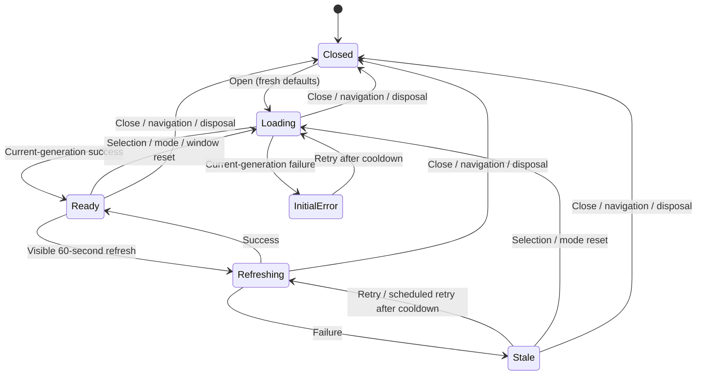

# Stats Overlay UI, Chart and Browser Lifecycle v1

This contract covers Stats presentation, local Stats open/close state and reusable chart/route behavior. The [API](stats-overlay-api-v1.md) and [read contract](stats-overlay-read-v1.md) own evidence/statistical formulas. These interfaces expose app-owned models, not Pax/EF types or arbitrary package options.

## Component ownership

| Owner | Inputs/actions | Responsibilities |
| --- | --- | --- |
| TransitMap | Current canonical city, audio lock, page visibility, shared launcher flag | Mounts welcome/map controls; keeps map/SignalR/audio instance alive; forwards visibility |
| MainLayout/InfoFab/settings | Existing content/theme/settings owner | Keeps existing independent Info controls and settings behavior |
| StatsOverlay | Current city, parent hidden flag, open/close callbacks | Local session/mode/selection/request generation, refresh/cooldown, accepted snapshot, atomic presentation and cleanup |
| StatsEndpointsService | Valid typed request/cancellation | Transport success/status/retry/safe-code only |
| StatsOverlayProjection | DTO + current culture/theme | Aligns server values, formats labels/help/tables and finite chart inputs; performs no metric aggregation |
| RouteFilterList | Immutable list items, ordinal selected keys, category order, theme, toggle/select/clear/hover callbacks | Shared MatBlazor pills, category labels/select/clear controls and bulk actions matching map RouteFilters; keyboard/accessibility and visible historical notes; no live-view-model injection/subscription |
| Existing RouteFilters | Existing map view model/live state | Thin map adapter preserving map/audio actions, sorting and emphasis |
| StatsFab | Map click or existing app event from welcome | Owns one local visibility flag and forwards IsOpen/OnClose to StatsOverlay |

Current-city mode always means the map's current city. All has no route selection/selector or city drill-down. Bubble/line inspection only shows data. Route selection filters all four panels/both distance cards and never changes map selection, route emphasis or music scope. Historical options remain unfiltered; selected absent keys remain explainable.

## Session/request state machine

Loading/error states carry current normalized scope and finite safe message codes. Same-scope refresh retains Ready chart/table evidence with a separate refreshing status; stale copy retains actual generatedAtUtc. Scope changes discard old-scope display so it cannot appear beneath new labels. A response can publish only when session/generation/normalized request match and the overlay is alive; cancellation alone is insufficient. Models, date/windows, metrics, coverage and status commit together.

Fetch on open, then every 60 seconds while open/visible; at most one active request/session. Selection debounce 200 ms. Hidden cancels/suspends; visible refreshes promptly subject to cooldown and resumes one schedule. Close/dispose invalidates generation, cancels request/timer, unsubscribes and prevents any further writes. Parent visibility is reused rather than overwriting the single-callback JS singleton. Theme reproject locally without reads.

Cooldown starts 60 seconds after 429/503/failure, grows to at most five minutes during continued failure and honors longer server Retry-After; success resets it. Explicit retry, newer selections and visibility restoration respect it. Initial failure is error; retained same-scope evidence is stale. A safe response with pending/unavailable history is data state, not transport failure.

## Silent access and unchanged audio

One client `FeatureFlags.StatsOverlay` exposes both welcome and map launchers. Welcome secondary Stats button has a separate ID/callback from the native-gesture-attached audio-enable button. Stats never invokes OnEnable, changes `_audioUnlocked`, or requires live geometry/feed/map readiness.

Welcome becomes inert while Stats is focused; closing returns to welcome and the Stats invoker with audio locked. Existing playback continues while Stats is open. Stats has no audio controls, preference synchronization or synth dependency. AudioFAB and settings retain their original behavior; Stats open/close does not change or restore audio preferences.

Preserve the common transit-synth.js module identity shared with crossing-dispatcher; do not create a separate cache-busted audio module/import or listener-specific statistic.

## Local open/close state

StatsFab owns a boolean open flag. The map launcher sets it directly; the welcome launcher publishes Stats through the existing application event channel. StatsOverlay receives IsOpen and an OnClose callback. Close/Escape clears the flag and cancels session work; reopening starts default city scope and selection. Info keeps its existing independent open/close controls. No URL/history entry, ownership token, Back/Forward interception, surface switching, reload marker or shared navigation service is used.

## Full-screen shell and native focus

Stats uses fixed inset 0/100dvh, one content scroll owner and no map backdrop. Desktop Routes above two-by-two cards; narrow reading order pie/totals/bubbles/timeline, sticky scope/close controls with safe-area padding. Minimum card widths/long text cannot create horizontal page scroll; tables can scroll inside their container. Reserve chart height.

Stats uses a labeled native dialog. Native showModal/close supplies focus entry/containment, background inertness and restoration to the available invoker. A small stats-dialog.js helper applies visibility; there is no custom modal lifecycle or settings replacement. Essential controls remain visible/reachable.

Entrance 100 ms, close immediate, brief reversible hover pulse; reduced motion suppresses entrance/pulse. Selected state uses text/aria-pressed or equivalent, keyboard focus and color. Every button/action/help has full localized accessible name; click/focus/touch exposes help. Coverage/freshness/partial warnings are persistent text.

## Reusable chart contract

| Element | Required behavior |
| --- | --- |
| ChartFrame | MatPaper/figure title, definition, period, coverage/status, canvas/table slots; no Stats data fetching/formulas |
| ChartCanvasHost | One mutable Pax config/canvas, successful-init gate/latest pending input, coordinated no-animation updates/options/data, bounded init failure, deliberate kind remount, disposal/generation checks |
| ChartPresentation | Existing theme palettes, keyed category/city styles and finite formatting policy; no index-based color assignment |
| PieChart | Server km/share per stable category; toggles disabled; zero total empty explanation and table; known partial slices qualified |
| BubbleChart | Finite x/y/mean per entity, sqrt area scale and minimum key, exact tooltip/table, no drill-down/jitter; coincident/omitted points retained in table |
| SeriesChart | Label or numeric-X model, aligned null values/details, bounded stack mode and visibility parameter; no arbitrary package option escape hatch |

Pin Pax 0.9.1 with local Chart.js 4.5.1 and compatible 10.0.9 client references. No runtime CDN, datalabels plugin/date adapter. Trusted local named formatters may handle server-derived tooltip/tick metadata as data; never evaluate API code. Initialization success-only package events require bounded host unavailable notice while loaded text/table evidence stays Ready.

Bubble r = `24*sqrt(mean/max)` for positive quantities, minimum 3 px; marker-size key explains minimum and within-snapshot comparison. Draw larger first; zero X/Y is valid with positive mean; undefined X/Y/nonpositive area omitted visually with table reason. Axes start zero/pad edges; no coordinate shifts.

City category timeline stacks raw cumulative contribution exactly once in stable category order, with no native category toggles. Tooltip/table shows category raw amount, combined total and hourly/cumulative known values. Gap nulls whole plot stack but not known prefixes. Straight segments, tension 0, spanGaps false. All city lines unstacked/unfilled, zero baseline. Numeric X is actual elapsed hours, 23/25-day extents; city local-clock/offset labels and All explicit hours-since-each-midnight axis. Future values remain null.

## All timeline visibility

AllowSeriesVisibilityToggle only for All city lines. Native legend default behavior remains authoritative. Use Pax native-delegating Legend.OnClickEvent then query IsDatasetVisible with current stable-key/index mapping; keyboard/Show all use SetDatasetVisibility. Keep one shared state with visible count/table hidden labels. Native-preservation source inference must be proven in browser; add a bounded internal adapter only if needed.

Visibility affects the timeline canvas only. API scope/pie/cards/bubbles/known endpoint reconciliation remain All. Preserve by city key across refresh/reorder/theme, new cities visible/removed discarded. Reset on mode exit/close; no settings persistence. Hide-all has its own localized explanation and Show all, distinct from no-data. Inspecting lines/bubbles never navigates or changes map/audio.

## Accessible evidence, culture and failure

Canvas under aria-hidden; expandable native details table with caption/headers/units from the same model. Pie table keeps zero/unavailable categories; bubble table all entities/omissions/coincident points; timeline table actual UTC interval/local date/time/offset, hourly/cumulative known amount/status and hidden line state. Small polite live region announces refresh/errors/coverage rather than whole tables.

Use only the neutral RouteFilterResources.resx with English copy. Set English culture at startup and keep document lang="en". No language controls, persisted preference, switching events or Spanish satellite are shipped. Preserve existing audio/theme preferences. Numbers use English formatting; date/clock follows the city zone. Both themes have readable palette contrast and non-color labels/styles. Failed chart initialization/asset leaves cards, definitions, summaries and tables useful with localized chart-unavailable explanation.

Required browser evidence: two launchers/silent welcome flow, unchanged audio playback/preferences, local Stats Close/Escape/reopen/reload controls, unchanged URL and native focus/inertness, four charts/native visibility/rapid initialization/close/reopen/blocked asset, route grid+bubbles at 4,096/overlaps, touch/keyboard/screen reader, 320px/200% zoom, English long text, both themes and reduced motion. Runtime browser checks are implementation gates.
