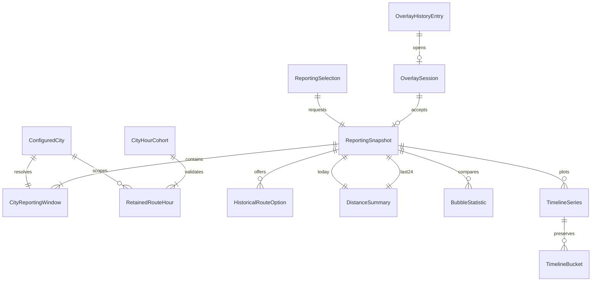

# Stats Overlay Data Model

**Contract**: `stats-overlay-v1`  
**Observation definition**: `observed-city-route-hour-statistics-v1`  
**Storage**: Existing route-hour table only. The following reporting/display/session records are proposed additions, not new persistent tables.

## 1. Relationships

## 2. Existing retained evidence

`CityRouteHourStatistic` is Data-owned and already mapped to `public.city_route_hour_statistics`. Its primary identity is `(CitySlug, RouteJoinKey, HourStartUtc)`; route keys use PostgreSQL C collation and ordinal .NET equality. `StaticRouteId`, `RouteShortName`, historical category and route-specific fingerprint are metadata, not interchangeable identities.

| Field group | Existing fields used by Stats | Purpose |
| --- | --- | --- |
| Identity/window | CitySlug, RouteJoinKey, HourStartUtc | One canonical route in one UTC hour |
| Historical metadata | RouteShortName, StaticRouteId, Category, RouteCatalogFingerprint, PersistedAtUtc | Retained labels/category, deterministic option metadata and catalog notice |
| Compatibility | DefinitionVersion, HealthyCadenceLimitSeconds | Exact supported definition and per-city configured cadence |
| Cohort integrity | CaptureRunId, CollectionStatus, HasConflict, CatalogChanged, IncompleteReasons | Complete coherent evidence; internal identifiers never reach browser |
| Sample/boundary evidence | ObservedCycleCount, ValidActiveSampleCount, ValidPublishCycleCount, FailedCycleCount, FirstCycleUtc, LastCycleUtc, MaxObservationGapSeconds, StartBoundaryOk, EndBoundaryOk | Existing Complete invariants and common cohort samples |
| Movement/population | DistanceMetersSum, DistinctActiveVehicleCount, ActiveVehicleCountSum | Distance, route-vehicle-hour denominator and activity samples |

Whole-cohort validation considers every retained row before filtering. One conflict/ineligible/inconsistent row excludes the city/hour. Different routes' fingerprints need not match. The writer guarantees atomic retained membership; Stats adds no manifest/repair path.

## 3. Reporting request and windows

| Entity | Fields | Validation/relationships |
| --- | --- | --- |
| ReportingSelection | scope (`city`/`all`), nullable citySlug, routeJoinKeys | City requires configured canonical identity; All requires null city/empty routes. Distinct ordinal nonblank <=512-UTF-8-byte keys; <=4,096. Empty city selection is whole city, not empty evidence. |
| ConfiguredCityPolicy (internal) | slug, displayNameKey, IANA zone, supported cadence, current capture mode, city-set/policy version | Configured public membership, <=32 cities; validate zones/cadence before exposure. Current mode explains availability but does not suppress retained data. |
| CityReportingWindow | citySlug, displayNameKey, timeZone, localDate, localDayStartUtc/endUtc, requestedTodayStartUtc/endUtc, nullable eligibleTodayStartUtc/endUtc, last24StartUtc/endUtc, todayCoverage, last24Coverage | As-of selects local date; actual midnights preserve DST. Cutoff/window bounds are half-open; empty today has no eligible interval. |
| ExpectedHour (internal) | citySlug, hourStartUtc/endUtc, window membership, full containment, boundary/current/future classification | Enumerated before reading rows; fully contained completed hours alone enter measures. |

One snapshot contains one generatedAtUtc/cutoff and all city windows. Numeric X uses elapsed actual hours since each midnight; local interval identity retains date/offset even when clock labels repeat.

## 4. Coverage and historical route options

| Entity | Fields |
| --- | --- |
| Coverage | state; expectedClosedHours; contributingHours; fullyCoveredHours; nullable expectedRouteHours; availableRouteHours; selectedRouteCoverage; exclusions; boundaryExcludedHours; nullable first/lastContributingUtc; pendingThroughUtc; historicalMembershipUnknown |
| RouteCoverage | citySlug, routeJoinKey, expectedHours, availableHours, reasons |
| CoverageExclusion | stable reason code, excluded city/hour count (not route rows) |
| HistoricalRouteOption | citySlug, routeJoinKey, historical label, category, metadataTimestampUtc, categoryChanged, availabilityReason |

Coverage states are `complete`, `partial`, `unavailable`, `pending`. Codes are finite and localized on the client. No eligible contributing amount means null; Complete inactive evidence means numeric zero. An empty expected-today grid is pending rather than failed history. Boundary exclusions remain separate from missing complete hours.

Selected route expectedRouteHours = selected key count × expected completed hours. Available route-hours sum each route's own contributing hours. FullyCoveredHours require every selected key available. Unfiltered expectedRouteHours remains null if a missing cohort prevents knowing historical population; never derive it from today's catalog. All reports coverage for every city plus city/hour/city counts, without one misleading aggregate percent.

Options are the union of retained keys within today/last24, regardless of eligibility/activity, bounded at 4,096 even on filtered requests. Latest hour wins metadata; deterministic tie handling uses persisted timestamp without discarding category-change evidence. An absent selected key stays in local selection with its key fallback and `unknown_route`; it is not silently inserted into retained metadata or removed. Category amounts use historical row categories even if the option's latest category differs.

## 5. Immutable reporting snapshot

| Entity | Fields/meaning |
| --- | --- |
| ReportingSnapshot | contractVersion, metricDefinitionVersion, generatedAtUtc, cutoffUtc, normalized selection, cities, unfiltered routeOptions, todayDistance, last24Distance, categoryShares, bubbles, timeline, warning codes |
| DistanceSummary | window (`today`/`last24CompletedHours`), nullable kilometers, coverage, contributing/expectedCityHours, contributing/expectedCityCount |
| CategoryShare | categoryKey, nullable kilometers, nullable percent, coverage reference |
| BubbleStatistic | entityKey/kind, citySlug, nullable routeJoinKey, label, nullable categoryKey, distanceKilometers, routeVehicleHours, activeClockHours, activitySampleNumerator/sampleDenominator, nullable x/y/meanActiveVehicles, coverage, omissionReason |
| Timeline | seriesKind (`category`/`city`), stacked, elapsedHourExtent, ordered series |
| TimelineSeries | stable key, city/category identity, window reference, ordered buckets |
| TimelineBucket | UTC start/end, local date/end label/offset, elapsedHours, nullable hourlyKnownKilometers, nullable cumulativeObservedKilometers, independently nullable plotCumulativeKilometers, selected available/expected route counts, coverage state/reason |

Decimal/numeric math occurs before display rounding. Bubble ratios use matching contributing rows, and zero divisors produce null. City activity sample denominator/active clock hours count once per city/hour. Server prefix arithmetic retains known contributions inside visual gaps; all category plot values null together when the bucket is not fully covered. Future buckets have no measured values. Origin marker zero at midnight does not assert health.

JSON explicitly writes nullable metric fields despite current global omit-null settings. C# records contain no EF/Pax type or individual vehicle/trip/listener/capture identifiers. Public success is structurally complete and never truncated. All output includes no route-option/raw route-hour cube; internal per-route work still validates capacity/cohort integrity.

## 6. Chart presentation models

| Model | Finite app-owned fields | Rules |
| --- | --- | --- |
| Pie model | stable slice key/label, nullable km/authoritative percent, period/unit/coverage | Unique keys, finite nonnegative amounts; all-zero explanatory visual with zero table rows |
| Bubble model | point key/label, nullable x/y, mean quantity, coverage/details, axis units | Undefined coordinate or nonpositive area omits canvas point but retains table; zero-coordinate active point is valid; radius policy is visual only |
| Series model | categorical labels or ordered numeric X/labels, stable series IDs, aligned nullable plot values, per-point known details, stack mode | Strict increasing finite X/aligned lengths; raw category cumulative once-only stack; city lines unstacked/unfilled; spanGaps false |
| AllTimelineVisibility | current series city keys and visible/hidden state | Presentation only; follows key through refresh/reorder, new keys visible, removed keys dropped, reset on mode exit/close; no persisted setting |

ChartFrame owns caption/status/table structure, renderers own typed projection, and ChartCanvasHost owns config initialization/update/disposal. Every table and canvas use the same model; no client metric formula registry.

## 7. Overlay and navigation state

`OverlaySession` is local to each Stats mount: session ID, generation, map current city, mode, ordinal route selection, parent visibility, cancellation/timer, accepted snapshot, load/refresh/stale/error state, cooldown, All visibility and invoker focus target. An accepted response must match current generation/normalized selection and a live session; publish all models/labels/coverage atomically.

| Event | Transition |
| --- | --- |
| Open or valid Forward | Fresh default city session, empty selection/all lines visible, fetch immediately subject to cooldown policy |
| Select/mode change | Increment generation, cancel old work, clear old-scope snapshot, debounce 200 ms selection; mode change clears route selection |
| Same-scope refresh | Retain Ready snapshot with refreshing notice; success atomically replaces; failure marks stale at its actual generation time |
| Hide | Cancel/suspend polling; do not overwrite parent's visibility listener |
| Visible | Refresh promptly under cooldown, resume one 60-second schedule |
| Theme/language | Reproject accepted evidence locally; no API request |
| Close/navigation/city reload/dispose | Invalidate generation, cancel timer/request, unsubscribe, clear selection/visibility; no post-disposal writes |

`OverlayHistoryEntry` is coordinator-owned: namespace/version, unique entry ID, page session ID, surface (`stats`/`info`), originating canonical city and preserved prior user state. Active entry ownership and pending explicit-close acknowledgement survive component unmount for valid same-session Forward. Framework index/state remains NavigationManager-owned.

Base open pushes once; replacing a surface replaces once; Back closes; valid Forward adopts without push. Explicit close dismisses immediately and traverses only a demonstrably owned current entry once. Old session/city/foreign entries never reopen. Full reload strips only obsolete feature marker through replacement without Back. Audio lock/preferences, Stats selections/snapshots and All visibility are never restored from entry payload.

## 8. Exposure, culture and ephemeral cache

Server `StatsOverlay.Enabled` and client `FeatureFlags.StatsOverlay` independently gate reads/presentation; both default false and both launchers share the client flag. History controls stay independent. Read limits/cache policy are centrally validated; cache/fill dictionaries have finite configured scope slots and expire/replace generations.

Language uses existing Settings persistence plus `en`/`es` culture/event/document language and the one RouteFilterResources store. Additive settings evolution preserves audio/theme preferences. Presentation changes do not alter reporting city zones or data. Shared explicit audio action uses Settings.IsAudioEnabled/AudioSettingChanged and keeps both controls synchronized.
