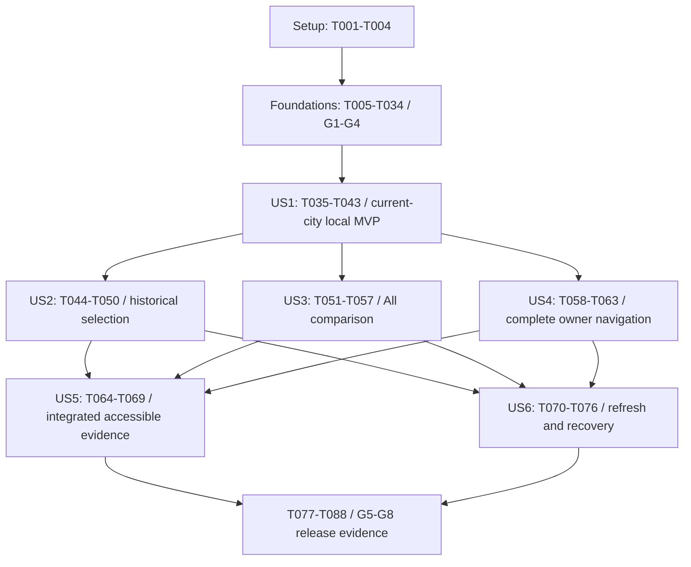

# Tasks: TransitJazz Stats Overlay

**Audio scope update (2026-10-12)**: Audio preference changes are withdrawn at the user's request. Restore the original AudioFAB settings/event implementation; Stats has no audio preference channel, mute/unmute controls or synth dependency. Earlier shared-audio tasks and evidence are historical.

**Navigation simplification (2026-10-12)**: Overlay navigation is withdrawn at the user's request. Stats uses a local visibility flag and the browser's native dialog; Info keeps its existing local open/close behavior. No shared coordinator, history entries/traversals, Info/Stats switching, modal lifecycle manager or special settings replacement is required. Earlier navigation prototype tasks and evidence are historical.

**Scope update (2026-10-12)**: The user has assessed the feature and confirmed it works. Remove the temporary chart prototype and browser-history diagnostic UI. Ship English only: no language selector, saved language preference, runtime language switching or Spanish satellite resource. Earlier Spanish/prototype validation records describe the prior implementation.

**Feature**: `058-stats-overlay`  
**Input**: [spec.md](spec.md), [plan.md](plan.md), [research.md](research.md), [data-model.md](data-model.md), [quickstart.md](quickstart.md), all three [contracts](contracts/), [Stats source design](../../docs/STATS_OVERLAY_DESIGN_DOCUMENT.md) and [chart foundation](../../docs/PAX_BLAZOR_CHARTJS_COMPONENTS_DESIGN_DOCUMENT.md).  
**Status**: Implementation in progress: 74 of 88 tasks complete; 14 remain. Completed local implementation and validation evidence is summarized in [validation.md](validation.md). Remaining accessibility/runtime, capacity/load, visitor-review and operator release gates are listed there.

**Organization**: Shared setup/foundations, then all six user stories in spec priority order, followed by cross-story release evidence. Existing project/test/DI/localization patterns apply. No extra runtime project, general dashboard/store/repository, unrestricted query API, new capture/backfill or formula registry is required.

## Format and Execution Rules

- `- [ ] Tnnn [P?] [USn?] Description with exact repository-relative file paths`.
- `[P]` means a file-disjoint task can run alongside another eligible task after its stated prerequisites. It never overrides a dependency or permits concurrent edits to the same file.
- Story phases require `[US1]` through `[US6]`; setup, foundation and release phases have no story label.
- Automated checks use existing xUnit projects. Disposable PostgreSQL fixtures require the explicit `ROUTE_HOUR_HISTORY_DISPOSABLE_CONNECTION` pattern; actual retained-data inspection is read only. Browser history, canvas lifecycle, focus and assistive technology require browser evidence.
- Keep API `StatsOverlay.Enabled=false` and client `FeatureFlags.StatsOverlay=false` in committed defaults. Both launchers share the client flag; capture settings remain separate.
- Never run `git commit` or any commit-producing hook/command. Preserve existing design/assets and prior artifacts; leave implementation changes for user review.

## Phase 1: Setup (Shared Infrastructure)

**Purpose**: Freeze evidence and provision the existing project seams. Keep both exposure defaults false. T001-T004 are preparation work; they do not establish deployed history or passing runtime gates.

- [X] T001 Record the 057 schema/migration dependency, source/capture status, seven canonical public city identities including `atlanta`, IANA zones, resolved `RouteHours.GapLimitFor(city)`, current source flags and Azure ingress/replica assumptions in `specs/058-stats-overlay/validation.md`; inspect `src/Server/ChefKnifeStudios.TransitJazz.Server.Data/Configurations/CityRouteHourStatisticConfiguration.cs` and the existing city/history registrations without changing capture.
- [X] T002 Create independently calculated aggregate/wire fixtures in `src/Server/ChefKnifeStudios.TransitJazz.Server.WebAPI.Tests/Statistics/StatsOverlayAcceptanceFixtures.cs` and `specs/058-stats-overlay/fixtures/stats-overlay-v1.json`: two cities, three categories, inactive/stationary/transfer/unknown/category-change routes, missing/conflicting hours, 160 km with 16/20 route-hours, 30/6 X, 30/2 Y, 180/120 mean and 100+gap+40=140; document expected evidence independently of production mappers in `specs/058-stats-overlay/validation.md`.
- [X] T003 [P] Revalidate and pin `pax.BlazorChartJs` 0.9.1 in `src/Client/ChefKnifeStudios.TransitJazz.Client.Shared/ChefKnifeStudios.TransitJazz.Client.Shared.csproj`, align direct ASP.NET Core/Blazor references in that file, `src/Client/ChefKnifeStudios.TransitJazz.Client.Core/ChefKnifeStudios.TransitJazz.Client.Core.csproj` and `src/Client/ChefKnifeStudios.TransitJazz.Client.WebApp/ChefKnifeStudios.TransitJazz.Client.WebApp.csproj` to exact compatible 10.0.9, and self-host Chart.js 4.5.1 with distribution/license/provenance in `src/Client/ChefKnifeStudios.TransitJazz.Client.WebApp/wwwroot/vendor/chartjs/4.5.1/`; reference the local asset in `src/Client/ChefKnifeStudios.TransitJazz.Client.WebApp/wwwroot/index.html`.
- [X] T004 [P] Add `StatsOverlay` to `src/ChefKnifeStudios.TransitJazz.Shared/Enums/FeatureFlags.cs` and default-disabled read/launcher configuration in `src/Server/ChefKnifeStudios.TransitJazz.Server.WebAPI/appsettings.json`, `src/Client/ChefKnifeStudios.TransitJazz.Client.WebApp/wwwroot/appsettings.json` and `src/Client/ChefKnifeStudios.TransitJazz.Client.WebApp/wwwroot/appsettings.Development.json`; keep `HistoricalStatistics.Enabled`, `DryRun`, Cities and category settings independent.

**Checkpoint (future exit criteria)**: Inputs, independent expected evidence, exact dependencies and disabled defaults are ready; no runtime acceptance is implied.

---

## Phase 2: Foundational (Blocking Prerequisites)

**Purpose**: Deliver shared contracts, culture, finite chart presentation, one history/modal owner and the bounded read/transport. No story couples live reporting to the UI until G1-G4 evidence passes. Tests are included because the source design, contracts and quickstart explicitly require them; use existing xUnit projects, with actual-browser evidence for rendering/history/focus. Write meaningful automated cases before their implementation and confirm their intended failure, then pass them. A missing disposable database or browser/load environment is a recorded gate, not a pass.

**Ordering inside the foundation**: Contract/policy, chart, navigation and backend/transport streams can progress in separate files. Complete the fixed chart proof (T019) and fixed modal/history proof (T023) before dashboard API coupling. Backend implementation may proceed alongside these prototypes.

- [X] T005 [P] Add wire-contract tests in `src/ChefKnifeStudios.TransitJazz.Shared.Tests/StatsOverlayContractTests.cs` for exact string discriminators, normalized case-distinct keys, canonical `atlanta`, explicit nullable metrics/coverage fields under existing `JsonSettings`, UTC Z/date/offset encoding, finite numeric values and aggregate-only response fields, using the frozen fixtures from T002.
- [X] T006 Add `ApiEndpoints.Stats.Query` in `src/ChefKnifeStudios.TransitJazz.Shared/ApiEndpoints.cs` and app-owned request/response/coverage/window/route/bubble/timeline records with finite reason/warning vocabulary in `src/ChefKnifeStudios.TransitJazz.Shared/Stats/StatsOverlayRequest.cs` and `src/ChefKnifeStudios.TransitJazz.Shared/Stats/StatsOverlayResponse.cs`; explicitly serialize Stats nulls without changing global omit-null behavior, retain unknown selections and keep EF/Pax/internal identifiers out of the wire types (after T005).
- [X] T007 [P] Add fixed-TimeProvider policy/window tests in `src/Server/ChefKnifeStudios.TransitJazz.Server.WebAPI.Tests/Statistics/StatsOverlayWindowTests.cs` for 14:01/14:02 grace boundaries, local date from as-of rather than cutoff, empty early morning, independent last24, differing city dates, 23/25-hour days/repeated offsets, fractional-midnight full-hour exclusion and invalid zone/cadence configuration.
- [X] T008 Implement validated centralized limits/exposure defaults in `src/Server/ChefKnifeStudios.TransitJazz.Server.WebAPI/Statistics/StatsOverlayOptions.cs` and immutable configured city/cadence/as-of policy plus expected full-hour grids in `src/Server/ChefKnifeStudios.TransitJazz.Server.WebAPI/Statistics/StatsOverlayService.cs`; resolve one TimeProvider instant, two-minute cutoff, actual midnights and independent windows while allowing valid retained evidence when capture is currently off (after T006, T007).
- [X] T009 [P] Verify compiled English chart resources and number formatting under non-English ambient culture in `src/Client/ChefKnifeStudios.TransitJazz.Client.Shared.Tests/StatsChartTextTests.cs` and `StatsResourcesTests.cs`; keep saved audio/theme settings compatible without changing Settings version.
- [X] T010 [P] Author all new Stats/chart/navigation labels, definitions, table headers/units, finite coverage/problem-code explanations and accessible control names in `src/Client/ChefKnifeStudios.TransitJazz.Client.Shared/Resources/RouteFilterResources.resx`; include completed-hour freshness, partial subtotal, zero/unavailable/pending, transfers, differing route periods, local-day All, minimum marker and chart failure copy. English is the only supported language.
- [X] T011 Fix startup culture to English in `src/Client/ChefKnifeStudios.TransitJazz.Client.WebApp/Program.cs` and document lang to English in `wwwroot/index.html`. Remove saved language preferences, language controls/events/services and the Spanish satellite; preserve audio/theme settings (after T003, T009, T010).
- [X] T012 [P] Add pure chart-model/mapping checks in `src/Client/ChefKnifeStudios.TransitJazz.Client.Shared.Tests/StatsChartModelTests.cs` for finite/aligned inputs, increasing numeric X, stable keyed styles, raw once-only stacks/null gaps, zero/omitted/coincident bubbles, square-root radius/minimum, zero pie rows and table/canvas equality; use independently authored expected values.
- [X] T013 Define finite app-owned models and stable theme/keyed presentation in `src/Client/ChefKnifeStudios.TransitJazz.Client.Shared/Components/Charts/SeriesChartModel.cs`, `src/Client/ChefKnifeStudios.TransitJazz.Client.Shared/Components/Charts/PieChartModel.cs`, `src/Client/ChefKnifeStudios.TransitJazz.Client.Shared/Components/Charts/BubbleChartModel.cs` and `src/Client/ChefKnifeStudios.TransitJazz.Client.Shared/Components/Charts/ChartPresentation.cs`; validate before interop, retain label/numeric-X variants and separate known detail from plotted nulls without client metric aggregation (after T012).
- [X] T014 [P] Implement the shared MatPaper/figure title/definition/period/coverage/state/canvas/table composition in `src/Client/ChefKnifeStudios.TransitJazz.Client.Shared/Components/Charts/ChartFrame.razor` and `src/Client/ChefKnifeStudios.TransitJazz.Client.Shared/Components/Charts/ChartFrame.razor.css`; use semantic slots, localized copy, reserved responsive height and light/dark parity without Stats fetching/formulas (after T010, T013).
- [X] T015 [P] Implement internal stable-config canvas lifecycle in `src/Client/ChefKnifeStudios.TransitJazz.Client.Shared/Components/Charts/ChartCanvasHost.razor` and `src/Client/ChefKnifeStudios.TransitJazz.Client.Shared/Components/Charts/ChartCanvasHost.razor.cs`: latest pending input, success-only initialization plus bounded failure deadline, one void/event-driven no-animation dataset/options update path, deliberate kind remount and generation-aware disposal; add only required trusted named formatting callbacks in `src/Client/ChefKnifeStudios.TransitJazz.Client.Shared/wwwroot/js/chart-formatters.js` and register Pax/callback loading in `src/Client/ChefKnifeStudios.TransitJazz.Client.WebApp/Program.cs` (after T003, T011, T013).
- [X] T016 [P] Implement `src/Client/ChefKnifeStudios.TransitJazz.Client.Shared/Components/Charts/PieChart.razor`, `src/Client/ChefKnifeStudios.TransitJazz.Client.Shared/Components/Charts/PieChartModel.cs` and `src/Client/ChefKnifeStudios.TransitJazz.Client.Shared/Components/Charts/PieChartConfig.cs` using ChartFrame/ChartCanvasHost, server km/shares, disabled category toggles, partial qualification and the all-zero empty visual with complete zero/unavailable category table rows (after T014, T015).
- [X] T017 [P] Implement `src/Client/ChefKnifeStudios.TransitJazz.Client.Shared/Components/Charts/BubbleChart.razor`, `src/Client/ChefKnifeStudios.TransitJazz.Client.Shared/Components/Charts/BubbleChartModel.cs` and `src/Client/ChefKnifeStudios.TransitJazz.Client.Shared/Components/Charts/BubbleChartConfig.cs` with zero-baseline axes, larger-first `24*sqrt(mean/max)` radius with disclosed 3px minimum, exact tooltip/table counts/coverage, positive-area zero coordinates and omitted/coincident rows; inspection must have no navigation/selection callback (after T014, T015).
- [X] T018 [P] Implement numeric/label series, straight `spanGaps=false` once-only category stacks and unstacked/unfilled city lines in `src/Client/ChefKnifeStudios.TransitJazz.Client.Shared/Components/Charts/SeriesChart.razor`, `src/Client/ChefKnifeStudios.TransitJazz.Client.Shared/Components/Charts/SeriesChart.razor.css` and `src/Client/ChefKnifeStudios.TransitJazz.Client.Shared/Components/Charts/SeriesChartConfig.cs`; support local-clock/offset versus elapsed-hour labels, raw/combined/known tooltip details and native-delegating Pax legend/visibility APIs with stable city-key mapping for keyboard/Show all, restricting toggles to All (after T014, T015).
- [X] T019 Run the focused pure chart checks and real-browser fixed-model pie/bubble/stacked-category/unstacked-city prototype before API coupling; record G2 evidence in `specs/058-stats-overlay/validation.md` for numeric X/DST, raw contributions, multiple canvases, pending init/theme, rapid close/reopen/kind remount/disposal, native/keyboard visibility preservation through reorder and blocked/late Chart.js assets with usable tables; resolve a demonstrated Pax gap within the bounded internal mapper/host (after T016, T017, T018).
- [X] T020 [P] Add pure coordinator ownership/transition tests in `src/Client/ChefKnifeStudios.TransitJazz.Client.Shared.Tests/OverlayNavigationTests.cs` for push/replace/adopt, unique page-session/entry/city ownership, explicit-close acknowledgement/idempotence, foreign/old-city markers and cleanup without traversal; browser assertions remain in T023.
- [X] T021 Implement one page-lifetime `src/Client/ChefKnifeStudios.TransitJazz.Client.Shared/Services/OverlayNavigationService.cs` and `src/Client/ChefKnifeStudios.TransitJazz.Client.Shared/wwwroot/js/overlay-navigation.js`, registered in `src/Client/ChefKnifeStudios.TransitJazz.Client.WebApp/Program.cs`; prefer NavigationManager same-URL HistoryEntryState pushes/replacements while preserving framework indexes and unrelated state, observe traversal with finite ownership, strip only obsolete reload markers via replacement and acknowledge explicit Back once (after T011, T015, T020; serialize the shared Program.cs edit).
- [X] T022 Prototype a localized full-screen fixed-data Stats shell in `src/Client/ChefKnifeStudios.TransitJazz.Client.Shared/Components/Stats/StatsOverlay.razor`, `src/Client/ChefKnifeStudios.TransitJazz.Client.Shared/Components/Stats/StatsOverlay.razor.css` and `src/Client/ChefKnifeStudios.TransitJazz.Client.WebApp/Pages/TransitMap.razor`, connecting the existing Info owner in `src/Client/ChefKnifeStudios.TransitJazz.Client.Shared/Components/FABs/InfoFab.razor` and `src/Client/ChefKnifeStudios.TransitJazz.Client.WebApp/Layout/MainLayout.razor` to T021; prove MatDialog focus/Escape/no outside-dismissal, or use native modal dialog with the same small helper in `src/Client/ChefKnifeStudios.TransitJazz.Client.Shared/wwwroot/js/overlay-navigation.js`, and provide owner-requested immediate settings close in `src/Client/ChefKnifeStudios.TransitJazz.Client.Shared/Components/Blades/BladeContainer.razor.cs`.
- [ ] T023 Record G3 browser proof in `specs/058-stats-overlay/validation.md` using fixed Stats content and normal Info: silent welcome/map entry, same URL/framework history state, Back/Forward, repeated explicit close, surface substitution, reload/foreign/obsolete city/unrelated navigation, settings replacement, inert background/focus return and 100ms/reduced-motion entrance; verify no map/SignalR/audio remount or second synth-module identity before API coupling (after T022).
- [X] T024 [P] Add disposable PostgreSQL acceptance tests in `src/Server/ChefKnifeStudios.TransitJazz.Server.WebAPI.Tests/Statistics/StatsOverlayQueryTests.cs`, reusing `src/Server/ChefKnifeStudios.TransitJazz.Server.WebAPI.Tests/Statistics/RouteHourStatisticsDatabaseFixture.cs` and `ROUTE_HOUR_HISTORY_DISPOSABLE_CONNECTION`; cover full unfiltered cohort validation, outside-filter conflicts, independent route coverage, inactive/missing/Partial/NoData/definition/cadence/run/sample/boundary inconsistencies, metadata union/category changes, ordinal keys, matching arithmetic and concurrent quarantine/write snapshot consistency without modifying operator data.
- [X] T025 Implement one parameterized bounded snapshot SQL/CTE pipeline in `src/Server/ChefKnifeStudios.TransitJazz.Server.Data/Statistics/StatsOverlayQuery.cs` and register it in `src/Server/ChefKnifeStudios.TransitJazz.Server.Data/ServiceCollectionExtensions.cs`; source only city/window union, generate missing expected grids, validate every retained row before filtering and derive unfiltered latest deterministic metadata/category-change options including inactive/ineligible/removed routes; enforce historical union limits even on filtered/All reads and use existing city/hour/route index with no row/advisory locks or tracked cube (after T008, T024).
- [X] T026 Complete server numeric/decimal selected-union and unfiltered-cohort measures in `src/Server/ChefKnifeStudios.TransitJazz.Server.Data/Statistics/StatsOverlayQuery.cs`: distinct coverage units/unknown population, both distance windows, per-row historical categories/shares, matching route ratios, city samples/active hours counted once, all configured city placeholders and future/null timeline grids; keep hourly known/cumulative known/plot values separate, gap every category for missing selected membership, resume prefixes and preserve useful totals even when all plots gap (after T025).
- [X] T027 Assemble one immutable structurally complete snapshot in `src/Server/ChefKnifeStudios.TransitJazz.Server.WebAPI/Statistics/StatsOverlayService.cs` from T026, retaining actual generatedAt/cutoff, normalized unknown keys and all city windows; propagate cancellation/remaining five-second budget through acquisition, SQL, projection and pre-header size validation with safe timeout/dependency/capacity outcomes and pooled-timeout cleanup. If multiple commands are necessary, use one short read-only REPEATABLE READ transaction for every response group.
- [X] T028 [P] Add TimeProvider/concurrency tests in `src/Server/ChefKnifeStudios.TransitJazz.Server.WebAPI.Tests/Statistics/StatsOverlayCacheTests.cs` for absolute 60s expiration, cutoff/date/config/cadence replacement, original generation time, <=33 slots/64MiB admission, unfiltered-only coalescing, uncached filtered scopes, canceled waiter versus shared fill, independent five-second fill deadline, no failed/expired fallback, All not stitched from city caches and immediate four-slot busy rejection.
- [X] T029 Implement dedicated size-limited successful-unfiltered cache and bounded fill/admission ownership in `src/Server/ChefKnifeStudios.TransitJazz.Server.WebAPI/Statistics/StatsOverlayService.cs` with options from `src/Server/ChefKnifeStudios.TransitJazz.Server.WebAPI/Statistics/StatsOverlayOptions.cs`: <=33 replaceable scope slots, initial 64MiB measured object budget, absolute 60s TTL, finite in-flight scope map and four nonblocking cold reads/instance; isolate canceled waiters and always release slots/fills on success/failure/deadline (after T027, T028). Cache admission uses an explicitly conservative object-size estimate; heap measurement remains pending T080.
- [X] T030 [P] Add request/error/policy tests in `src/Server/ChefKnifeStudios.TransitJazz.Server.WebAPI.Tests/Statistics/StatsOverlayEndpointTests.cs` for exact configured scope/city/ordinal keys, unknown fields, pre-SQL body/key validation, 413/422 complete-result caps, unsafe numeric counts, explicit null wire response, no sensitive data, disabled/no-DB startup, missing dependency versus unavailable retained history, token bucket/Retry-After and trusted versus spoofed forwarded-client provenance.
- [X] T031 Add read-only anonymous POST in `src/Server/ChefKnifeStudios.TransitJazz.Server.WebAPI/EndpointGroups/StatsEndpoints.cs` and wire DI/mapping/endpoint token bucket/trusted forwarded-header handling in `src/Server/ChefKnifeStudios.TransitJazz.Server.WebAPI/Program.cs`; enforce 4MiB/512-byte/4096-key/32-city/32-category/8MiB limits and safe fixed ProblemDetails codes, numeric/date retry hints, no-store/existing compression and bounded scope/status/cache/duration/bytes/rejection telemetry with no route arrays or SQL labels (after T029, T030).
- [X] T032 [P] Add fake-handler transport tests in `src/Client/ChefKnifeStudios.TransitJazz.Client.Shared.Tests/StatsTransportTests.cs` for typed success/null evidence, safe ProblemDetails/status, numeric/date Retry-After, malformed/untrusted error bodies, response disposal and caller cancellation propagation; verify existing typed POST behavior remains supported.
- [X] T033 Extend `src/Client/ChefKnifeStudios.TransitJazz.Client.Core/Services/HttpService.cs` with narrow opt-in metadata-preserving POST returning existing Result plus HTTP status/safe code/retry delay, and add `src/Client/ChefKnifeStudios.TransitJazz.Client.Core/Services/EndpointsServices/StatsEndpointsService.cs` registered through `src/Client/ChefKnifeStudios.TransitJazz.Client.WebApp/Program.cs`; reuse the named factory/serializer, dispose responses and rethrow caller cancellation before general exception handling without changing existing caller signatures (after T006, T021, T032).
- [X] T034 Execute G1/G4 Shared, policy, disposable PostgreSQL, API/cache and transport checks; reconcile every frozen numerator/denominator/card/share/prefix, concurrent quarantine consistency, SQL parameterization, remaining-budget cancellation and safe bounds, and record representative EXPLAIN using the existing index in `specs/058-stats-overlay/validation.md`; report DB skips explicitly and keep reads/launchers disabled. Only a measured need may create an index migration in `src/Server/ChefKnifeStudios.TransitJazz.Server.Data/Migrations/`, with schema-before-code dependency documented.

**Checkpoint (future exit criteria)**: G1/G2/G3/G4 are evidenced for the shared seams. If DB/browser proof is skipped, dependent coupling/release work remains gated.

---

## Phase 3: User Story 1 - Explore the current city's observed travel (Priority: P1)

**Goal**: Deliver the current-city four-panel experience from welcome and map, independent of live readiness and audio consent.

**Independent acceptance**: With a known unfiltered current-city fixture, open from each entry point and verify category pie, today/last24 cards, route bubbles and category timeline with definitions/windows/coverage. Exercise positive, healthy zero, pending today with useful last24, partial and unavailable cases. Welcome entry/close preserves audio lock; unlocked entry preserves playback and the current audio preference. No route selection or All interaction is required.

**Requirements**: FR-001-005, FR-012-033, FR-036-037, FR-043-047; SC-001/003-005/007. Foundations supply G1-G4; this phase is a local disabled MVP, with remaining release gates below.

- [X] T035 [P] [US1] Add independently expected current-city projection tests in `src/Client/ChefKnifeStudios.TransitJazz.Client.Shared.Tests/StatsOverlayProjectionTests.cs` for positive/zero/pending/partial/unavailable snapshots, authoritative shares/ratios, unknown categories, omitted/stationary bubbles, raw category stacks and known amounts surviving whole-stack/final/all-point gaps.
- [X] T036 [P] [US1] Withdrawn: shared audio preference/event tests and StatsAudioTests.cs were removed with AudioPreferenceChannel at the user's request. Silent entry and unchanged playback remain acceptance requirements.
- [X] T037 [US1] Implement pure current-city DTO-to-presentation alignment in `src/Client/ChefKnifeStudios.TransitJazz.Client.Shared/Components/Stats/StatsOverlayProjection.cs`, preserving server evidence/precision/known-versus-plot values and city-zone/culture formatting for all four panels and tables; construct finite chart models without recomputing statistical formulas (after T035).
- [X] T038 [US1] Replace fixed prototype data with the current-city request/accepted-snapshot path in `src/Client/ChefKnifeStudios.TransitJazz.Client.Shared/Components/Stats/StatsOverlay.razor` and `src/Client/ChefKnifeStudios.TransitJazz.Client.Shared/Components/Stats/StatsOverlay.razor.cs`; start a fresh canonical map-city session with empty routes, atomically render all four panels/both cards from T037, show actual generatedAt/cutoff/window/coverage and distinct zero/pending/unavailable/partial states (after T019, T023, T034).
- [X] T039 [US1] Wire one exposure-gated Stats mounting/open/close path in `src/Client/ChefKnifeStudios.TransitJazz.Client.WebApp/Pages/TransitMap.razor` and `src/Client/ChefKnifeStudios.TransitJazz.Client.WebApp/Pages/TransitMap.razor.cs`, with distinct localized map open/close launcher and secondary welcome callback/control in `src/Client/ChefKnifeStudios.TransitJazz.Client.Shared/Components/AudioUnlockOverlay.razor`; keep the native enable-audio gesture target separate, preserve the map/SignalR/audio instance and open without geometry/feed readiness.
- [X] T040 [US1] Restore the original AudioFAB settings/event implementation; remove the Stats audio control, preference synchronization and synth dependency. Stats must leave audio lock, playback and preferences unchanged.
- [X] T041 [US1] Complete full-screen desktop Routes/two-by-two layout and narrow pie/totals/bubbles/timeline reading order in `src/Client/ChefKnifeStudios.TransitJazz.Client.Shared/Components/Stats/StatsOverlay.razor.css`; use one content scroll owner, reserved chart height, persistent safe-area scope/close controls, light/dark parity, 100ms entrance/immediate dismissal and reduced-motion styles without horizontal page overflow.
- [X] T042 [US1] Run the current-city projection checks from `src/Client/ChefKnifeStudios.TransitJazz.Client.Shared.Tests/StatsOverlayProjectionTests.cs`, reconcile fixture tables/cards/stack before rounding and record results plus pending integration evidence in `specs/058-stats-overlay/validation.md`.
- [ ] T043 [US1] Record current-city independent browser acceptance in `specs/058-stats-overlay/validation.md` from welcome/map against the frozen healthy/zero/pending/partial/unavailable fixtures, including no live-readiness prerequisite, locked close-to-welcome/focus, continuing playback, unchanged audio preference and preserved map/city/selection; remove temporary fixed-data coupling from `src/Client/ChefKnifeStudios.TransitJazz.Client.Shared/Components/Stats/StatsOverlay.razor.cs` while retaining an isolated development fixture path only if needed for later gates.

**Checkpoint (future exit criteria)**: US1 works independently as a disabled local demo; silent entry, current-city evidence and unchanged audio behavior are recorded.

---

## Phase 4: User Story 2 - Focus statistics on selected historical routes (Priority: P2)

**Goal**: Reuse the route grid while keeping Stats selection independent from map selection/music.

**Independent acceptance**: Start with map A/B selected and a retained-history fixture containing active, inactive, ineligible, removed and current-catalog-only routes. Select different Stats routes and verify all panels/both cards, 160 km and 16/20 route-hours, per-route ratios, whole-stack gaps with retained known amounts, stable unfiltered options, category bulk actions and selected-absent fallback. Map hover/emphasis/audio stay unchanged; mode/close/city resets clear Stats only.

**Requirements**: FR-005-011, FR-018-020/027/032/044; SC-003-005.

- [X] T044 [P] [US2] Add historical-option/ordinal-selection/reset/isolation tests in `src/Client/ChefKnifeStudios.TransitJazz.Client.Shared.Tests/StatsRouteSelectionTests.cs` for retained union versus current catalog, category bulk operations, empty city scope, stable labels/category-change notice, selected-but-absent fallback, 200ms settled exact requests and no map callbacks.
- [X] T045 [P] [US2] Add focused existing-map adapter regressions in `src/Client/ChefKnifeStudios.TransitJazz.Client.Shared.Tests/RouteFilterListTests.cs` for live sort/selection/bulk/hover-emphasis/music behavior preserved through immutable list projection; cover ordinal case-distinct keys and existing category/color resolution without testing markup snapshots.
- [X] T046 [US2] Extract immutable-data category-grouped button presentation into `src/Client/ChefKnifeStudios.TransitJazz.Client.Shared/Components/RouteFilterList.razor` and `src/Client/ChefKnifeStudios.TransitJazz.Client.Shared/Components/RouteFilterList.razor.css`; provide named toggles/category select/clear/whole clear, full labels/aria-pressed/focus/Enter/Space and scrolling without search, live subscription or injected map view model (after T044, T045).
- [X] T047 [US2] Make `src/Client/ChefKnifeStudios.TransitJazz.Client.Shared/Components/RouteFilters.razor`, `src/Client/ChefKnifeStudios.TransitJazz.Client.Shared/Components/RouteFilters.razor.cs` and `src/Client/ChefKnifeStudios.TransitJazz.Client.Shared/Components/RouteFilters.razor.css` the thin existing map-view-model adapter to T046, preserving current live sorting, map selection/emphasis/counts/music and existing visual category/color helpers.
- [X] T048 [US2] Connect immutable historical options and a local ordinal key set to Routes/visible summary in `src/Client/ChefKnifeStudios.TransitJazz.Client.Shared/Components/Stats/StatsOverlay.razor` and `src/Client/ChefKnifeStudios.TransitJazz.Client.Shared/Components/Stats/StatsOverlay.razor.cs`; retain selected absent keys with reason/fallback, keep options unfiltered, clear on close/either mode/app-city change, debounce 200ms and clear old-scope evidence before exact filtered requests.
- [X] T049 [US2] Extend `src/Client/ChefKnifeStudios.TransitJazz.Client.Shared/Components/Stats/StatsOverlayProjection.cs` with selected scope/category-change/empty-history copy, per-route available/expected hours and combined route-hour coverage, differing-period qualifiers and known contributions within whole-stack gaps; never infer missing membership or modify mutable map RouteItem instances.
- [ ] T050 [US2] Run focused selection/map-adapter checks and record independent browser acceptance in `specs/058-stats-overlay/validation.md`: map A/B versus Stats C, hover isolation, select-category/clear/empty reset, all-panel bus subset, retained inactive/ineligible/removed options, selected key disappearance, 160 km/16-of-20 and two-of-three stack gap with useful totals; verify both Stats and existing map grid keyboard behavior.

**Checkpoint (future exit criteria)**: US2 exact historical selection works independently; existing map/audio selection behavior remains evidenced.

---

## Phase 5: User Story 3 - Compare cities across their own local days (Priority: P2)

**Goal**: Render every configured city with honest local-day comparisons and presentation-only timeline visibility.

**Independent acceptance**: Load a frozen All response with differing dates, a missing city and DST. Verify category amounts/cards/city bubbles/unstacked lines/per-city coverage and true day extents. Native legend, keyboard toggles and Show all share identity-based state through refresh/reorder/theme; hide-all retains totals/table rows. Inspection never changes app city, selection or audio.

**Requirements**: FR-021/026-035; SC-003/004/005/009.

- [X] T051 [P] [US3] Add All projection/reconciliation tests in `src/Client/ChefKnifeStudios.TransitJazz.Client.Shared.Tests/StatsAllProjectionTests.cs` for every configured city/unavailable reasons, own dates/extents, summed known endpoints/category/card totals, city samples/active hours once, no route options and presentation-only hiding.
- [X] T052 [P] [US3] Add pure stable-city visibility reconciliation tests in `src/Client/ChefKnifeStudios.TransitJazz.Client.Shared.Tests/StatsTimelineVisibilityTests.cs` for reorder/refresh/theme preservation, new visible/removed dropped keys, hide-all versus unavailable, Show all and reset on mode exit/close; browser native-event proof remains in T057.
- [X] T053 [US3] Add All models/copy/per-city windows and coverage to `src/Client/ChefKnifeStudios.TransitJazz.Client.Shared/Components/Stats/StatsOverlayProjection.cs`; preserve server category/card/city-bubble/known-prefix values, align numeric elapsed hours per midnight with 23/25-hour extents/offset details and explicitly label Sum of each city's local day without a normalized ranking (after T051).
- [X] T054 [US3] Wire city/All segments and exact All request in `src/Client/ChefKnifeStudios.TransitJazz.Client.Shared/Components/Stats/StatsOverlay.razor` and `src/Client/ChefKnifeStudios.TransitJazz.Client.Shared/Components/Stats/StatsOverlay.razor.cs`; clear route selection on both changes, hide Routes in All, render all configured city rows and reset to the current map city on return, with tooltip-only inspection and no CityFab/drill-down action.
- [X] T055 [US3] Bind one local All-session city-key visibility set/count/Show all/table labels in `src/Client/ChefKnifeStudios.TransitJazz.Client.Shared/Components/Stats/StatsOverlay.razor.cs` to the native-delegating/keyboard bridge in `src/Client/ChefKnifeStudios.TransitJazz.Client.Shared/Components/Charts/SeriesChart.razor`; preserve it through accepted snapshot/presentation updates, reset on mode exit/close and leave API selection/pie/cards/bubbles/known endpoints unchanged (after T052, T054).
- [X] T056 [US3] Run All projection/visibility checks from `src/Client/ChefKnifeStudios.TransitJazz.Client.Shared.Tests/StatsAllProjectionTests.cs` and `src/Client/ChefKnifeStudios.TransitJazz.Client.Shared.Tests/StatsTimelineVisibilityTests.cs`; record before-rounding All endpoint/card reconciliation including hidden/missing-final-point series in `specs/058-stats-overlay/validation.md`.
- [ ] T057 [US3] Record independent All browser acceptance in `specs/058-stats-overlay/validation.md`: differing dates/DST/offsets/future nulls/missing city, native and keyboard legend synchronization, hide-all/Show all, reorder/new/removed cities/theme/refresh/rapid toggles and reset; verify all amounts/table rows remain All and inspection leaves map/city/audio unchanged.

**Checkpoint (future exit criteria)**: US3 compares all configured cities; hidden timeline lines retain all measurement scope and table evidence.

---

## Phase 6: User Story 4 - Open and dismiss overlays with predictable navigation (Priority: P2)

**Goal**: Finish Stats/Info integration over the proven coordinator, preserving one modal and one owned browser entry.

**Independent acceptance**: With fixed current-city data and normal Info content, test welcome/map/Info open, Back/ordinary next Back, valid Forward/fresh Stats defaults, every close path/repeated activation, surface replacement, settings replacement, full reload, old-session/old-city/foreign state, unrelated navigation and component removal. Check URL/framework state, audio, prompt dismissal and focus return without relying on metric arithmetic.

**Requirements**: FR-036-043; SC-005/006. The shared lifecycle prototype is a prerequisite; this phase completes production owner integration and its full acceptance matrix.

- [X] T058 [P] [US4] Extend integration ownership cases in `src/Client/ChefKnifeStudios.TransitJazz.Client.Shared.Tests/OverlayNavigationTests.cs` for close during pending open/traversal, repeated close acknowledgement, rapid replacements, valid Forward with new Stats session/default selection/visibility and obsolete originating city without restoring audio/data.
- [X] T059 [US4] Finalize Stats owner integration in `src/Client/ChefKnifeStudios.TransitJazz.Client.WebApp/Pages/TransitMap.razor.cs` and `src/Client/ChefKnifeStudios.TransitJazz.Client.Shared/Components/Stats/StatsOverlay.razor.cs`: adopt coordinator events, initialize bridge before launchers, reset/fetch fresh current-city state on valid Forward, close/reset on app-city change and invalidate work before unmount; disposal/unrelated navigation must only clean up.
- [X] T060 [US4] Route every existing Info open/FAB/body-button/Escape path through the shared coordinator in `src/Client/ChefKnifeStudios.TransitJazz.Client.Shared/Components/FABs/InfoFab.razor` and `src/Client/ChefKnifeStudios.TransitJazz.Client.WebApp/Layout/MainLayout.razor`; preserve normal current-city Info content/theme, replace Stats/Info surfaces instead of stacking and retain page-session ownership after content unmount.
- [X] T061 [US4] Complete owner-requested settings/welcome/Info/Stats focus coordination in `src/Client/ChefKnifeStudios.TransitJazz.Client.Shared/Components/Blades/SettingsBlade.razor.cs`, `src/Client/ChefKnifeStudios.TransitJazz.Client.Shared/Components/Blades/BladeContainer.razor.cs` and `src/Client/ChefKnifeStudios.TransitJazz.Client.Shared/wwwroot/js/overlay-navigation.js`; ensure the 300ms blade guard cannot delay replacement, one focus trap/inert owner exists, invoker restoration checks mounting and callbacks/listeners are disposed.
- [X] T062 [US4] Run ownership/transition checks from `src/Client/ChefKnifeStudios.TransitJazz.Client.Shared.Tests/OverlayNavigationTests.cs` and record integration results/pending browser cases in `specs/058-stats-overlay/validation.md`; inspect same-URL framework entry/index preservation and ensure no raw pushState index clone or unconditional Back remains in `src/Client/ChefKnifeStudios.TransitJazz.Client.Shared/Services/OverlayNavigationService.cs`.
- [X] T063 [US4] Record the complete Stats-from-welcome/map and Info browser/phone history acceptance matrix in `specs/058-stats-overlay/validation.md`: owned entry counts, Back/Forward/fresh defaults, all explicit/repeated close paths, pending transitions/replacement, reload to welcome, foreign/prior-session/obsolete-city state and unrelated removal; verify URL/hash/unrelated/framework state, focus and current audio with no map/SignalR/synth remount.

**Checkpoint (future exit criteria)**: US4 has complete Stats/Info same-page history, cleanup and focus evidence without altering audio/city/framework state.

---

## Phase 7: User Story 5 - Read and operate statistics accessibly (Priority: P2)

**Goal**: Complete accessible evidence and verify English, theme, mobile and chart-failure parity across both modes.

**Independent acceptance**: With fixed complete/partial/zero/unavailable data, traverse controls and all measures by keyboard and screen reader in English and both themes, at 320px and 200% zoom with touch/reduced motion. Every canvas has matching expandable semantic tables; blocked chart assets retain all useful cards/text/tables. Essential warnings/help remain reachable without hover.

**Requirements**: FR-036/037/043-047/050; SC-007. Baseline semantics/localization are included in earlier increments; this phase completes evidence details and browser/publish proof.

- [X] T064 [P] [US5] Add meaningful presentation-contract tests in `src/Client/ChefKnifeStudios.TransitJazz.Client.Shared.Tests/StatsAccessibleEvidenceTests.cs` for matching table/canvas evidence, all unavailable/zero/omitted/coincident/hidden rows, real UTC/local date/offset intervals, visible known values within plot gaps and culture-only reprojection without a transport call.
- [X] T065 [US5] Complete captioned expandable details tables, headers/units, per-entity denominators/coverage/omission reasons and actual timeline interval/hourly/known-cumulative/hidden state in `src/Client/ChefKnifeStudios.TransitJazz.Client.Shared/Components/Charts/PieChart.razor`, `src/Client/ChefKnifeStudios.TransitJazz.Client.Shared/Components/Charts/BubbleChart.razor` and `src/Client/ChefKnifeStudios.TransitJazz.Client.Shared/Components/Charts/SeriesChart.razor`; derive them from the same complete app models and keep canvases aria-hidden (after T064).
- [X] T066 [US5] Complete named dialog/control states, keyboard/touch/focus/click help, persistent title/definition/period/coverage/warnings and small polite refresh/error/coverage announcements in `src/Client/ChefKnifeStudios.TransitJazz.Client.Shared/Components/Stats/StatsOverlay.razor` and `src/Client/ChefKnifeStudios.TransitJazz.Client.Shared/Components/Charts/ChartFrame.razor`; avoid announcing whole refreshed tables and retain text/cards/tables through chart initialization/asset failure.
- [X] T067 [US5] Audit English resource completeness, long labels/problem reasons, English number formatting/city-zone dates, non-color identities/line patterns and dataset+options theme updates in `src/Client/ChefKnifeStudios.TransitJazz.Client.Shared/Resources/RouteFilterResources.resx`, `Components/Stats/StatsOverlayProjection.cs` and `Components/Charts/ChartPresentation.cs`; theme changes reuse accepted evidence.
- [X] T068 [US5] Run focused English-resource/evidence tests, build the client and publish WASM from `src/Client/ChefKnifeStudios.TransitJazz.Client.WebApp/ChefKnifeStudios.TransitJazz.Client.WebApp.csproj`; record package compatibility, local Chart.js/callback assets, English document language and absence of the removed Spanish satellite and prototype page in `specs/058-stats-overlay/validation.md`.
- [ ] T069 [US5] Record independent integrated accessibility acceptance in `specs/058-stats-overlay/validation.md` for English/light/dark, 320px/200% zoom, touch/keyboard/screen reader/reduced motion, sticky safe-area controls/no horizontal page scroll, focus/inertness, long labels/large numbers, unknown/overlapping points, maximum route grid and blocked/late chart asset with complete text/table fallback; resolve failures in `src/Client/ChefKnifeStudios.TransitJazz.Client.Shared/Components/Stats/StatsOverlay.razor.css` and the affected chart/route component.

**Checkpoint (future exit criteria)**: US5 text/tables and controls are verified in English and both themes and required viewport/assistive/failure cases.

---

## Phase 8: User Story 6 - Trust refreshes and recover from unavailable statistics (Priority: P3)

**Goal**: Finish one request/refresh session with honest freshness, obsolete-work rejection, safe recovery and withdrawable exposure.

**Independent acceptance**: Drive open/60s refresh, delayed old responses, scope changes, midnight/cutoff changes, visibility/close/disposal and initial/refresh errors. Verify one active request, zero hidden/disposed polling, atomic snapshots, retained same-scope stale evidence with actual timestamp and cooldown across retry/selection/visibility. Exercise disabled/no-DB/schema/rate/deadline/busy/capacity states; both launcher defaults obey one flag and dismissal preserves map/music.

**Requirements**: FR-022/048-055; SC-002/008/010/011. Full retention/capacity/load/release evidence remains in the final phase.

- [X] T070 [P] [US6] Add controlled-time/request session tests in `src/Client/ChefKnifeStudios.TransitJazz.Client.Shared.Tests/StatsOverlaySessionTests.cs` for one request/timer, generation+normalized-scope acceptance, obsolete response after close/reopen/mode/selection, atomic midnight/cutoff updates, same-scope refresh/stale timestamp, hidden/disposed zero polling and culture/theme updates without reads.
- [X] T071 [P] [US6] Add retry/exposure tests in `src/Client/ChefKnifeStudios.TransitJazz.Client.Shared.Tests/StatsOverlayRetryTests.cs` for initial 60s growing-to-5min backoff, longer Retry-After, success reset, latest selection/Retry/visible restoration during cooldown, safe localized transport/capacity explanations and one flag for both launchers independent of capture.
- [X] T072 [US6] Complete session/generation/normalized-scope guards and atomic accepted-presentation publication in `src/Client/ChefKnifeStudios.TransitJazz.Client.Shared/Components/Stats/StatsOverlay.razor.cs`; load on open, retain same-scope Ready evidence while refreshing/stale with actual snapshot time, switch new scope to Loading, reject late/obsolete work and cancel/unsubscribe timer/request/events on close/navigation/disposal (after T070).
- [X] T073 [US6] Forward existing parent visibility from `src/Client/ChefKnifeStudios.TransitJazz.Client.WebApp/Pages/TransitMap.razor` and `src/Client/ChefKnifeStudios.TransitJazz.Client.WebApp/Pages/TransitMap.razor.cs` to the single visible 60s refresh schedule in `src/Client/ChefKnifeStudios.TransitJazz.Client.Shared/Components/Stats/StatsOverlay.razor.cs`; cancel/suspend when hidden, promptly refresh on return under cooldown and preserve the map's single-callback visibility registration (after T072).
- [X] T074 [US6] Complete one cooldown/retry path and safe initial-error versus retained-stale presentation in `src/Client/ChefKnifeStudios.TransitJazz.Client.Shared/Components/Stats/StatsOverlay.razor.cs` and `src/Client/ChefKnifeStudios.TransitJazz.Client.Shared/Components/Stats/StatsOverlay.razor`; honor retry delay across timer/manual/selection/visibility triggers, keep newest desired scope, reset after success and show localized disabled/dependency/busy/deadline/rate/scope explanations without raw server detail (after T071, T073).
- [X] T075 [US6] Run focused session/retry/transport checks in `src/Client/ChefKnifeStudios.TransitJazz.Client.Shared.Tests/StatsOverlaySessionTests.cs`, `src/Client/ChefKnifeStudios.TransitJazz.Client.Shared.Tests/StatsOverlayRetryTests.cs` and `src/Client/ChefKnifeStudios.TransitJazz.Client.Shared.Tests/StatsTransportTests.cs`; record cancellation/race/cooldown/visibility and G5 outcomes in `specs/058-stats-overlay/validation.md`.
- [ ] T076 [US6] Record independent browser recovery/refresh acceptance in `specs/058-stats-overlay/validation.md` using delayed responses/day rollover/cutoff transition/hidden-tab/close/reopen and 429/503/422 fixtures; verify one in-flight request, no obsolete writes, latest scope delayed by cooldown, actual stale timestamps, presentation-only updates, both launchers hidden when false and map/music usable after disabled/unavailable service dismissal.

**Checkpoint (future exit criteria)**: US6 request/refresh/cooldown/exposure behavior is evidenced; actual-retention/capacity/load/release gates remain.

---

## Phase 9: Polish, Capacity and Release Handoff

**Purpose**: Resolve cross-story regressions and produce G5-G8 evidence before public exposure. All tasks below are future implementation/release work. An unavailable environment, failed measurement or skipped case leaves its gate unresolved and both exposure defaults false.

**Release prerequisite**: All six stories and foundational gates; the 057 schema/capture acceptance is an external operational dependency, not something inferred from source code.

- [X] T077 Run focused Shared/Client.Shared/WebAPI Stats checks and existing map-selection/color/count/audio/query/route-hour worker regressions through `src/ChefKnifeStudios.TransitJazz.Shared.Tests/ChefKnifeStudios.TransitJazz.Shared.Tests.csproj`, `src/Client/ChefKnifeStudios.TransitJazz.Client.Shared.Tests/ChefKnifeStudios.TransitJazz.Client.Shared.Tests.csproj`, `src/Server/ChefKnifeStudios.TransitJazz.Server.WebAPI.Tests/ChefKnifeStudios.TransitJazz.Server.WebAPI.Tests.csproj` and `src/Server/ChefKnifeStudios.TransitJazz.Server.TransitDataWorker.Tests/ChefKnifeStudios.TransitJazz.Server.TransitDataWorker.Tests.csproj`; record final results and explicit DB/browser skips in `specs/058-stats-overlay/validation.md`.
- [ ] T078 Perform bounded read-only inspection of actual retained history for every configured public city and record G6 in `specs/058-stats-overlay/release-handoff.md`: real capture/persistence mode, schema/definition/cadence, earliest requested evidence, representative healthy day/coverage and zero/partial/unavailable/early-morning cases, missing cities, current-capture-off retained reads and unresolved 057 operational acceptance; never claim seven-city completeness from defaults.
- [ ] T079 Measure finalizer/writer-to-retention lag and read cutoff behavior around grace/hour/midnight transitions on the accepted history dependency; record evidence for the proposed two-minute allowance, 60s cache quarantine lag and completed-hour freshness copy in `specs/058-stats-overlay/release-handoff.md` (after T078); retain pending review if measurements require a confirmed-behavior tradeoff.
- [ ] T080 Exercise synthetic/disposable supported bounds and over-cap failures, recording G7 in `specs/058-stats-overlay/validation.md`: 4096 selected/returned historical keys and worst union per city, 32 cities/categories, 512-byte/case-distinct keys, 4MiB request, 8MiB uncompressed response and typical <1MiB compressed city response, safe numeric bounds, peak request/result/in-flight/cache object memory, <=33 slots/64MiB and four cold reads; never truncate success.
- [ ] T081 Profile the accepted build with 4096 historical route buttons/bubbles, coincident points, maximum city/category series, multiple canvases, responsive resizing and rapid refresh/theme/close/reopen; record render/interop/memory/reachable-table evidence and safe failure behavior in `specs/058-stats-overlay/validation.md` (after T080).
- [X] T082 Define the matched-load protocol in `specs/058-stats-overlay/release-handoff.md` before measurements: representative device/network, dashboard concurrency, city/route cardinality, replicas/trusted ingress, warmup/sample counts and p95 calculation; include combined history+Stats versus equivalent baseline without that added work and Stats-on/off with capture fixed, retaining the existing total <=5% history budget.
- [ ] T083 Run the agreed protocol from T082 and record warm useful open p95 <=2s, cold read p95 <=2s, prepared read p95 <=250ms, all-read <=5s safe completion, burst-ten/refill-one-per-second/no-queue behavior, trusted IP provenance/spoof rejection/four-read saturation/per-replica scaling and combined history+Stats worker p95 <=5% with no read-induced capture/write blockage/loss in `specs/058-stats-overlay/release-handoff.md`; tune only bounded read options/query/cache based on concrete evidence and rerun affected checks.
- [ ] T084 Conduct the specified five-visitor review on the accepted Stats build and record SC-012 in `specs/058-stats-overlay/release-handoff.md`; at least four must explain current scope, zero/partial/unavailable evidence, completed-hour freshness and each-city-local-day All using visible help/tables. Mark this as the spec's explicit acceptance threshold and resolve copy/usability failures before exposure.
- [X] T085 Finish the G8 handoff/runbook in `specs/058-stats-overlay/release-handoff.md` and update `specs/058-stats-overlay/quickstart.md` with actual definitions/windows/cities/coverage/lag/limits/cache/deadline/retry/ingress/replicas/sizes/load/browser evidence, safe error smoke cases and every pending gate; map existing bounded telemetry to operational checks/alerts without route-cardinality labels or inventing a new monitoring service.
- [X] T086 Build/publish the final API/WASM artifacts and inspect existing `.github/workflows/server.yml`, `.github/workflows/client.yml` and `.github/workflows/client-marta.yml` for local chart/license/culture assets and disabled settings; only if validated read tunables need infrastructure wiring, update `bicep/main.bicep`, `bicep/modules/containerApp.bicep` and regenerate `bicep/main.json` through the existing process. Record schema/index-before-API-before-client order and exact artifact/config values in `specs/058-stats-overlay/release-handoff.md`.
- [ ] T087 After all G1-G8 evidence is accepted, execute the normal operator-controlled staged history-schema/index dependency -> disabled API -> disabled client rollout and smoke aggregate pending/partial/zero/unavailable/safe errors using `specs/058-stats-overlay/release-handoff.md`; enable reads and the shared welcome/map launcher flag only at the accepted release step, verify production read/worker health, and leave exposure false if any required check is skipped or fails.
- [ ] T088 Exercise/document withdrawal of both launchers, disabled read responses and restoration of prior API/client artifacts using `specs/058-stats-overlay/release-handoff.md`; verify map/music after dismissal, preserve retained history and capture/dry-run/city/category settings, record rollback triggers/config/artifacts and close the release checklist only when evidence is recorded.

**Checkpoint (future exit criteria)**: Public exposure is allowed only after recorded G1-G8 acceptance; rollback is concrete and preserves history/capture.

---

## Dependencies and Execution Order

### Shared Foundations and Engineering Gates

1. T001-T002 freeze input/evidence before feature fixtures and contract checks. T003/T004 are file-disjoint setup work.
2. T005 -> T006; T007 -> T008, which also depends on T006.
3. T009/T010 -> T011; T012 -> T013; T014/T015 wait for their listed inputs; T016/T017/T018 wait for both frame/host. T019 is the G2 fixed-model exit.
4. T020 -> T021 -> T022 -> T023 (G3). The navigation and chart streams share `Program.cs` at T011/T015/T021; serialize those edits.
5. T024 -> T025 -> T026 -> T027; T028 -> T029, also waiting for T027; T030 -> T031, also waiting for T029.
6. T032 -> T033, after T006/T021. T034 waits for all required backend/contract/cache/endpoint/transport checks. It is G1/G4; a skipped disposable PostgreSQL check cannot certify SQL or release.
7. API/UI coupling at T038 requires T019, T023 and T034. Runtime prototypes/DB correctness are engineering exit conditions, not document-generation results.

### User Story Graph

US1 depends only on the shared foundations. US2, US3 and US4 reuse US1's accepted shell/session and can be validated independently with their fixtures. US3 does not require a selected-route journey; US4 can use fixed reporting data. US5 and US6 complete cross-mode/cross-owner acceptance after US2-US4, while their pure checks may be authored earlier. Independent acceptance means each story has a focused fixture/journey, not duplicate shells, endpoints or history owners.

**File ownership constraints**: US2/US3 share `StatsOverlayProjection.cs` and `StatsOverlay.razor.cs`; US4/US6 share TransitMap/Stats session lifecycle; US5/US6 share Stats markup. Implement in listed priority order or explicitly serialize the integration edits. Do not label whole stories parallel.

**Release ordering**: T077 closes regressions. T078 -> T079; T080 -> T081; T082 -> T083; T084 is an independent review after the accepted UI exists. T085/T086 require all relevant evidence. T087 requires every G1-G8 gate plus the accepted 057 dependency; T088 verifies withdrawal against the rollout/handoff. If load identifies a necessary index, generate/review it through existing Data migrations and deploy it before dependent API code.

### Parallel Examples by User Story

| Phase/story | Eligible parallel work | Prerequisites and integration boundary |
| --- | --- | --- |
| Setup | T003 package/assets and T004 disabled defaults | T001-T002 ready; separate package/asset versus configuration files |
| Foundation | T005/T007/T009/T012/T020/T024/T028/T030/T032 | Frozen fixtures; separate test files. These are test-authoring opportunities, with execution after required types/seams exist |
| Foundation | T014 frame and T015 canvas host; then T016/T017/T018 renderers | Complete each listed shared input first; renderer files are separate. Coordinate any common-model changes rather than editing them concurrently |
| US1 | T035 projection checks and T036 audio checks | Foundation complete; then T037 projection can progress while T041 owns only CSS; shell/audio integration stays serialized |
| US2 | T044 Stats-selection checks and T045 map-adapter checks | US1 complete; then T047 map adapter and T049 Stats projection can proceed in separate files after T046 |
| US3 | T051 All-projection checks and T052 visibility checks | US1 complete; finish T053 before shared Stats markup/state integration; native/keyboard bridge edits serialize with other SeriesChart work |
| US4 | T058 coordinator cases alongside fixed-data browser-matrix preparation for T063 | US1/coordinator prototype complete; T059, T060 and T061 require coordinated owner changes before executing full browser acceptance |
| US5 | T064 pure evidence checks alongside browser-matrix preparation for T069 | US2-US4 accepted; table/renderers and resource/presentation work can use separate owners, while shared ChartFrame/Stats markup edits serialize |
| US6 | T070 session checks and T071 cooldown/exposure checks | US2-US4 accepted; session, visibility and retry implementation are sequential because they share request ownership |
| Release | Independent measurements for T078/T080/T082/T084 | All story acceptance available; these tasks have no [P] marker because validation.md/release-handoff.md are shared outputs. Measurements may run concurrently, with sequential document merges |

Preparation of a browser matrix is a parallel planning activity within its named task; it is not a claim that a browser test has passed. `[P]` marks the task itself only when its implementation/test-authoring files are disjoint. Evidence tasks sharing `validation.md` or `release-handoff.md` may perform independent measurements but must merge their document edits sequentially.

## Implementation Strategy

### MVP and Incremental Delivery

1. Complete setup and the safety foundations, including fixed chart/history prototypes and actual disposable PostgreSQL/API proof. Keep public flags false.
2. Deliver US1 as the smallest useful **local fixture/development MVP**: four current-city panels, both entry points, honest coverage, accessible tables/culture/theme baseline and unchanged audio playback/preferences. Validate its independent journey before adding route/All behavior.
3. Add US2 historical selection, then US3 All comparison, preserving exact server evidence and isolation. Add US4's complete Stats/Info owner acceptance over the shared history seam.
4. Finish US5 accessibility/publish proof and US6 refresh/recovery acceptance. Earlier increments already include their necessary accessible labels, culture, focus and safe failure baseline; these phases close the complete matrices.
5. Finish regressions and G6/G7 actual history/capacity/load evidence, the five-visitor check and G8 artifact/operator handoff. Public v1 exposure requires all six stories and every release gate; a successful local US1 demo does not satisfy that release.
6. Deploy through existing operator workflows in dependency order and record withdrawal/rollback proof. Leave all source changes for the user to review and commit.

This MVP keeps the reporting and browser safety boundaries in place before a live dashboard is coupled, while deferring route exploration and All journeys until the city increment is understood. The full feature remains one bounded aggregate read, one local Stats session and one Stats/Info history owner.

## Gate and Requirement Coverage

| Gate | Owning tasks | Required evidence before exposure |
| --- | --- | --- |
| G1 Contracts/fixtures | T001-T006, T007-T008, T034 | Canonical identities, explicit nulls/reasons, independent amounts/weighted counts, current source/cadence |
| G2 Chart prototype | T012-T019 | Four forms, DST/numeric X, once-only stacking/gaps/tooltips, lifecycle/local asset failure/native visibility |
| G3 History/modal prototype | T020-T023; T058-T063 | Framework entries/state, all Stats/Info traversal/reload paths, focus/inert/settings replacement/no remount |
| G4 PostgreSQL/API | T024-T034 | One snapshot, all-cohort validation, ordinal membership, arithmetic/coverage, plans/deadline/cancel/bounds/cache/rate/null/transport |
| G5 Integrated state/accessibility | T035-T076, T077 | Six independent story journeys, map/audio isolation, presentation parity/tables and refresh/recovery races |
| G6 Actual history | T078-T079 | Every actual retaining city, representative complete/zero/partial/unavailable/early morning, 057 acceptance and measured lag |
| G7 Capacity/performance | T080-T083 | Supported union/cardinality, raw/compressed/object-memory limits, browser cost, trusted ingress/replicas, latency and total <=5% budget |
| G8 Release handoff | T084-T088 | Four-of-five understanding, all evidence/pending checks, final disabled artifacts, accepted exposure/deployment/monitoring/rollback |

| Requirement range | Implementation/acceptance ownership |
| --- | --- |
| FR-001-005 | T004; US1; US2/US3 isolation and US4 history checks |
| FR-006-011 | Bounded retained metadata at T025; US2 exact historical selector/session |
| FR-012-022 | T008, T024-T027, T029; US1-US3 projection and US6 refresh |
| FR-023-035 | T002, T012-T019, T026; US1-US3 reconciliation/native visibility |
| FR-036-043 | T022-T023; US1 shell and US4 owner/focus acceptance |
| FR-044-047 | T010-T011, T014-T019; US1/US2 baseline and US5 full accessibility/culture/failure proof |
| FR-048-050 | T032-T033; US6 session/timer/cooldown and US5 local presentation updates |
| FR-051-053 | T008, T025-T031, T034; T080-T083 complete-scope/privacy/budget evidence |
| FR-054-055 | T004, T031, US6 exposure checks and T078-T088 handoff/deployment/withdrawal |
| SC-001-012 | Story checkpoints plus G6-G8; p95/size/load targets and four-of-five visitor threshold are measured at T083/T084, not assumed |

## Original Task-Generation Validation

- Original generation produced 88 dependency-ordered tasks (T001-T088), all unchecked at generation time. Current completion is summarized at the top of this file and in validation.md.
- All story task labels match their phase; every task names exact repository paths, including proposed files or evidence outputs.
- All three contracts, all six stories, FR-001-FR-055, SC-001-SC-012 and G1-G8 have an implementation/acceptance owner.
- Dependency references use existing task IDs; 27 [P] tasks have file-disjoint eligible batches, and parallel examples specify prerequisites and shared-file constraints. Shared-evidence release tasks have no [P] marker.
- This section records generation-time checks only. Current implementation results are tracked in validation.md; runtime browser, retained-history, matched-load, visitor and deployment evidence remains pending.
- The configured optional `before_tasks` and `after_tasks` git-commit hooks are skipped under AGENTS.md. No commit-producing hook is executed.

