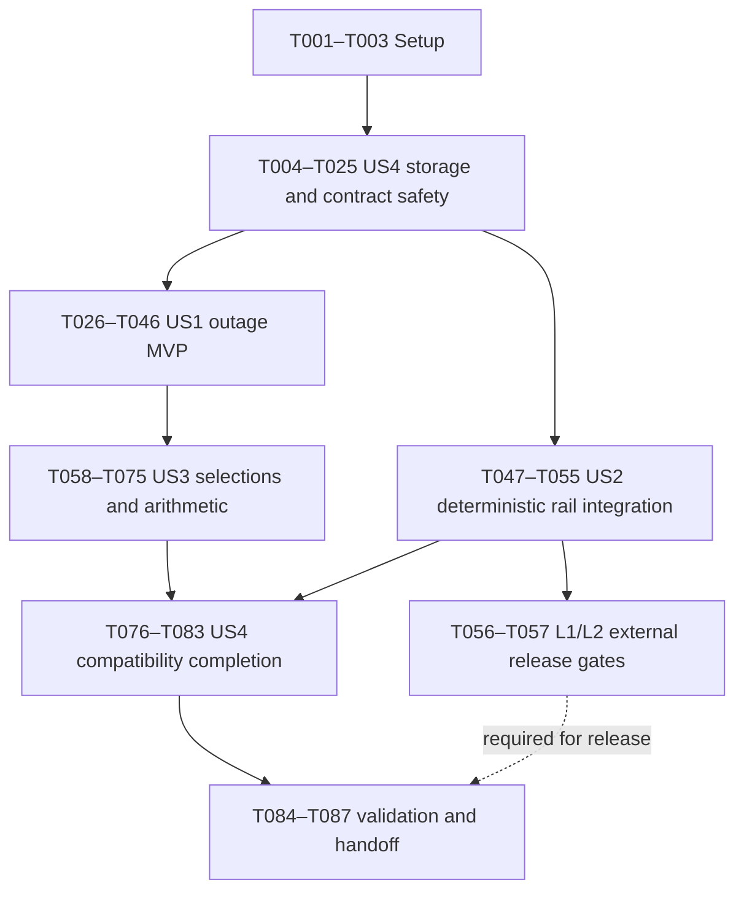

# Tasks: Atlanta Rail Recovery and Available Statistics

**Input**: `specs/063-atlanta-rail-statistics/spec.md`, `specs/063-atlanta-rail-statistics/plan.md`, `specs/063-atlanta-rail-statistics/testing-plan.md`, research, data model, quickstart and all three contracts. Primary design: `docs/ATLANTA_RAIL_RECOVERY_DESIGN_DOCUMENT.md`; supporting investigation: `docs/ATLANTA_DATA_SOURCE_INVESTIGATION.md`.  
**Branch**: `064-atlanta-rail-statistics`; **selected directory**: `specs/063-atlanta-rail-statistics`. Numbering is intentionally independent.  
**Status**: Implementation in progress. Completed tasks are checked below; validation results and external gates remain explicit in `validation-evidence.md`.

## Execution rules

TDD is required: each RED task runs a newly missing behavior and records its intended assertion failure before its dependent GREEN implementation. Compilation, unavailable infrastructure, undiscovered tests and fixture setup errors are not RED. Add only neutral compile/fixture plumbing needed to reach the existing public behavior; do not implement a rule to make a test compile. A test already passing is regression evidence; select a missing behavior before changing that rule. GREEN means minimal implementation and focused passing checks; REFACTOR follows GREEN with the same checks. Each RED/GREEN task appends commands, assertions and pass/fail/skip counts to `specs/063-atlanta-rail-statistics/validation-evidence.md`.

Read `.agents/skills/util-testing/SKILL.md` and its references during implementation. Use existing .NET 10/xUnit 2 projects, hand-written doubles, TimeProvider and TestHost; no new runtime package, project or browser test framework. All paths below are repository-relative and fully expanded. Proposed new files are explicitly named. The only generated names are EF timestamped migration artifacts; T007 defines their migration name and location.

Within a phase tasks execute in ID order unless a parallel pair below explicitly permits overlap. [P] means different files and no mutual dependency after the stated common prerequisite; tests and their implementation never run in parallel. No cross-story parallel implementation is assumed because Worker/query/client files overlap.

Preserve the four existing Worker/WebAPI appsettings edits and the untracked design/investigation/toast documents. Never create a commit or run commit-producing hooks; the optional before_tasks/after_tasks git hooks are skipped under AGENTS.md. Do not deploy, change secrets, use serving databases, backfill, relabel history, restore the retired rail endpoint or disable production rail for screenshots. Live validation tasks require existing authorized access; unavailable gates remain unchecked and explicitly UNRUN.

## Phase 1: Setup

**Goal**: Establish reproducible, guarded implementation evidence without changing behavior.

- [X] T001 Create `specs/063-atlanta-rail-statistics/validation-evidence.md` with T01–T08, B1–B3, L1/L2 and R1 sections; record baseline revision/uncommitted state, selected `.specify/feature.json`, SDK/environment, existing settings/docs changes and all gates initially UNRUN; preserve the intentional branch/directory numbering.
- [X] T002 Check .NET 10 tooling and the existing disposable-DB guard in `src/Server/ChefKnifeStudios.TransitJazz.Server.WebAPI.Tests/Statistics/RouteHourStatisticsDatabaseFixture.cs`; obtain an already provisioned `ROUTE_HOUR_HISTORY_DISPOSABLE_CONNECTION` through approved environment tooling without printing or putting it in command text, verify the database name contains disposable and child create/drop permission, and record unavailable infrastructure as a blocker in `specs/063-atlanta-rail-statistics/validation-evidence.md`.
- [X] T003 Inspect fixture loading and existing test facilities in `src/ChefKnifeStudios.TransitJazz.Shared.Tests/StatsOverlayContractTests.cs`, `src/Server/ChefKnifeStudios.TransitJazz.Server.TransitDataWorker.Tests/Statistics/RouteHourCaptureFixture.cs`, `src/Server/ChefKnifeStudios.TransitJazz.Server.WebAPI.Tests/Statistics/RouteHourStatisticsDatabaseFixture.cs` and `src/Server/ChefKnifeStudios.TransitJazz.Server.WebAPI.Tests/ChefKnifeStudios.TransitJazz.Server.WebAPI.Tests.csproj`; record fixed UTC hour 2026-11-07T12:00:00Z, 10-second cadence, root-relative fixture resolution, injected clocks and signal-based concurrency strategy in `specs/063-atlanta-rail-statistics/validation-evidence.md`; do not add a new framework.

## Phase 2: Foundational safety (blocks all stories)

**Goal**: Implement the shared US4 storage/contract protections before v2 writes or client opt-in. These are required US4 work scheduled early; foundational tasks intentionally have no story label.

**Acceptance**: Real additive upgrade/store cases execute with zero skips, every new field is immutable, v1 remains conservative, and negotiated/cache/client identities are isolated. Do not claim foundation complete on skipped DB tests.

- [X] T004 RED T03a: add bounded evidence/legacy-null behavioral tests in `src/Server/ChefKnifeStudios.TransitJazz.Server.TransitDataWorker.Tests/Statistics/SourceObservationEvidenceTests.cs`, `src/Server/ChefKnifeStudios.TransitJazz.Server.TransitDataWorker.Tests/Statistics/RouteHourFoundationTests.cs` and `src/Server/ChefKnifeStudios.TransitJazz.Server.WebAPI.Tests/Statistics/CityRouteHourStatisticModelTests.cs`; assert schema/outcome/reason validation, 32/33 sources, 64/65 UTF-8-byte multibyte keys, sorted unique route-relevant keys, fingerprint agreement, UTC bounds, checked counts and no legacy default-to-valid (FR-010/011; US4.3/5).
- [X] T005 GREEN T004: add bounded immutable source values and canonical dependency/support fingerprints in `src/Server/ChefKnifeStudios.TransitJazz.Server.TransitDataWorker/Statistics/SourceObservationEvidence.cs`; extend `src/Server/ChefKnifeStudios.TransitJazz.Server.TransitDataWorker/Metrics/CityFetchResult.cs`, `src/Server/ChefKnifeStudios.TransitJazz.Server.TransitDataWorker/Statistics/FinalizedRouteHourStatisticsBatch.cs` and `src/Server/ChefKnifeStudios.TransitJazz.Server.Data/Models/CityRouteHourStatistic.cs` with v2 JSON/scalar/reason/support fields, preserving null v1 fields and existing combined outcome; rerun T004 (FR-004/010/011).
- [ ] T006 RED T03c: extend `src/Server/ChefKnifeStudios.TransitJazz.Server.WebAPI.Tests/Statistics/RouteHourStatisticsDatabaseFixture.cs` with a guarded pre-feature migration stop and add upgrade/round-trip/constraint assertions in `src/Server/ChefKnifeStudios.TransitJazz.Server.WebAPI.Tests/Statistics/RouteHourStatisticsMigrationTests.cs`, `src/Server/ChefKnifeStudios.TransitJazz.Server.WebAPI.Tests/Statistics/RouteHourStatisticsStoreTests.cs` and `src/Server/ChefKnifeStudios.TransitJazz.Server.WebAPI.Tests/Statistics/RouteHourStatisticsWriterTests.cs`; seed legacy Complete/Partial before upgrade, require retained identity/fields/nulls, all v2 fields and atomic rejection; run real PostgreSQL, not an in-memory substitute (FR-010/011/013/031; US4.1/3).
- [ ] T007 GREEN T006 schema: extend `src/Server/ChefKnifeStudios.TransitJazz.Server.Data/Configurations/CityRouteHourStatisticConfiguration.cs` and scaffold additive EF migration named AddRouteHourSourceEvidence under `src/Server/ChefKnifeStudios.TransitJazz.Server.Data/Migrations/` with its generated timestamped .cs/.Designer.cs and `src/Server/ChefKnifeStudios.TransitJazz.Server.Data/Migrations/AppDbContextModelSnapshot.cs`; add nullable JSONB/scalars/reason arrays and separate preserved v1/v2 constraint branches; no data UPDATE/backfill or normal rollback Down execution (FR-010/013/031).
- [ ] T008 GREEN T006 persistence: map every new field through `src/Server/ChefKnifeStudios.TransitJazz.Server.WebAPI/Statistics/RouteHourStatisticsWriter.cs`, `src/Server/ChefKnifeStudios.TransitJazz.Server.Data/Statistics/CityRouteHourStatisticsStore.cs` and `src/Server/ChefKnifeStudios.TransitJazz.Server.Data/Models/CityRouteHourStatistic.cs`; preserve atomic city/hour insertion, ordinal identity, numeric precision, lock namespace, retention, bounded queue/retries and immutable envelopes; run T006 to GREEN (FR-011/014).
- [ ] T009 RED T03c: extend `src/Server/ChefKnifeStudios.TransitJazz.Server.WebAPI.Tests/Statistics/RouteHourStatisticsStoreTests.cs` and `src/Server/ChefKnifeStudios.TransitJazz.Server.WebAPI.Tests/Statistics/RouteHourStatisticsWriterTests.cs` for reordered JSON retry=Unchanged, one-at-a-time mutation of every dependency/counter/boundary/reason/validity/support field=Quarantined, original retained payload/sticky HasConflict, lost acknowledgement and concurrent identical/different/mixed-version writers sharing one city/hour lock; synchronize with signals (FR-011/014; US4.3).
- [ ] T010 GREEN T009: implement typed canonical validation/Normalize/Copy/SamePayload comparison in `src/Server/ChefKnifeStudios.TransitJazz.Server.Data/Statistics/CityRouteHourStatisticsStore.cs` and consistent writer validation in `src/Server/ChefKnifeStudios.TransitJazz.Server.WebAPI/Statistics/RouteHourStatisticsWriter.cs`; never compare raw JSON property order or replace original history; rerun real store/writer concurrency/retry cases (FR-011/014).
- [X] T011 RED T03b: extend `src/Server/ChefKnifeStudios.TransitJazz.Server.TransitDataWorker.Tests/Statistics/RouteHourFailureIsolationTests.cs`, `src/Server/ChefKnifeStudios.TransitJazz.Server.TransitDataWorker.Tests/Statistics/RouteHourCatalogAndLimitTests.cs` and `src/Server/ChefKnifeStudios.TransitJazz.Server.WebAPI.Tests/Statistics/RouteHourStatisticsWriterTests.cs` for localized versus unlocalizable capture/processing/catalog/queue loss, population overflow and source outage distinction; assert configured limits including 4096/16384 routes, 25000 identities, 50000 memberships, queue16, 128 rows/command and three attempts using small pressure fixtures (FR-011/014/028; US4.3).
- [X] T012 GREEN T011: add conservative v2 measure/cohort loss validity in `src/Server/ChefKnifeStudios.TransitJazz.Server.TransitDataWorker/Statistics/FinalizedRouteHourStatisticsBatch.cs`, `src/Server/ChefKnifeStudios.TransitJazz.Server.TransitDataWorker/Statistics/RouteHourStatisticsCapture.cs` and `src/Server/ChefKnifeStudios.TransitJazz.Server.TransitDataWorker/Statistics/RouteHourStatisticsAccumulator.cs`; retain intact measures only with proven localized impact, invalidate unknown impact, reject checked overflow without truncation, and preserve existing option/sink bounds in `src/Server/ChefKnifeStudios.TransitJazz.Server.TransitDataWorker/Statistics/RouteHourHistoryOptions.cs`; rerun T011.
- [ ] T013 REFACTOR/verify T03: deduplicate canonical validation where project boundaries allow in `src/Server/ChefKnifeStudios.TransitJazz.Server.TransitDataWorker/Statistics/SourceObservationEvidence.cs` and `src/Server/ChefKnifeStudios.TransitJazz.Server.Data/Models/CityRouteHourStatistic.cs`; run Worker foundation/limit and real migration/store/writer suites from `specs/063-atlanta-rail-statistics/testing-plan.md`, record executed DB pass counts/zero skips in `specs/063-atlanta-rail-statistics/validation-evidence.md`; block new writes if unavailable.
- [X] T014 RED T06a: extend `src/ChefKnifeStudios.TransitJazz.Shared.Tests/StatsOverlayContractTests.cs` against unchanged `specs/058-stats-overlay/fixtures/stats-overlay-v1.json` and add `specs/063-atlanta-rail-statistics/fixtures/stats-overlay-v2.json`; assert exact v1 omission/formulas and v2 required nested source/measure/category/timeline fields, explicit numeric nulls and bounded vocabulary; resolve fixtures from repo root or explicit csproj copying (FR-013/024; US4.4; SC-006).
- [X] T015 GREEN T014: extend version-aware response records, allowed reasons and serialization in `src/ChefKnifeStudios.TransitJazz.Shared/Stats/StatsOverlayResponse.cs` for stats-overlay-v2 and observed-city-route-hour-statistics-v2; preserve v1 JSON shape and null serialization, independent reported-vehicle fields, definition transitions and per-measure contract semantics; run shared contract tests (FR-024/027).
- [X] T016 [P] RED T06a after T015: extend `src/Server/ChefKnifeStudios.TransitJazz.Server.WebAPI.Tests/Statistics/StatsOverlayEndpointTests.cs` for absent/exact v1/exact v2, HTTP-whitespace trim with ordinal casing, empty/multiple/unsupported header rejection before query/cache, Vary and no-store; use query-call spies and unchanged request body (FR-024; US4.4; SC-006).
- [X] T017 [P] RED T06b after T015, parallel only with T016: extend `src/Server/ChefKnifeStudios.TransitJazz.Server.WebAPI.Tests/Statistics/StatsOverlayCacheTests.cs`, `src/Server/ChefKnifeStudios.TransitJazz.Server.WebAPI.Tests/Statistics/StatsOverlayOptionsTests.cs` and `src/Server/ChefKnifeStudios.TransitJazz.Server.WebAPI.Tests/Statistics/StatsOverlayTelemetryTests.cs` for interleaved/concurrent v1/v2 same-selection results, retained slots/in-flight isolation and unchanged global four reads/5s/8MiB response/64MiB cache/entry bounds; use release signals and injected time (FR-023/024; US4.4; SC-006).
- [X] T018 GREEN T016: negotiate X-TransitJazz-Stats-Contract before service/cache access in `src/Server/ChefKnifeStudios.TransitJazz.Server.WebAPI/EndpointGroups/StatsEndpoints.cs` and `src/Server/ChefKnifeStudios.TransitJazz.Server.WebAPI/Statistics/StatsOverlayPolicy.cs`; pass normalized contract explicitly, return 400 unsupported_stats_contract without query, emit Vary plus no-store, keep absent/v1 conservative and exclude v2 Partial from v1; run endpoint tests (FR-013/024).
- [X] T019 GREEN T017 after T018: isolate contract in full cache key, retained selection slot, in-flight identity and projection/query policy in `src/Server/ChefKnifeStudios.TransitJazz.Server.WebAPI/Statistics/StatsOverlayService.cs`; preserve global bounds/config/cutoff identity, cancellation and safe diagnostics in `src/Server/ChefKnifeStudios.TransitJazz.Server.WebAPI/Statistics/StatsOverlayOptions.cs` and `src/Server/ChefKnifeStudios.TransitJazz.Server.WebAPI/Statistics/StatsOverlayTelemetry.cs`; run cache/endpoint suites (FR-023/024).
- [X] T020 RED T07a: extend `src/Client/ChefKnifeStudios.TransitJazz.Client.Shared.Tests/StatsSnapshotAcceptanceTests.cs` and `src/Client/ChefKnifeStudios.TransitJazz.Client.Shared.Tests/StatsSnapshotStoreTests.cs` for v2 nested source/period/reason/numeric validation, wrong contract/selection rejection, recursive freeze against post-acceptance collection mutation and evidence-aware snapshot identity; keep old accepted snapshot atomically on invalid input (FR-024/025; US3.7; US4.4).
- [X] T021 GREEN T020: extend `src/Client/ChefKnifeStudios.TransitJazz.Client.Shared/Services/StatsSnapshotPolicy.cs` and `src/Client/ChefKnifeStudios.TransitJazz.Client.Shared/Services/StatsSnapshotStore.cs` with strict version-aware validation, deep immutable copy and contract-qualified acceptance/identity; leave client opt-in disabled until the US1 projection is ready and rerun snapshot tests (FR-024/025/027).
- [X] T022 RED T06a transport: extend `src/Client/ChefKnifeStudios.TransitJazz.Client.Shared.Tests/StatsTransportTests.cs` for request-local contract headers, concurrent unrelated calls unchanged, cancellation/disposal/Retry-After and safe unsupported_stats_contract handling; no shared DefaultRequestHeaders mutation (FR-024; US4.4).
- [X] T023 GREEN T022: add request-local header capability in `src/Client/ChefKnifeStudios.TransitJazz.Client.Core/Services/HttpService.cs` and `src/Client/ChefKnifeStudios.TransitJazz.Client.Core/Services/EndpointsServices/StatsEndpointsService.cs`, plus bounded safe code mapping in `src/Client/ChefKnifeStudios.TransitJazz.Client.Shared/Components/Stats/StatsOverlayRequestPolicy.cs`; preserve current transport disposal/cancellation/retry rules and defer enabling v2 until T033; run transport tests.
- [ ] T024 Verify shared contract, TestHost endpoint/cache, transport and snapshot foundation checks with real storage still passing; record T03/T06/T07 results, discoverable test counts and outstanding gates in `specs/063-atlanta-rail-statistics/validation-evidence.md`; contract/cache safety and additive schema are mandatory before any story's v2 write/opt-in.
- [X] T025 Review/update `specs/063-atlanta-rail-statistics/quickstart.md` and `specs/063-atlanta-rail-statistics/contracts/stats-overlay-api.md` with actual additive migration identity, old-read guarantees and storage→new writes→dual server→client order; document stop-v2-writes before incompatible rollback, retain schema/history and safe unknown-version exclusion; do not execute rollout (FR-031; US4 safety).

## Phase 3: User Story 1 — See measurements during a source outage (P1, MVP)

**Goal**: Deliver a deterministic completed-hour source-outage journey through actual fetch-result eligibility, real persistence/query and visible Stats selection, without a live MARTA key.

**Independent test**: Nonzero bus observations survive failed rail with retained exact valid samples/population, city Partial, rail null, selectable/visible bus data and persistent source explanation. Reverse the sources; both failed is null; fully supported empty is Complete zero. Prove recovery/publication boundaries separately.

Dependencies: T001–T025. US2/live access is not a prerequisite.

- [X] T026 [US1] Prepare the narrow journey fixture in `src/Server/ChefKnifeStudios.TransitJazz.Server.WebAPI.Tests/Statistics/AtlantaAvailableStatisticsJourneyFixture.cs` and test-only Client.Shared project reference in `src/Server/ChefKnifeStudios.TransitJazz.Server.WebAPI.Tests/ChefKnifeStudios.TransitJazz.Server.WebAPI.Tests.csproj`; compose existing capture/DB helpers, fixed shapes/run/hour, bus protobuf/rail HTTP doubles, clocks and signals. If necessary extract a minimal internal cycle entry seam in `src/Server/ChefKnifeStudios.TransitJazz.Server.TransitDataWorker/Worker.cs` without changing gating/scheduling; fixture must drive actual MartaCity fetch→Worker reconciliation, not pass activityEligible=true or seed final rows/DTOs (T04; FR-029).
- [X] T027 [US1] RED T01c: add source inventory/mapping assertions in `src/Server/ChefKnifeStudios.TransitJazz.Server.TransitDataWorker.Tests/Statistics/SourceObservationEvidenceTests.cs`, `src/Server/ChefKnifeStudios.TransitJazz.Server.TransitDataWorker.Tests/Statistics/ReportedVehicleSourceExtractionTests.cs` and `src/Server/ChefKnifeStudios.TransitJazz.Server.TransitDataWorker.Tests/Statistics/ReportedVehicleConfigurationTests.cs`; require source evidence with reported capture on/off, explicit bus aliases/four rail routes, disabled expected sources, unknown/ambiguous provenance and no global category-to-source guess; reported IDs retain pre-position filtering policy (FR-004/005/027; US1.1/2; US4.5).
- [X] T028 [US1] GREEN T027: emit bounded marta-bus/marta-rail outcomes/receipt/reasons independently of reported capture in `src/Server/ChefKnifeStudios.TransitJazz.Server.TransitDataWorker/Cities/MartaCity.cs` and resolve expected inventory/dependencies through `src/Server/ChefKnifeStudios.TransitJazz.Server.TransitDataWorker/Cities/CityConfig.cs` and `src/Server/ChefKnifeStudios.TransitJazz.Server.TransitDataWorker/Statistics/RouteHourCatalog.cs`; preserve combined monitoring/reporting fields and conservative legacy adapters (FR-004/005/027).
- [ ] T029 [US1] RED T02a/T04: add `src/Server/ChefKnifeStudios.TransitJazz.Server.WebAPI.Tests/Statistics/AtlantaAvailableStatisticsJourneyTests.cs` plus focused `src/Server/ChefKnifeStudios.TransitJazz.Server.TransitDataWorker.Tests/Statistics/RouteHourWorkerIntegrationTests.cs` and `src/Server/ChefKnifeStudios.TransitJazz.Server.TransitDataWorker.Tests/Statistics/RouteHourActivityTests.cs` cases; run actual fetch-result orchestration for fixed full hour with predecessor/successor, real writer/store/PostgreSQL→v2 service→StatsOverlayProjection.Build. Assert lost bus samples/cohort exclusion fails as intended, symmetric outage, all-failed null and full empty Complete0; independently calculate snapped meters, exact sample counts and populations, not a synthetic 120km jump (FR-006/007/012/015/024-026/029; US1.1-4; SC-001/002).
- [X] T030 [US1] GREEN capture for T029: replace combined activity eligibility with own-source/route/index/processing decisions in `src/Server/ChefKnifeStudios.TransitJazz.Server.TransitDataWorker/Worker.cs`, `src/Server/ChefKnifeStudios.TransitJazz.Server.TransitDataWorker/Statistics/RouteHourStatisticsCapture.cs` and `src/Server/ChefKnifeStudios.TransitJazz.Server.TransitDataWorker/Statistics/RouteHourStatisticsAccumulator.cs`; preserve accepted movement/activity on sibling failure, empty-success zero samples versus failure no sample, route-relevant bounded summaries/support and v2 finalization; other adapters keep legacy behavior (FR-006/007/010/012). The local actual-fetch capture slice is verified; T029's PostgreSQL-to-projection journey remains open.
- [ ] T031 [US1] GREEN retrieval for T029: separate cohort integrity from v2 per-row/measure admission in `src/Server/ChefKnifeStudios.TransitJazz.Server.Data/Statistics/StatsOverlayQuery.cs` and `src/Server/ChefKnifeStudios.TransitJazz.Server.WebAPI/Statistics/StatsOverlayService.cs`; return eligible bus/rail distance, activity/route bubbles, options/category/timeline evidence, contributing1/full0 for Partial, unavailable sibling null and supported zero only; keep v1 conservative, ratio support nullable and no scaling. Include minimum historical selection/source qualification needed for the walking slice (FR-014-016/024).
- [ ] T032 [US1] RED T07a/T07b: extend `src/Client/ChefKnifeStudios.TransitJazz.Client.Shared.Tests/StatsOverlayProjectionTests.cs`, `src/Client/ChefKnifeStudios.TransitJazz.Client.Shared.Tests/StatsSnapshotAcceptanceTests.cs` and `src/Client/ChefKnifeStudios.TransitJazz.Client.Shared.Tests/StatsOverlaySessionTests.cs` for current usable Partial/zero displacing older Complete/yesterday, city Partial versus bus-only coverage, source/unavailable category data and valid bus bubble/table preservation; obsolete/cancelled selection cannot publish (FR-025/026; US1.1-4; SC-001).
- [ ] T033 [US1] GREEN T032: unify current-eligible-period/fallback choice in `src/Client/ChefKnifeStudios.TransitJazz.Client.Shared/Components/Stats/StatsOverlayProjection.cs`, `src/Client/ChefKnifeStudios.TransitJazz.Client.Shared/Services/StatsSnapshotPolicy.cs`, `src/Client/ChefKnifeStudios.TransitJazz.Client.Shared/Services/StatsSnapshotStore.cs` and server projection in `src/Server/ChefKnifeStudios.TransitJazz.Server.WebAPI/Statistics/StatsOverlayService.cs`; enable per-request v2 opt-in in `src/Client/ChefKnifeStudios.TransitJazz.Client.Core/Services/EndpointsServices/StatsEndpointsService.cs` now that validation/projection are ready; current Partial/zero wins and reported headings remain independently city-wide (FR-024-027).
- [ ] T034 [US1] RED T07b: extend `src/Client/ChefKnifeStudios.TransitJazz.Client.Shared.Tests/StatsResourcesTests.cs`, `src/Client/ChefKnifeStudios.TransitJazz.Client.Shared.Tests/StatsChartTextTests.cs` and `src/Client/ChefKnifeStudios.TransitJazz.Client.Shared.Tests/StatsAccessibleEvidenceTests.cs` for localized Partial/no-observation/zero/source/period labels adjacent to figure models, unavailable category and omitted-bubble evidence; assert neutral/Spanish key parity and no arbitrary raw reason/source text (FR-020/026/028; SC-004).
- [ ] T035 [US1] GREEN T034: add resource keys first in `src/Client/ChefKnifeStudios.TransitJazz.Client.Shared/Resources/RouteFilterResources.resx` and proposed `src/Client/ChefKnifeStudios.TransitJazz.Client.Shared/Resources/RouteFilterResources.es.resx`, map safe names/reasons in `src/Client/ChefKnifeStudios.TransitJazz.Client.Shared/Services/StatsChartText.cs`, then wire visible card/heading CoverageDescription and source/hour details into `src/Client/ChefKnifeStudios.TransitJazz.Client.Shared/Components/Stats/StatsOverlay.razor`, `src/Client/ChefKnifeStudios.TransitJazz.Client.Shared/Components/Stats/StatsOverlay.razor.css` and `src/Client/ChefKnifeStudios.TransitJazz.Client.Shared/Components/Charts/ChartFrame.razor`; preserve themes/units/mobile/access and Stats-local feedback (FR-026/028).
- [ ] T036 [US1] GREEN/REFACTOR T04: run `src/Server/ChefKnifeStudios.TransitJazz.Server.WebAPI.Tests/Statistics/AtlantaAvailableStatisticsJourneyTests.cs` with real PostgreSQL and pure resource-backed client projection after T030–T035; assert captured/persisted/query/display meters reconcile within storage precision, exact valid activity counts survive, source details/route selection visible in projection, reverse/none/zero controls pass; refactor fixture composition only after GREEN and record zero skipped journey cases (FR-029; SC-001/002).
- [ ] T037 [US1] RED T02b: extend `src/Server/ChefKnifeStudios.TransitJazz.Server.TransitDataWorker.Tests/Statistics/RouteHourMovementTests.cs`, `src/Server/ChefKnifeStudios.TransitJazz.Server.TransitDataWorker.Tests/Statistics/RouteHourCoverageTests.cs` and `src/Server/ChefKnifeStudios.TransitJazz.Server.TransitDataWorker.Tests/Statistics/RouteHourCaptureLifecycleTests.cs` for mid-hour failure/recovery/disable/excess gap, independent rail boundaries despite bus predecessor/successor, first recovery reseed, next full healthy hour, startup/shutdown/sealed-hour behavior; retain stale/equal/nonpositive time, teleport and transfer checks (FR-008/012; US1.5; US2.5; SC-002).
- [ ] T038 [US1] GREEN T037: track continuity/boundaries/max gaps per source and reset/reseed affected movement baselines in `src/Server/ChefKnifeStudios.TransitJazz.Server.TransitDataWorker/Statistics/RouteHourStatisticsCapture.cs`, `src/Server/ChefKnifeStudios.TransitJazz.Server.TransitDataWorker/Statistics/RouteHourStatisticsAccumulator.cs` and existing movement state in `src/Server/ChefKnifeStudios.TransitJazz.Server.TransitDataWorker/Worker.cs`; retain accepted pre/post intervals, permanently Partial recovery hour and immutable sealed hours; no sibling continuity proof or outage bridge (FR-008/012).
- [ ] T039 [US1] RED T02c: extend `src/Server/ChefKnifeStudios.TransitJazz.Server.TransitDataWorker.Tests/Statistics/RouteHourWorkerIntegrationTests.cs`, `src/Server/ChefKnifeStudios.TransitJazz.Server.TransitDataWorker.Tests/Statistics/CategoryWorkerIntegrationTests.cs`, `src/Server/ChefKnifeStudios.TransitJazz.Server.TransitDataWorker.Tests/Statistics/CategoryActivityTests.cs`, `src/Server/ChefKnifeStudios.TransitJazz.Server.TransitDataWorker.Tests/Statistics/CategoryCoverageTests.cs` and `src/Server/ChefKnifeStudios.TransitJazz.Server.TransitDataWorker.Tests/Statistics/CategoryPublicationTests.cs` for publication-only loss preserving valid movement/activity, consistent route/category validity and unchanged detected/published diagnostics/reconciliation (FR-009/027/028; US1.6).
- [ ] T040 [US1] GREEN T039: separate observation/processing from publication validity in `src/Server/ChefKnifeStudios.TransitJazz.Server.TransitDataWorker/Worker.cs`, `src/Server/ChefKnifeStudios.TransitJazz.Server.TransitDataWorker/Statistics/RouteHourStatisticsAccumulator.cs`, `src/Server/ChefKnifeStudios.TransitJazz.Server.TransitDataWorker/Statistics/CityCategoryStatisticsCapture.cs` and `src/Server/ChefKnifeStudios.TransitJazz.Server.TransitDataWorker/Statistics/CategoryStatisticsAccumulator.cs`; share source validity decisions, preserve minute/hour reconciliation and delivery diagnostics, and keep overlay on route-hour tables (FR-009/028).
- [ ] T041 [US1] RED T02a/T02c: extend `src/Server/ChefKnifeStudios.TransitJazz.Server.TransitDataWorker.Tests/Statistics/RouteHourCoverageTests.cs`, `src/Server/ChefKnifeStudios.TransitJazz.Server.TransitDataWorker.Tests/Statistics/RouteHourCatalogAndLimitTests.cs` and `src/Server/ChefKnifeStudios.TransitJazz.Server.TransitDataWorker.Tests/Statistics/CategoryCoverageTests.cs` for source inventory removal/disable/catalog change, overlapping feeds, identity deduplication, unknown mapping and explicit substitution policy; one surviving overlap cannot manufacture Complete or erase expected history (FR-004/006/012/017; US4.5).
- [ ] T042 [US1] GREEN T041: freeze/retain hourly expected dependency union and explicit substitution semantics in `src/Server/ChefKnifeStudios.TransitJazz.Server.TransitDataWorker/Statistics/RouteHourCatalog.cs`, `src/Server/ChefKnifeStudios.TransitJazz.Server.TransitDataWorker/Statistics/RouteHourStatisticsCapture.cs`, `src/Server/ChefKnifeStudios.TransitJazz.Server.TransitDataWorker/Statistics/RouteHourStatisticsAccumulator.cs` and `src/Server/ChefKnifeStudios.TransitJazz.Server.TransitDataWorker/Statistics/CityCategoryStatisticsCapture.cs`; mark configuration/provenance limitations conservatively and retain dedup/bounds (FR-004/006/010/012).
- [ ] T043 [US1] REFACTOR/verify T02/T03/T04: consolidate route/category validity decisions without altering reconciliation in `src/Server/ChefKnifeStudios.TransitJazz.Server.TransitDataWorker/Worker.cs` and capture classes named in T040; rerun focused capture/activity/movement/coverage/lifecycle/limits plus real journey/store cases from `specs/063-atlanta-rail-statistics/testing-plan.md`; require symmetric outage, both-failed versus zero, publication-only loss and recovery passing with no DB skips (FR-029; US1.1-6; SC-001/002).
- [ ] T044 [US1] Execute the core B1 controlled-browser outage view using deterministic local/test HTTP sources and actual v2 payload; record artifacts, nonzero bus value, bus timeline/valid bubble, persistent Partial card/headings, rail unavailable/source-hour detail, bus-selectable state and both-failed/zero distinction in `specs/063-atlanta-rail-statistics/validation-evidence.md`. Run rendered `src/Client/ChefKnifeStudios.TransitJazz.Client.Shared/Components/Stats/StatsOverlay.razor` and charts; pure projection is not this gate. Never disable production rail (FR-026/029/030; SC-001/004/008).
- [ ] T045 [US1] Execute B2 controlled recovery with the same local/test fixture; verify actual rendered `src/Client/ChefKnifeStudios.TransitJazz.Client.Shared/Components/Stats/StatsOverlay.razor` retains pre/post observations, does not bridge outage, keeps recovery hour Partial and allows next fully healthy closed hour after grace/refresh, while old outage hours can keep last24 Partial; record exact UTC capture/query windows and both-source view in `specs/063-atlanta-rail-statistics/validation-evidence.md` (US1.5; US2.5; FR-008/012/030; SC-002/008).
- [ ] T046 [US1] Complete independent MVP evidence in `specs/063-atlanta-rail-statistics/validation-evidence.md`: run healthy-city/category/reported regressions including `src/Server/ChefKnifeStudios.TransitJazz.Server.TransitDataWorker.Tests/Cities/SeattleCityTests.cs`, `src/Server/ChefKnifeStudios.TransitJazz.Server.TransitDataWorker.Tests/Statistics/ReportedVehicleFailureIsolationTests.cs`, `src/Server/ChefKnifeStudios.TransitJazz.Server.WebAPI.Tests/Statistics/ReportedVehicleScopeTests.cs` and `src/Server/ChefKnifeStudios.TransitJazz.Server.WebAPI.Tests/Statistics/CategoryStatisticsDurabilityTests.cs`; state deterministic US1 and its browser status separately from UNRUN live rail recovery; no live key dependency (T08a; FR-005/009/027-030).

## Phase 4: User Story 2 — Restore Atlanta rail safely (P1)

**Goal**: Make the only production rail poll use the replacement source safely, with explicit request/normalization outcomes and sanitized diagnostics.

**Independent test**: Controlled HTTP tests prove both hosts, once-only polling, safe failure isolation and normalization without a credential. L1/L2 separately prove authenticated serving recovery when existing authorized access is available.

Dependencies: foundation. Sequential execution follows US1 to avoid shared MartaCity/Worker conflicts; this story's live key is never needed by US1.

- [ ] T047 [P] [US2] RED T01a/T01b after foundation: add `src/Server/ChefKnifeStudios.TransitJazz.Server.TransitDataWorker.Tests/Cities/MartaCityTests.cs` using synthetic reserved-character sentinel fixture&key=+/%?; assert encoded apiKey round-trip without printing URI, missing/whitespace key no request, no fallback/retry/second poll, rail HTTP400/401/403/500/transport/timeout/malformed/object/null/type failures leave bus intact, caller cancellation propagates, and application/named-client logs contain no key/encoded key/credential URI (FR-001-003; US2.1/2/4).
- [ ] T048 [P] [US2] RED T01b after foundation, parallel only with T047: add `src/Server/ChefKnifeStudios.TransitJazz.Server.TransitDataWorker.Tests/RailRealtime/RailArrivalMapperTests.cs` for known four rail lines/string DTO values, deterministic normalized-ID dedup/conflicting positions, valid empty/schedule-only versus rejected realtime coverage, finite coordinate endpoints/ranges/NaN/infinity, blank identity/unknown lines and explicit verified event-time forms; ambiguous/absent/unverified timezone supplies no movement timestamp but may retain activity (FR-002; US2.1/3/4).
- [ ] T049 [US2] GREEN T047: implement safe encoded request/missing-key handling, bounded rail-source failure, cancellation and sanitized exception/HttpClient diagnostics consistently in `src/Server/ChefKnifeStudios.TransitJazz.Server.TransitDataWorker/Cities/MartaCity.cs` and `src/Server/ChefKnifeStudios.TransitJazz.Server.TransitDataWorker/RailRealtime/RailRealtimeAdapter.cs`; avoid retired fallback/retry and preserve buses/expected disabled-source evidence; run HTTP component tests (FR-001-003).
- [ ] T050 [US2] GREEN T048: introduce pure `src/Server/ChefKnifeStudios.TransitJazz.Server.TransitDataWorker/RailRealtime/RailArrivalMapper.cs` and use it from `src/Server/ChefKnifeStudios.TransitJazz.Server.TransitDataWorker/Cities/MartaCity.cs` and `src/Server/ChefKnifeStudios.TransitJazz.Server.TransitDataWorker/RailRealtime/RailRealtimeAdapter.cs`; update `src/Server/ChefKnifeStudios.TransitJazz.Server.TransitDataWorker/RailRealtime/RailArrivalDto.cs` only if verified contract requires it, preserve reported-ID extraction, distinguish limited positions from true empty and never infer server-local event time; run mapper plus HTTP tests (FR-002/004/027).
- [ ] T051 [US2] RED T01a: extend `src/Server/ChefKnifeStudios.TransitJazz.Server.WebAPI.Tests/CityConfigParityTests.cs` and `src/Server/ChefKnifeStudios.TransitJazz.Server.WebAPI.Tests/Statistics/RouteHourCaptureHostRegistrationTests.cs` for all six prepared replacement URL entries/four settings files, active Cities[0]:RailRealtime binding, both named-client five-second deadlines and exactly one production MartaCity poll; if existing URL checks already pass, retain as regression and target missing deadline/registration behavior for intended RED (FR-001/003).
- [ ] T052 [US2] GREEN T051: set named RailRealtimeApi timeout/safe diagnostics in `src/Server/ChefKnifeStudios.TransitJazz.Server.TransitDataWorker/Program.cs` and `src/Server/ChefKnifeStudios.TransitJazz.Server.WebAPI/Program.cs` without registering a second adapter poll; preserve prepared URL edits in `src/Server/ChefKnifeStudios.TransitJazz.Server.TransitDataWorker/appsettings.json`, `src/Server/ChefKnifeStudios.TransitJazz.Server.TransitDataWorker/appsettings.Development.json`, `src/Server/ChefKnifeStudios.TransitJazz.Server.WebAPI/appsettings.json` and `src/Server/ChefKnifeStudios.TransitJazz.Server.WebAPI/appsettings.Development.json`; keep key out of settings and verify Atlanta index zero (FR-001/003).
- [ ] T053 [US2] REFACTOR/verify T01/T02: remove request/normalization duplication only after GREEN in `src/Server/ChefKnifeStudios.TransitJazz.Server.TransitDataWorker/Cities/MartaCity.cs` and `src/Server/ChefKnifeStudios.TransitJazz.Server.TransitDataWorker/RailRealtime/RailRealtimeAdapter.cs`; rerun HTTP/mapper/config/registration, source extraction on/off and recovery-hour capture/journey tests; record deterministic schema/time assumptions separately from live findings in `specs/063-atlanta-rail-statistics/validation-evidence.md` (FR-001-005/027/029; US2.1-5).
- [ ] T054 [US2] Update canonical `skills/mj-gtfs/SKILL.md` with replacement URL, existing credential requirement and honest verification status; run `tools/sync-skills.ps1` -Mode Sync then -Mode Check, review managed `.claude/skills/mj-gtfs/SKILL.md`, `.agents/skills/mj-gtfs/SKILL.md` and `.opencode/skills/mj-gtfs/SKILL.md` and avoid unrelated drift; record output in `specs/063-atlanta-rail-statistics/validation-evidence.md` (T08b; FR-001/028/031).
- [ ] T055 [US2] Update authenticated/serving instructions in `specs/063-atlanta-rail-statistics/quickstart.md` and `specs/063-atlanta-rail-statistics/contracts/source-evidence.md` with actual application DTO/event-time rules, sanitized validation method, `TransitSources__atlanta__RailRealtime__ApiKey` existing managed reference and named-section serving override checks; explicitly leave L1/L2 UNRUN until real evidence exists, with no secret/deployment action (FR-003/030/031).
- [ ] T056 [US2] L1 external release gate: only with existing authorized operator access, validate replacement response via application's HTTP/DTO behavior and existing managed-secret reference; record redacted array/types/realtime/coordinates/dedup/line/event-time-timezone findings in `specs/063-atlanta-rail-statistics/validation-evidence.md`, no credential URI/raw sensitive payload. Missing access leaves this task unchecked UNRUN; do not change secrets or deploy to close it (FR-002/003/030; SC-007).
- [ ] T057 [US2] L2 external release gate after L1: with existing authorized read access, verify actual serving revision/image ingests trains exactly once, bus work continues, safe rail warnings stop and recovery/next fully healthy closed hour plus grace/refresh follow coverage rules; record revision and exact UTC windows in `specs/063-atlanta-rail-statistics/validation-evidence.md`. No access/serving deployment means unchecked UNRUN; deterministic success is not serving recovery (FR-001/030; US2.1/5; SC-007/008).

## Phase 5: User Story 3 — Understand selections and arithmetic (P2)

**Goal**: Make historical selections, coherent populations, ratios, shares, timelines, all-cities and snapshot refresh describe the same admitted observations.

**Independent test**: Known historical bus/rail/city/all-city rows reconcile across card/category/timeline; aligned 6/3 and 3/3 becomes 9/6=1.5, unaligned support stays null; [10,null,5] plots [10,null,15] with a gap. Current Partial/zero wins over old Complete/yesterday.

Dependencies: foundation + US1 capture/query/projection. No dependency on L1/L2.

- [ ] T058 [US3] RED T05a: extend real `src/Server/ChefKnifeStudios.TransitJazz.Server.WebAPI.Tests/Statistics/StatsOverlayQueryTests.cs`, `src/Server/ChefKnifeStudios.TransitJazz.Server.WebAPI.Tests/Statistics/StatsOverlayProjectionTests.cs` and `src/Client/ChefKnifeStudios.TransitJazz.Client.Shared.Tests/StatsRouteSelectionTests.cs` for historical bus-only/rail-only/both selection, retained routes absent current catalog, known/unknown membership, NoData not contributing, Partial hour counted once/full0 and all-cities missing city/source with local windows (FR-015-017/023; US3.1/5/6; SC-003).
- [ ] T059 [US3] GREEN T058: implement explicit historical admitted row/measure sets and coverage in `src/Server/ChefKnifeStudios.TransitJazz.Server.Data/Statistics/StatsOverlayQuery.cs`, `src/Server/ChefKnifeStudios.TransitJazz.Server.WebAPI/Statistics/StatsOverlayService.cs` and `src/Client/ChefKnifeStudios.TransitJazz.Client.Shared/Components/Stats/StatsOverlayProjection.cs`; keep ExpectedRouteHours/unavailable count null for unknown history, route options available, bus selection potentially Complete while city Partial, and count city-hours without category addition (FR-014-017/023).
- [ ] T060 [US3] RED T05b: extend `src/Server/ChefKnifeStudios.TransitJazz.Server.WebAPI.Tests/Statistics/StatsOverlayQueryTests.cs`, `src/Server/ChefKnifeStudios.TransitJazz.Server.WebAPI.Tests/Statistics/StatsOverlayProjectionTests.cs`, `src/Client/ChefKnifeStudios.TransitJazz.Client.Shared.Tests/StatsChartModelTests.cs` and `src/Client/ChefKnifeStudios.TransitJazz.Client.Shared.Tests/StatsAccessibleEvidenceTests.cs` for weighted 9/6=1.5, unequal counts and equal-count/different-support null, within-hour alignment across differing hours, ratio matched numerator/denominator sets, route/hour populations versus unique fleet, incompatible definitions and zero axes/size omission without hiding distance (FR-018-020; US3.3; SC-003).
- [ ] T061 [US3] GREEN T060: aggregate summed activity numerator/valid denominator only with capture-proven coherent within-hour support in `src/Server/ChefKnifeStudios.TransitJazz.Server.Data/Statistics/StatsOverlayQuery.cs`; preserve route-vehicle-hour/active-clock-hour definitions and match ratio row sets, return bounded unaligned_activity_samples/unsupported_definition/null as required; expose per-axis omission/observed-ratio qualification via `src/Server/ChefKnifeStudios.TransitJazz.Server.WebAPI/Statistics/StatsOverlayService.cs` (FR-018-020).
- [ ] T062 [US3] RED T05c plus T05b bounds: extend `src/Server/ChefKnifeStudios.TransitJazz.Server.WebAPI.Tests/Statistics/StatsOverlayQueryTests.cs`, `src/Server/ChefKnifeStudios.TransitJazz.Server.WebAPI.Tests/Statistics/StatsOverlayProjectionTests.cs`, `src/Client/ChefKnifeStudios.TransitJazz.Client.Shared.Tests/StatsAccessibleEvidenceTests.cs` and `src/Client/ChefKnifeStudios.TransitJazz.Client.Shared.Tests/StatsTimelineVisibilityTests.cs` for exact bus120/rail-null available-distance100%, zero denominator null, no scaling, category/card/timeline reconciliation, [10,null,5]→[10,null,15], Partial annotation and checked sums/decimals/API2^53−1 versus overflow/NaN/infinity (FR-015/018/021/022; US3.2/4; SC-003).
- [ ] T063 [US3] GREEN T062: implement shared admitted-distance totals/category shares/bucket increments and safe numeric projection in `src/Server/ChefKnifeStudios.TransitJazz.Server.Data/Statistics/StatsOverlayQuery.cs`, `src/Server/ChefKnifeStudios.TransitJazz.Server.WebAPI/Statistics/StatsOverlayService.cs` and `src/Client/ChefKnifeStudios.TransitJazz.Client.Shared/Components/Stats/StatsOverlayProjection.cs`; keep unavailable rail rows, availableDistance denominator, null percentages at zero, observed subtotal across gaps and nullable plotted segments with no invented zero/bridge (FR-015/021/022).
- [ ] T064 [US3] Add T05d boundary regressions before changing windows in `src/Server/ChefKnifeStudios.TransitJazz.Server.WebAPI.Tests/Statistics/StatsOverlayWindowTests.cs`, `src/Server/ChefKnifeStudios.TransitJazz.Server.WebAPI.Tests/Statistics/StatsOverlayRefreshPolicyTests.cs`, `src/Server/ChefKnifeStudios.TransitJazz.Server.WebAPI.Tests/Statistics/RouteHourStatisticsLocalTimeTests.cs` and `src/Client/ChefKnifeStudios.TransitJazz.Client.Shared.Tests/StatsSnapshotScheduleTests.cs`; explicit America/New_York 2026-03-08/2026-11-01 23/25-hour local days, last24 exactly24 UTC identities, local midnight/cutoff/grace before-at-after, startup and recovery/full-hour cases. Record intended RED only for missing behavior; retain passing baseline (FR-023; US2.5; US3.5; SC-002/003).
- [ ] T065 [US3] GREEN any missing T064 rule in `src/Server/ChefKnifeStudios.TransitJazz.Server.WebAPI/Statistics/StatsOverlayPolicy.cs`, `src/Server/ChefKnifeStudios.TransitJazz.Server.WebAPI/Statistics/StatsOverlayService.cs` and `src/Client/ChefKnifeStudios.TransitJazz.Client.Shared/Services/StatsSnapshotStore.cs`; preserve request shapes/hourly refresh/UTC hour identity, per-city local days/DST offset labels, completed-hour cutoff and ingestion grace; leave already passing rules unchanged and rerun window/schedule cases (FR-023).
- [ ] T066 [US3] REFACTOR/verify T05a–d in `src/Server/ChefKnifeStudios.TransitJazz.Server.Data/Statistics/StatsOverlayQuery.cs` and `src/Server/ChefKnifeStudios.TransitJazz.Server.WebAPI/Statistics/StatsOverlayService.cs`: consolidate only proven-compatible eligibility/arithmetic, run real query plus pure projection/window suites and US1 journey, require zero DB skips and unchanged totals; record results in `specs/063-atlanta-rail-statistics/validation-evidence.md` (FR-013-023/029; SC-003).
- [ ] T067 [US3] RED T07a: extend `src/Client/ChefKnifeStudios.TransitJazz.Client.Shared.Tests/StatsSnapshotStoreTests.cs`, `src/Client/ChefKnifeStudios.TransitJazz.Client.Shared.Tests/StatsOverlaySessionTests.cs`, `src/Client/ChefKnifeStudios.TransitJazz.Client.Shared.Tests/StatsOverlayRetryTests.cs` and `src/Client/ChefKnifeStudios.TransitJazz.Client.Shared.Tests/StatsSnapshotAcceptanceTests.cs` for rapid route/city changes, cancellation/out-of-order completions, current Partial/zero versus attached yesterday/old Complete, invalid nested evidence preserving old snapshot, retained60min/contact-only identical evidence, changed evidence identity and independently city-wide reported heading (FR-024/025/027; US3.7).
- [ ] T068 [US3] GREEN T067: finish one fallback/current-period rule across `src/Client/ChefKnifeStudios.TransitJazz.Client.Shared/Services/StatsSnapshotPolicy.cs`, `src/Client/ChefKnifeStudios.TransitJazz.Client.Shared/Services/StatsSnapshotStore.cs`, `src/Client/ChefKnifeStudios.TransitJazz.Client.Shared/Components/Stats/StatsOverlayProjection.cs` and `src/Server/ChefKnifeStudios.TransitJazz.Server.WebAPI/Statistics/StatsOverlayService.cs`; preserve current generation/selection/cancellation/retry checks, deep-frozen evidence identity and consistent card/title/reported fallback text (FR-025/027).
- [ ] T069 [US3] RED T07b: extend `src/Client/ChefKnifeStudios.TransitJazz.Client.Shared.Tests/StatsChartModelTests.cs`, `src/Client/ChefKnifeStudios.TransitJazz.Client.Shared.Tests/StatsChartTextTests.cs`, `src/Client/ChefKnifeStudios.TransitJazz.Client.Shared.Tests/StatsAccessibleEvidenceTests.cs`, `src/Client/ChefKnifeStudios.TransitJazz.Client.Shared.Tests/StatsResourcesTests.cs` and `src/Client/ChefKnifeStudios.TransitJazz.Client.Shared.Tests/StatsDisplayUnitsTests.cs` for category-specific coverage, unavailable legend/table, available-distance explanation, omitted-axis/size/population reasons, bounded source/hour evidence with DST offsets, null segment models, neutral/Spanish keys/ARIA and original-evidence unit conversions (FR-020-022/026/028; US3.2/4; SC-004).
- [ ] T070 [US3] GREEN T069 models/resources first: extend `src/Client/ChefKnifeStudios.TransitJazz.Client.Shared/Resources/RouteFilterResources.resx`, `src/Client/ChefKnifeStudios.TransitJazz.Client.Shared/Resources/RouteFilterResources.es.resx`, `src/Client/ChefKnifeStudios.TransitJazz.Client.Shared/Services/StatsChartText.cs`, `src/Client/ChefKnifeStudios.TransitJazz.Client.Shared/Components/Charts/PieChartModel.cs`, `src/Client/ChefKnifeStudios.TransitJazz.Client.Shared/Components/Charts/BubbleChartModel.cs` and `src/Client/ChefKnifeStudios.TransitJazz.Client.Shared/Components/Charts/SeriesChartModel.cs`; retain all accessible rows and null gaps while plotting only valid bubbles, resource-map safe source/reasons and preserve independent distance (FR-020-022/026).
- [ ] T071 [US3] GREEN T069 rendered wiring after T070: finish `src/Client/ChefKnifeStudios.TransitJazz.Client.Shared/Components/Stats/StatsOverlay.razor`, `src/Client/ChefKnifeStudios.TransitJazz.Client.Shared/Components/Stats/StatsOverlay.razor.css`, `src/Client/ChefKnifeStudios.TransitJazz.Client.Shared/Components/Charts/ChartFrame.razor`, `src/Client/ChefKnifeStudios.TransitJazz.Client.Shared/Components/Charts/PieChart.razor`, `src/Client/ChefKnifeStudios.TransitJazz.Client.Shared/Components/Charts/BubbleChart.razor` and `src/Client/ChefKnifeStudios.TransitJazz.Client.Shared/Components/Charts/SeriesChart.razor`; persistent Partial beside affected figures/headings, readable covered/unavailable periods, table omission reasons, category status and available denominator; preserve `src/Client/ChefKnifeStudios.TransitJazz.Client.Shared/Components/Charts/SeriesChartConfig.cs` SpanGaps=false, themes/mobile/keyboard and Stats-local feedback (FR-020-022/026/028).
- [ ] T072 [US3] RED remaining T05a/T07b selection display cases in `src/Client/ChefKnifeStudios.TransitJazz.Client.Shared.Tests/StatsRouteSelectionTests.cs`, `src/Client/ChefKnifeStudios.TransitJazz.Client.Shared.Tests/StatsAllProjectionTests.cs` and `src/Client/ChefKnifeStudios.TransitJazz.Client.Shared.Tests/StatsOverlayProjectionTests.cs`; assert bus-only Complete/city Partial, unavailable rail still selectable from history, all-cities missing city/source disclosure and no current-catalog historical expectation (FR-016/017/023/026; US3.1/5/6).
- [ ] T073 [US3] GREEN T072: finish selected/all-city qualification and independently available figures in `src/Client/ChefKnifeStudios.TransitJazz.Client.Shared/Components/Stats/StatsOverlayProjection.cs` and `src/Client/ChefKnifeStudios.TransitJazz.Client.Shared/Components/Stats/StatsOverlay.razor`; maintain historical route options, selection identity, per-city local periods and independent city-wide reported card (FR-017/023/026/027).
- [ ] T074 [US3] REFACTOR/verify T05/T07 across pure client models/store/projection and real `src/Server/ChefKnifeStudios.TransitJazz.Server.WebAPI.Tests/Statistics/StatsOverlayQueryTests.cs`; run focused tests from `specs/063-atlanta-rail-statistics/testing-plan.md` and repeat US1 journey only because these rules changed; record ratio/null/support, sum reconciliation, selection/window/stale assertions with zero skipped DB cases in `specs/063-atlanta-rail-statistics/validation-evidence.md` (US3.1-7; SC-003/004).
- [ ] T075 [US3] Complete B1/B3 rendered acceptance in `specs/063-atlanta-rail-statistics/validation-evidence.md` against actual API v2 and `src/Client/ChefKnifeStudios.TransitJazz.Client.Shared/Components/Stats/StatsOverlay.razor`: bus/rail/both/all-city selections, bus100% available denominator/rail unavailable, omitted bubble table, [10,gap,15] unconnected plot, current Partial/zero versus yesterday and rapid cancellation; check light/dark, metric/imperial, desktop/narrow mobile, neutral/Spanish labels/ARIA, keyboard/dismissal/details and readable DST offset periods. Record artifacts; model tests alone do not close this gate (FR-020-026/030; SC-003/004/008).

## Phase 6: User Story 4 — Trust history and compatible rollout (P2)

**Goal**: Finish cross-version admission/rollback proof after its mandatory shared protections in Phase 2. No safety prerequisite is deferred to this phase.

**Independent test**: Healthy legacy Complete retains prior eligibility, legacy Partial/incompatible/conflicting remains excluded, safe mixed definitions combine only equivalent measures, and old/new consumers cannot share semantics or cache results.

Dependencies: foundation + US1 and US3 for new captured/query evidence; local deterministic US2 integration is available, L1/L2 are not prerequisites.

- [ ] T076 [US4] RED T05a/T08a: extend `src/Server/ChefKnifeStudios.TransitJazz.Server.WebAPI.Tests/Statistics/StatsOverlayQueryTests.cs`, `src/Server/ChefKnifeStudios.TransitJazz.Server.WebAPI.Tests/Statistics/RouteHourStatisticsMigrationTests.cs` and `src/Server/ChefKnifeStudios.TransitJazz.Server.WebAPI.Tests/Statistics/StatsOverlayProjectionTests.cs` for healthy v1 Complete unchanged, v1 Partial excluded partial_cohort, compatible mixed-version distance/route ratios with transition, incompatible aggregate activity null unsupported_definition, unknown version/cadence and no historical membership invention (FR-013/017; US4.1/2; SC-005).
- [ ] T077 [US4] GREEN T076: finish per-measure version/formula/unit/cadence compatibility and transition disclosure in `src/Server/ChefKnifeStudios.TransitJazz.Server.Data/Statistics/StatsOverlayQuery.cs` and `src/Server/ChefKnifeStudios.TransitJazz.Server.WebAPI/Statistics/StatsOverlayService.cs`; preserve every v1 Complete predicate, exclude legacy Partial without backfill/default evidence and never mix v1 sum/max with v2 sum/sum aggregate activity (FR-013/014).
- [ ] T078 [US4] RED T03b/T05a: extend `src/Server/ChefKnifeStudios.TransitJazz.Server.WebAPI.Tests/Statistics/StatsOverlayQueryTests.cs` and `src/Server/ChefKnifeStudios.TransitJazz.Server.WebAPI.Tests/Statistics/CityRouteHourStatisticModelTests.cs` for malformed retained v2 JSON/scalar agreement, unknown provenance, conflicting/mixed-run envelopes and localized/unlocalizable loss; prove a sibling outage alone is admitted while corrupt evidence is not, including disabled/source-inventory history (FR-010/012/014; US4.3/5; SC-005).
- [ ] T079 [US4] GREEN T078: finish defensive retained-evidence admission in `src/Server/ChefKnifeStudios.TransitJazz.Server.Data/Statistics/StatsOverlayQuery.cs`, `src/Server/ChefKnifeStudios.TransitJazz.Server.Data/Models/CityRouteHourStatistic.cs` and safe bounded exclusion projection/diagnostics in `src/Server/ChefKnifeStudios.TransitJazz.Server.WebAPI/Statistics/StatsOverlayPolicy.cs` and `src/Server/ChefKnifeStudios.TransitJazz.Server.WebAPI/Statistics/StatsOverlayTelemetry.cs`; exclude uncertain cohort impact and disclose limitations without arbitrary payload text (FR-014/024/028).
- [ ] T080 [US4] Verify T03/T08a real upgrade/store/query/atomic lock/conflict suites and healthy `src/Server/ChefKnifeStudios.TransitJazz.Server.TransitDataWorker.Tests/Cities/SeattleCityTests.cs`, `src/Server/ChefKnifeStudios.TransitJazz.Server.TransitDataWorker.Tests/Statistics/CategoryWorkerIntegrationTests.cs`, `src/Server/ChefKnifeStudios.TransitJazz.Server.WebAPI.Tests/Statistics/CategoryStatisticsDurabilityTests.cs`, `src/Server/ChefKnifeStudios.TransitJazz.Server.WebAPI.Tests/Statistics/ReportedVehicleScopeTests.cs`, `src/ChefKnifeStudios.TransitJazz.Shared.Tests/RouteNearestPointRecordV2Tests.cs` and `src/Server/ChefKnifeStudios.TransitJazz.Server.TransitDataWorker.Tests/WireSizeTests.cs`; review no historical UPDATE/relabel, extra package/service or music/SignalR payload change and record proof in `specs/063-atlanta-rail-statistics/validation-evidence.md` (FR-005/009/011/013/027-029; SC-005).
- [ ] T081 [US4] RED T06a/T06b on newly captured hours: extend `src/Server/ChefKnifeStudios.TransitJazz.Server.WebAPI.Tests/Statistics/StatsOverlayEndpointTests.cs`, `src/Server/ChefKnifeStudios.TransitJazz.Server.WebAPI.Tests/Statistics/StatsOverlayCacheTests.cs` and `src/ChefKnifeStudios.TransitJazz.Shared.Tests/StatsOverlayContractTests.cs` to prove v2 Complete projects to v1 only when every old support/predicate/formula is equivalent, v2 Partial never leaks, conservative exclusion otherwise and concurrent/interleaved captured v1/v2 variants remain isolated (FR-013/024; US4.4; SC-006).
- [ ] T082 [US4] GREEN T081: finish conservative v1 projection of eligible new Complete cohorts in `src/Server/ChefKnifeStudios.TransitJazz.Server.Data/Statistics/StatsOverlayQuery.cs`, `src/Server/ChefKnifeStudios.TransitJazz.Server.WebAPI/Statistics/StatsOverlayService.cs` and version-aware `src/ChefKnifeStudios.TransitJazz.Shared/Stats/StatsOverlayResponse.cs`; no storage relabeling or changed v1 fields/formulas. Rerun shared/TestHost/cache/client transport/snapshot suites and T04 with real DB before refactoring (FR-013/024; SC-005/006).
- [ ] T083 [US4] Complete R1 runbook review in `specs/063-atlanta-rail-statistics/quickstart.md` against actual `src/Server/ChefKnifeStudios.TransitJazz.Server.Data/Migrations/AppDbContextModelSnapshot.cs` and deployed-reader assumptions: additive storage before writes, dual server before v2 client, old reads/unknown-version exclusion, stop new writes before incompatible rollback, retain columns/history and v1 client fallback; prohibit retired URL/backfill. Record review versus UNRUN rollout separately in `specs/063-atlanta-rail-statistics/validation-evidence.md`; execute no deploy/secret/history change (T08b; FR-030/031; SC-005/006/008).

## Phase 7: Cross-cutting validation and handoff

**Goal**: Produce truthful implementation evidence and an explicit release gate ledger. No new speculative features or test infrastructure.

- [ ] T084 Run the four full existing Release test projects and Release solution build exactly as listed in `specs/063-atlanta-rail-statistics/quickstart.md`: `src/Server/ChefKnifeStudios.TransitJazz.Server.TransitDataWorker.Tests/ChefKnifeStudios.TransitJazz.Server.TransitDataWorker.Tests.csproj`, `src/Server/ChefKnifeStudios.TransitJazz.Server.WebAPI.Tests/ChefKnifeStudios.TransitJazz.Server.WebAPI.Tests.csproj`, `src/ChefKnifeStudios.TransitJazz.Shared.Tests/ChefKnifeStudios.TransitJazz.Shared.Tests.csproj`, `src/Client/ChefKnifeStudios.TransitJazz.Client.Shared.Tests/ChefKnifeStudios.TransitJazz.Client.Shared.Tests.csproj` and `src/ChefKnifeStudios.TransitJazz.sln`; require executed zero-skip upgrade/store/query/journey DB cases, report workload/environment gaps and store exact TRX/counts/results in `specs/063-atlanta-rail-statistics/validation-evidence.md` (FR-029/030).
- [ ] T085 Run `tools/sync-skills.ps1` -Mode Check and git diff --check; review diff against `specs/063-atlanta-rail-statistics/contracts/source-evidence.md`, `specs/063-atlanta-rail-statistics/contracts/stats-overlay-api.md` and `specs/063-atlanta-rail-statistics/contracts/overlay-presentation.md` for preserved queue/memory/concurrency/numeric limits, no credentials/credential URLs, immutable history, independent reported/category/music semantics and no unintended settings/docs overwrite; record results without making a commit (FR-001/011/027/028/031).
- [ ] T086 Audit `specs/063-atlanta-rail-statistics/validation-evidence.md` for all T01–T08 and B1/B2/B3 assertions/artifacts, environment/revision/uncommitted state, fixed fixture ID, command counts and UTC capture/query windows; rerun only evidence invalidated by later changes, preserve failures/skips and keep browser/live gaps explicit (FR-029/030; SC-001-008).
- [ ] T087 Update `specs/063-atlanta-rail-statistics/quickstart.md` and `specs/063-atlanta-rail-statistics/validation-evidence.md` with concrete implementation handoff, MVP/deterministic status, storage/contract compatibility, rollout/rollback review and separate L1/L2 serving/authenticated status; declare release complete only after authenticated serving recovery and both browser views, otherwise list outstanding unchecked gates and operator dependencies. No deploy, secret/history edit, commit or speckit-implement invocation is part of task generation (FR-030/031; SC-007/008).

## Dependencies and execution order

The numbered order is the default execution plan. Every GREEN task depends on its named earlier RED; every refactor/verification depends on the relevant GREEN tasks. Test/fixture compilation and infrastructure must work before recording RED.

- **Storage gate**: T004–T013 completes before any v2 capture writes. Real migration/store/atomic-conflict tests require the guarded disposable DB and executed cases with zero skips.
- **Contract gate**: T014–T025 completes before v2 client opt-in at T033. Negotiation/retained-slot/in-flight isolation is shared prerequisite safety, not deferred US4 polish.
- **US1 gate**: T029 records original combined-gate behavioral RED before T030/T031. T036 must pass the actual fetch→closed envelope→real writer/store/query→pure projection journey. T044/T045 are actual controlled browser gates, separate from model assertions.
- **US2 gate**: T047/T048 precede request/mapper changes; T051 precedes host deadline/registration changes. Run after US1 in a single working tree to avoid MartaCity/Worker edits colliding. L1/L2 require existing authorized access and never block the deterministic outage increment.
- **US3 gate**: Each query/ratio/share/window/client rule has preceding focused tests. T064 may reveal an already-correct baseline; preserve it and change only a separately demonstrated missing rule. Shared SQL/projection/store files make the story tasks sequential.
- **US4 gate**: Foundation already enforces immutable storage/old contract safety. T076–T083 adds cross-version captured-hour proof and hardening after new rules exist. US4.5 inventory preservation is implemented by T027/T028/T041/T042, not deferred.
- **External gate policy**: An unavailable DB blocks its dependent GREEN claim; an unavailable controlled browser leaves its acceptance tasks open; absent live/operator access leaves T056/T057 open. Documentation/implementation progress may continue on independent work, but outstanding gates cannot be relabeled passing or feature-release-complete.
- **Final handoff**: T084 follows deterministic story completion; T085/T086 audit rather than blindly repeat valid checks. T087 may truthfully document partial implementation readiness while retaining unchecked external tasks. It cannot declare full release before SC-007/SC-008 evidence exists.

### Parallel execution examples

Only the following [P] pairs are authorized by this task graph. Wait for both RED tasks in a pair before its implementation; neither pair shares files. Parallel markers never authorize changing a behavior before its RED.

| Scope | Safe example / serialization |
| --- | --- |
| Foundation | After T015: T016 endpoint RED and T017 cache/options/telemetry RED may run together; then T018 → T019 sequentially. |
| US1 | No [P] task: T029 RED → T030 capture → T031 query → T032 client RED → T033 client GREEN → T034 presentation RED → T035 presentation GREEN → T036 journey. Shared Worker/query/projection files prohibit parallel implementation. |
| US2 | T047 HTTP RED and T048 mapper RED may run together after foundation/fixture readiness; T049 → T050 then T051 → T052 are sequential. Do not overlap with US1 edits in MartaCity. |
| US3 | No [P] task: T058 → T059, T060 → T061, T062 → T063, T064 → T065, T067 → T068, T069 → T070 → T071 and T072 → T073 are sequential because SQL/projection/resources/store files recur. |
| US4 | No [P] task: T076 → T077 → T078 → T079 → T080 → T081 → T082 → T083. Foundation/storage/cache work is already a prerequisite. |

## Coverage cross-check

T01–T08 below are the test-group IDs in testing-plan.md, distinct from the three-digit task IDs. All referenced story scenarios/FR/SC remain acceptance requirements even where a task contains a compact range.

| Testing group | Implementation tasks |
| --- | --- |
| T01a HTTP/config | T047, T049, T051–T053; authenticated portion T055–T057 |
| T01b normalization | T048–T050, T053; live schema/time findings T056 |
| T01c source extraction | T004/T005, T027/T028, T053 |
| T02a capture/zero/overlap | T029/T030, T041/T042, T043 |
| T02b continuity/lifecycle | T037/T038, T043, T045; windows T064/T065 |
| T02c publication/category/inventory | T039–T043, T046/T080 |
| T03a bounded evidence | T004/T005, T013, T078/T079 |
| T03b corruption/loss/bounds | T011/T012, T043, T078–T080 |
| T03c additive/atomic/equality/conflict | T006–T010, T013, T076/T080 |
| T04 actual completed-hour journey | T026, T029–T036, T043, T066/T074, T084 |
| T05a selection/integrity/versions | T058/T059, T072/T073, T076–T080 |
| T05b alignment/ratio/numeric | T060/T061, T062/T063, T069–T071 |
| T05c shares/gaps/reconciliation | T062/T063, T069–T071, T075 |
| T05d local time/grace/refresh | T064–T066, T045/T057 |
| T06a contract/HTTP/transport | T014–T016, T018, T022/T023, T081/T082 |
| T06b cache/global bounds | T017/T019, T024, T081/T082 |
| T07a snapshot/fallback/stale/freeze | T020/T021, T032/T033, T067/T068, T074 |
| T07b resources/presentation/access | T034/T035, T044/T045, T069–T075 |
| T08a healthy compatibility regressions | T046, T076–T080, T084/T085 |
| T08b operational/skill/live/browser gates | T025, T044/T045, T054–T057, T075, T083–T087 |

| Requirement | Concrete task coverage |
| --- | --- |
| FR-001 | T047, T049, T051–T057 |
| FR-002 | T047–T050, T053, T055/T056 |
| FR-003 | T047/T049, T051–T053, T055–T057, T085 |
| FR-004 | T004/T005, T027/T028, T037–T042 |
| FR-005 | T027/T028, T046/T080 |
| FR-006 | T029/T030, T041/T042 |
| FR-007 | T029/T030, T036/T043 |
| FR-008 | T037/T038, T043/T045 |
| FR-009 | T039/T040, T046/T080 |
| FR-010 | T004–T008, T013, T030, T041/T042, T078/T079 |
| FR-011 | T004–T013, T080/T085 |
| FR-012 | T029/T030, T037/T038, T041–T045, T078/T079 |
| FR-013 | T006/T007, T014–T019, T076/T077, T080–T083 |
| FR-014 | T008–T012, T031, T058/T059, T076–T080 |
| FR-015 | T029–T036, T058/T059, T062/T063 |
| FR-016 | T031, T058/T059, T072/T073 |
| FR-017 | T041/T042, T058/T059, T072/T073, T076/T077 |
| FR-018 | T060–T063 |
| FR-019 | T060/T061 |
| FR-020 | T034/T035, T060/T061, T069–T071, T075 |
| FR-021 | T062/T063, T069–T071, T075 |
| FR-022 | T062/T063, T069–T071, T075 |
| FR-023 | T017/T019, T058/T059, T064–T066, T072/T073 |
| FR-024 | T014–T024, T029–T033, T067/T068, T079, T081/T082 |
| FR-025 | T020/T021, T032/T033, T067/T068, T075 |
| FR-026 | T029–T036, T044/T045, T069–T075 |
| FR-027 | T015, T027/T028, T033, T039/T040, T046, T050, T067/T068, T073, T080/T085 |
| FR-028 | T011/T012, T034/T035, T039/T040, T054, T069–T071, T079/T080, T085 |
| FR-029 | T026/T029/T036/T043/T046, T053, T066/T074, T080, T084/T086 |
| FR-030 | T044–T046, T055–T057, T075, T083–T087 |
| FR-031 | T006/T007, T025, T054/T055, T083/T085/T087 |

| Story acceptance | Tasks / independent observable evidence |
| --- | --- |
| US1.1–US1.4 | T027–T036, T043/T044: real source outage capture/DB/projection, symmetric source outage, all-failed null and Complete supported zero. Exact120 is the separate arithmetic fixture T062/T063. |
| US1.5 | T037/T038, T043/T045: source-specific continuity, no outage bridge, recovery Partial and later full healthy hour. |
| US1.6 | T039/T040, T043: publication failure preserves valid activity/distance, independent publication limitation. |
| US2.1/US2.2 | T047–T057: deterministic request/config/failure/redaction plus separate actual authenticated serving gates. |
| US2.3/US2.4 | T047–T050/T053: true empty/schedule-only versus unusable realtime, cancellation, dedup/coordinates/time. |
| US2.5 | T037/T038/T045, T053/T057, T064/T065: recovery versus first fully healthy closed hour after grace/refresh. |
| US3.1 | T058/T059, T072/T073, T075: Complete historical bus selection versus Partial city, retained route options. |
| US3.2 | T062/T063, T069–T071, T075: available-distance denominator and unavailable rail at bus100%, zero shares null. |
| US3.3 | T060/T061, T069–T071: weighted aligned support, unaligned null reason and intact distance/route bubbles. |
| US3.4 | T062/T063, T069–T071, T075: observed subtotal with separate segments, annotation and no invented zeros. |
| US3.5/US3.6 | T058/T059, T064/T065, T072/T073, T075: per-city windows/missing cities and unknown historical expectations. |
| US3.7 | T020/T021, T032/T033, T067/T068, T075: Partial/zero acceptance, fallback, freeze, obsolete/cancelled generations. |
| US4.1/US4.2 | T006–T010/T013, T025, T076/T077/T080/T083: additive immutable legacy history and formula-compatible transitions only. |
| US4.3 | T004–T013, T078–T080: corruption/loss/overflow/localization, quarantine and conservative integrity exclusion. |
| US4.4 | T014–T024, T081–T083: absent/v1/v2 contracts, request-local opt-in, all cache variants and rollback compatibility. |
| US4.5 | T027/T028, T041/T042, T078/T079: expected inventory/dependencies survive disable/removal/config change. |

| Success criterion | Gates |
| --- | --- |
| SC-001 | T029–T036/T043 plus visible B1 T044 and final affected browser checks T075 |
| SC-002 | T029/T030/T036–T038/T043/T045 and T064/T065 |
| SC-003 | T058–T066, T069–T075 |
| SC-004 | T034/T035, T044/T045, T069–T075; rendered light/dark, units/mobile/Spanish/access evidence required |
| SC-005 | T004–T013, T076–T080/T083, T084/T085 |
| SC-006 | T014–T024, T081/T082, T084 |
| SC-007 | T047–T053 local portion; T056/T057 authenticated serving proof mandatory |
| SC-008 | T044/T045/T075 browser views plus T056/T057 and T083–T087 exact evidence/handoff |

## Implementation strategy and completion

1. **MVP**: T001–T046 (setup + all shared safety + US1). Demonstrate nonzero available-source measures through real persistence and controlled browser outage/recovery without a live key. No release/deployment is implied. US4 foundational protections are part of this MVP.
2. **Rail increment**: T047–T055 provides deterministic safe integration and skill/runbook work; L1/L2 T056/T057 remain separate operator/environment gates.
3. **Selection increment**: T058–T075 completes coherent arithmetic, histories, windows, fallback and rendered presentation. It works with controlled feeds even if L1/L2 remain unavailable.
4. **Compatibility completion**: T076–T083 proves captured-history transitions, defensive exclusions and conservative v1 output/rollback instructions. Shared safety was already required before MVP.
5. **Handoff**: T084–T087 checks full native Release suites/build, real zero-skip DB execution, skill sync and evidence completeness. Full feature release additionally requires authenticated serving recovery and the controlled outage/recovery views. Any unrun gate stays explicitly outstanding.

**Task totals**: 87 tasks — Setup 3; Foundation 22; US1 21; US2 11; US3 18; US4 8; Cross-cutting 4. There are 4 [P] tasks, in 2 independent RED-test pairs. Foundational tasks carry shared US4 protections in addition to the 8 explicitly US4-labeled tasks.

**Generation validation**: All tasks must match unchecked checklist + sequential T001–T087 + optional [P] + story label only inside a story phase + concrete repository path. Coverage tables include all 31 FRs, all 8 SCs, all 23 numbered acceptance scenarios and T01–T08 subgroups. No task completion or test/build/database/browser/live pass is inferred from generating this file.

**Assumptions and blockers**: Existing .NET10/native test facilities and source design decisions stand; no technical clarification blocks task generation. A guarded disposable PostgreSQL environment is needed for executed storage/query/journey proof. Existing authorized MARTA credential/serving access is needed for L1/L2. Controlled local/test browser orchestration is needed for B1–B3. Those environments are not supplied or verified by task generation. The evidence ledger and v2 JSON fixture are planned implementation artifacts, not fabricated results.

